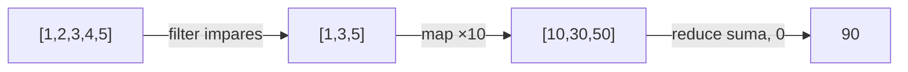

# map, filter y reduce

Parte de: [[04-JavaScript-Web/02 Básico de JavaScript/_Índice Básico de JavaScript|Básico de JavaScript]]

> [!info] Cómo avanzar
> `progreso`: **pendiente** → **viendo** (estudiando) → **visto** (contestaste la autoevaluación sin abrir las respuestas) → **dominado** (hiciste el laboratorio o lo aplicaste de verdad).

## Contenido

### Qué es
Son los tres métodos de arreglo centrales del estilo **funcional** en JavaScript. Ninguno modifica el arreglo original:

- **`map(fn)`**: transforma **cada** elemento y devuelve un arreglo **del mismo tamaño** con los resultados.
- **`filter(fn)`**: devuelve un arreglo nuevo con **solo** los elementos para los que `fn` devuelve truthy.
- **`reduce(fn, inicial)`**: **combina** todos los elementos en **un solo valor** (un número, un objeto, un `Map`, otro arreglo).

Son el equivalente de `Select`, `Where` y `Aggregate` de LINQ en C#.

### Cómo funciona
`map` y `filter` llaman al callback con `(elemento, índice, arreglo)`. `reduce` lo llama con `(acumulador, elemento, índice, arreglo)`: el valor que devuelves en cada vuelta se vuelve el acumulador de la siguiente.



```js
const nums = [1, 2, 3, 4, 5];

nums.filter(n => n % 2 === 1).map(n => n * 10); // [10, 30, 50]
nums.reduce((suma, n) => suma + n, 0);          // 15
```

Paso a paso de la suma: acumulador 0 → 0+1=1 → 1+2=3 → 3+3=6 → 6+4=10 → 10+5=15.

### El valor inicial de `reduce`
Si **no** pasas valor inicial, `reduce` usa el **primer elemento** como acumulador y empieza desde el segundo. Consecuencias:
- Sobre un **arreglo vacío** sin valor inicial lanza **`TypeError: Reduce of empty array with no initial value`**.
- Con un solo elemento, devuelve ese elemento sin llamar al callback.
- Si el acumulador debe ser de otro tipo que los elementos (sumar `precio` de objetos), sin inicial el primer acumulador sería un **objeto** y el resultado basura.

Regla: **pasa siempre el valor inicial** (`0`, `{}`, `[]`, `new Map()`).

### Contar y agrupar
```js
// Contar ocurrencias
['a', 'b', 'a', 'c', 'a'].reduce((acc, x) => {
  acc[x] = (acc[x] ?? 0) + 1;
  return acc;
}, {});                                   // { a: 3, b: 1, c: 1 }

// Agrupar por propiedad
const items = [
  { tipo: 'fruta', n: 'manzana' }, { tipo: 'verdura', n: 'apio' }, { tipo: 'fruta', n: 'pera' },
];
items.reduce((acc, it) => {
  (acc[it.tipo] ??= []).push(it);
  return acc;
}, {});
// { fruta: [manzana, pera], verdura: [apio] }
```

Desde ES2024 existe `Object.groupBy(items, it => it.tipo)` (y `Map.groupBy`), que hace la agrupación directamente y se lee mejor. Mutar el acumulador local dentro de `reduce` está bien: es un objeto que creaste tú; lo que no debes mutar son los elementos de entrada.

### Ejemplo
Resumen de pedidos para el tablero de Itzamna.Clio:

```js
const pedidos = await (await fetch('/api/pedidos?mes=2024-11')).json();

const pagados = pedidos.filter(p => p.pagado);
const totales = pagados.map(p => p.totalCentavos);
const ingresoCentavos = totales.reduce((s, t) => s + t, 0);

const porCliente = pagados.reduce((m, p) => m.set(p.clienteId, (m.get(p.clienteId) ?? 0) + p.totalCentavos), new Map());

const filas = pagados.map(p => ({ folio: p.folio, total: moneda.format(p.totalCentavos / 100) }));
```

### `map` para efectos secundarios
```js
pedidos.map(p => enviarCorreo(p));   // mal si no usas el resultado
```

`map` existe para **producir un arreglo nuevo**. Usarlo solo por sus efectos (pintar, enviar, registrar) crea un arreglo que se descarta, confunde a quien lee ("¿dónde se usa el resultado?") y algunos linters lo marcan. Para efectos usa **`forEach`** o **`for...of`** (este último permite `break` y `await` secuencial; ver [[Condicionales y bucles en JS]]). Si los efectos son asíncronos y quieres esperarlos en paralelo, ahí sí `await Promise.all(pedidos.map(p => enviarCorreo(p)))` usa el resultado.

### Cuándo usarlo y cuándo no
Encadena `filter` → `map` → `reduce` cuando el flujo se lee como una transformación de datos. Si un `reduce` se vuelve difícil de leer, un `for...of` con variables claras suele ser mejor. Para arreglos enormes en código muy caliente, encadenar crea arreglos intermedios; un solo bucle puede ser más eficiente (mide antes de optimizar). Otros métodos útiles: [[find, some, every y flatMap]].

### Errores comunes
- **`reduce` sin valor inicial**.
- **Olvidar `return`** en callbacks con llaves: `map(n => { n * 2 })` da `[undefined, ...]`.
- **`map` para efectos**.
- **Mutar los elementos** dentro de `map` (`p.total = ...; return p`): modifica el arreglo original.
- **`map(parseInt)`**: ver [[Coerción de tipos]].

### Para profundizar
- [`Array.prototype.map()` (MDN)](https://developer.mozilla.org/en-US/docs/Web/JavaScript/Reference/Global_Objects/Array/map)
- [`Array.prototype.filter()` (MDN)](https://developer.mozilla.org/en-US/docs/Web/JavaScript/Reference/Global_Objects/Array/filter)
- [`Array.prototype.reduce()` (MDN)](https://developer.mozilla.org/en-US/docs/Web/JavaScript/Reference/Global_Objects/Array/reduce)
- [`Object.groupBy()` (MDN)](https://developer.mozilla.org/en-US/docs/Web/JavaScript/Reference/Global_Objects/Object/groupBy)

## Ejercicios

Resuélvelos en papel o en la herramienta; la solución está plegada.

> [!question]- Con `nums = [1,2,3,4,5]`, obtén los impares multiplicados por 10.
> `nums.filter(n => n % 2).map(n => n * 10)` → `[10, 30, 50]`.

> [!question]- Suma `[1,2,3,4,5]` con `reduce`.
> `nums.reduce((acc, n) => acc + n, 0)` → `15`.

> [!question]- Cuenta ocurrencias de `['a','b','a','c','a']` en un objeto.
> ```js
> const cuenta = arr.reduce((acc, x) => {
>   acc[x] = (acc[x] ?? 0) + 1;
>   return acc;
> }, {});
> // { a: 3, b: 1, c: 1 }
> ```

> [!question]- Agrupa `[{tipo:'fruta',n:'manzana'},{tipo:'verdura',n:'apio'},{tipo:'fruta',n:'pera'}]` por `tipo`.
> ```js
> const grupos = items.reduce((acc, it) => {
>   (acc[it.tipo] ??= []).push(it.n);
>   return acc;
> }, {});
> // { fruta: ['manzana','pera'], verdura: ['apio'] }
> ```
> En entornos recientes también existe `Object.groupBy(items, it => it.tipo)`.

## Autoevaluación

Contesta primero en voz alta o en papel; luego despliega la respuesta.

> [!question]- ¿Qué devuelve cada uno?
> `map`: arreglo nuevo del mismo largo con cada elemento transformado. `filter`: arreglo nuevo con los que cumplen la condición. `reduce`: un solo valor acumulado (número, objeto, arreglo).

> [!question]- ¿Qué pasa si llamas `reduce` sin valor inicial sobre un arreglo vacío?
> Lanza `TypeError`. Pasa siempre el valor inicial (`reduce(fn, 0)`).

> [!question]- Error común: usar `map` solo para efectos (sin usar el resultado). ¿Qué usar?
> `forEach` o `for...of`. `map` construye un arreglo que tiras.

