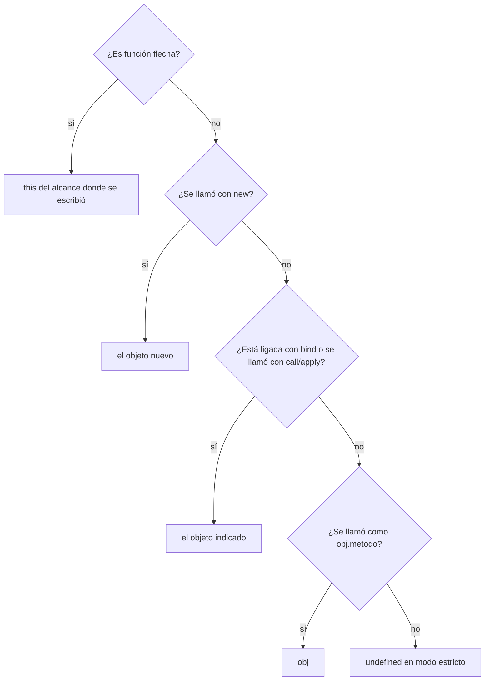

# this en JavaScript

Parte de: [[04-JavaScript-Web/02 Básico de JavaScript/_Índice Básico de JavaScript|Básico de JavaScript]]

> [!info] Cómo avanzar
> `progreso`: **pendiente** → **viendo** (estudiando) → **visto** (contestaste la autoevaluación sin abrir las respuestas) → **dominado** (hiciste el laboratorio o lo aplicaste de verdad).

## Contenido

### Qué es
`this` es una palabra clave que, dentro de una función, se refiere a un **objeto de contexto**. A diferencia de C#, donde `this` siempre es la instancia de la clase, en JavaScript el valor de `this` de una función normal **no depende de dónde se escribió la función, sino de cómo se llama**. Las funciones flecha son la excepción: no tienen `this` propio.

### Cómo funciona: las reglas
Para una **función normal** (declaración, expresión o método), `this` se decide en el momento de la llamada:

| Forma de llamar | `this` |
|---|---|
| `obj.metodo()` | `obj` (lo que está antes del punto) |
| `fn()` suelta | `undefined` en modo estricto (módulos y clases); el objeto global en scripts no estrictos |
| `new Fn()` | El objeto nuevo que se está creando |
| `fn.call(x)`, `fn.apply(x)` | `x` |
| `fn.bind(x)` y luego llamar | `x`, de forma permanente |
| Listener del DOM con función normal | El elemento que tiene el listener (`e.currentTarget`) |

Orden de prioridad si se combinan: `new` > `bind` > `call`/`apply` > llamada como método > llamada suelta. Los detalles de `call`, `apply` y `bind` están en [[call, apply y bind]].

Para una **función flecha**, `this` es **léxico**: es el `this` del alcance donde la flecha fue escrita, y ninguna forma de llamarla lo cambia.



### Perder el `this`
El caso más común de error: **separar el método de su objeto**. En el momento en que guardas `obj.metodo` en una variable o lo pasas como callback, solo pasas la función; el "obj." desaparece.

```js
const obj = { n: 'obj', reg() { return this.n; } };
const g = obj.reg;
obj.reg();   // 'obj'
g();         // TypeError en módulo: this es undefined
```

Con listeners pasa algo parecido, pero `this` no queda `undefined`: el navegador llama al handler con `this` igual al **elemento**:

```js
const vista = {
  conteo: 0,
  alClic() { this.conteo++; },
};
boton.addEventListener('click', vista.alClic);   // this = boton → boton.conteo = NaN
boton.addEventListener('click', () => vista.alClic());     // correcto
boton.addEventListener('click', vista.alClic.bind(vista)); // correcto
```

Lo mismo ocurre al pasar métodos de clase a `setTimeout`, `then` o `map` (ver [[Clases en JS]]).

### Flechas dentro de métodos
Como la flecha toma el `this` de su alrededor, una flecha **dentro** de un método ve el `this` del método. Es exactamente lo que quieres en callbacks:

```js
const reporte = {
  tasa: 0.16,
  conIva(precios) {
    return precios.map(p => p * (1 + this.tasa));  // this = reporte
  },
  conIvaMal(precios) {
    return precios.map(function (p) { return p * (1 + this.tasa); }); // this = undefined → TypeError
  },
};
```

Antes de las flechas se hacía `const self = this;` y se usaba `self` dentro del callback.

Y al revés: una flecha **como método** de un objeto literal no ve el objeto, porque el alcance donde se escribió es el de afuera (ver [[Funciones (declaración, expresión y flecha)]]).

### Ejemplo
Componente de lista en el molde de Itzamna.Clio:

```js
export class TablaPedidos {
  #raiz;
  #seleccion = new Set();

  constructor(raiz) {
    this.#raiz = raiz;
    raiz.addEventListener('click', this.#alClic);   // campo-flecha: this ya ligado
  }

  #alClic = (e) => {
    const fila = e.target.closest('tr[data-id]');
    if (!fila) return;
    this.#seleccion.add(fila.dataset.id);           // this es la instancia
    this.render();
  };

  render() {
    this.#raiz.querySelectorAll('tr[data-id]').forEach(tr => {
      tr.classList.toggle('seleccionada', this.#seleccion.has(tr.dataset.id)); // flecha: this de render
    });
  }
}
```

### Cuándo usarlo y cuándo no
Usa `this` dentro de métodos de clases y objetos, siempre llamándolos como `obj.metodo()`. Al pasar métodos como callbacks, envuélvelos en una flecha o lígalos. En código funcional (funciones puras que reciben todo por parámetro) no necesitas `this` en absoluto, y eso elimina toda una clase de errores.

### Errores comunes
- **Pasar `obj.metodo` como callback** y perder el `this`.
- **Usar flecha como método** de objeto literal.
- **Usar una función normal en un callback** dentro de un método esperando el `this` del método.
- **Asumir que `this` en un listener es tu objeto**: es el elemento.
- **Olvidar que módulos y clases son estrictos**: una llamada suelta da `undefined`, no `window`.

### Para profundizar
- [`this` (MDN)](https://developer.mozilla.org/en-US/docs/Web/JavaScript/Reference/Operators/this)
- [Funciones flecha y `this` (MDN)](https://developer.mozilla.org/en-US/docs/Web/JavaScript/Reference/Functions/Arrow_functions)
- [`this` en manejadores de eventos (MDN)](https://developer.mozilla.org/en-US/docs/Web/API/EventTarget/addEventListener#the_value_of_this_within_the_handler)

## Ejercicios

Resuélvelos en papel o en la herramienta; la solución está plegada.

> [!question]- (Módulo, modo estricto)
> ```js
> const obj = { n: 'obj', reg() { return this.n; } };
> const g = obj.reg;
> console.log(obj.reg());
> console.log(g());
> ```
>
> > [!success]- Respuesta
> > `obj` y luego `TypeError` (no se puede leer `n` de `undefined`): `g()` se llamó sin objeto.

> [!question]- ¿Qué imprime este código?
> ```js
> const obj = { n: 'obj', nested() { return [1].map(() => this.n)[0]; } };
> console.log(obj.nested());
> ```
>
> > [!success]- Respuesta
> > `obj`: la flecha hereda `this` de `nested`.

> [!question]- ¿Qué imprime este código?
> ```js
> const f = obj.reg.bind({ n: 'otro' });
> console.log(f(), f.call({ n: 'x' }));
> ```
>
> > [!success]- Respuesta
> > `otro otro`: una función ligada con `bind` ignora `call`/`apply` posteriores.

> [!question]- ¿Qué imprime este código?
> ```js
> class P { constructor() { this.n = 'p'; } m() { return this?.n; } }
> const m = new P().m;
> console.log(m());
> ```
>
> > [!success]- Respuesta
> > `undefined`: el cuerpo de una clase es estricto y `m()` se llama sin objeto.

## Autoevaluación

Contesta primero en voz alta o en papel; luego despliega la respuesta.

> [!question]- ¿De qué depende el valor de `this` en una función normal?
> De **cómo se llama**: `obj.f()` → `obj`; `f()` suelta → `undefined` en modo estricto (o el global en modo no estricto); `new F()` → el objeto nuevo; `f.call(x)` → `x`. Las flechas no tienen `this` propio: usan el del alcance donde se escribieron.

> [!question]- Caso: pasas `obj.metodo` como callback (`boton.addEventListener('click', obj.metodo)`). ¿Qué es `this` dentro?
> No es `obj`: en listeners del DOM, `this` es el elemento que tiene el listener. Arréglalo con `obj.metodo.bind(obj)` o `() => obj.metodo()`.

> [!question]- ¿Por qué una flecha dentro de un método sí ve el `this` del método?
> Porque la flecha toma `this` léxicamente del método que la contiene: `metodo() { arr.map(x => this.n) }` funciona.

## Práctica

- [[Lab 2 - Predecir la salida de JavaScript (coerción, closures y this)]]

