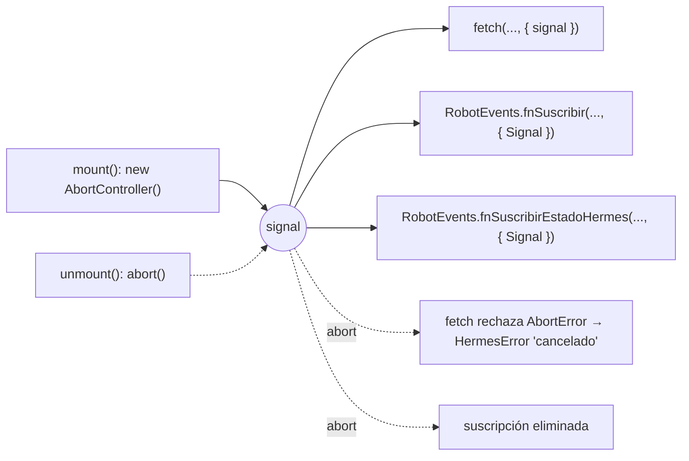

# AbortController

> API estándar del navegador para cancelar operaciones asíncronas (peticiones `fetch`, listeners, suscripciones propias) con una sola señal compartida.

## Qué es y qué problema resuelve
`AbortController` crea un objeto con una propiedad `signal` (`AbortSignal`) y un método `abort()`. Quien hace un trabajo cancelable recibe la `signal`; quien quiere cancelarlo llama `abort()`.

El problema que resuelve en una SPA: al salir de una pantalla quedan peticiones en vuelo y suscripciones vivas. Si no se cancelan, la respuesta "vieja" puede pintar sobre la pantalla nueva, los handlers se duplican al volver y se fuga memoria. Con una sola `signal` por pantalla, un `abort()` en `unmount` limpia todo de golpe.

Es el equivalente en JavaScript del `CancellationToken` de .NET (ver [[NET y CSharp|.NET y C#]]).

## Cómo funciona por dentro
- `const c = new AbortController(); const s = c.signal`.
- `c.abort()` marca `s.aborted = true`, guarda `s.reason` y dispara el evento `abort` en `s` (una sola vez).
- `fetch(url, { signal: s })`: si se aborta, la promesa se rechaza con un `DOMException` de nombre `AbortError` (también si ya se estaba leyendo el cuerpo con `.json()`).
- `elemento.addEventListener(tipo, fn, { signal: s })`: el listener se quita solo al abortar.
- Para APIs propias: `s.addEventListener('abort', limpiar, { once: true })`.
- Utilidades: `AbortSignal.timeout(ms)`, `AbortSignal.any([s1, s2])`, `s.throwIfAborted()`.
- Un controlador abortado no se puede "reiniciar": se crea uno nuevo en cada montaje.



## Cuándo usarla y cuándo no
### Ventajas
- Estándar, sin dependencias, soportado por `fetch` y `addEventListener`.
- Una señal limpia muchas cosas a la vez: menos código de limpieza manual.
- Composición (`AbortSignal.any`, `timeout`).
### Desventajas
- Abortar un `fetch` cancela la espera en el cliente, **no** deshace lo que el servidor ya hizo (un POST puede haberse aplicado).
- Hay que distinguir el error de cancelación de los errores reales para no mostrar avisos falsos.
- Las APIs propias deben implementar el soporte de `signal` a mano.

## Alternativas
| Alternativa | En qué se diferencia |
|---|---|
| Funciones "desuscribir" devueltas (`return () => ...`) | Iris también las devuelve; hay que guardarlas y llamarlas una por una. |
| Bandera `isMontado` | Evita pintar respuestas viejas, pero no cancela la petición ni quita listeners. |
| Cancelación de librerías (axios `CancelToken`, RxJS `unsubscribe`) | Propias de cada librería; axios moderno ya usa `AbortSignal`. |
| `useEffect` cleanup (React) | Mismo concepto ligado al ciclo de vida del framework. |

## Cómo se usó en Ocelotl
En [[Ocelotl.Iris]] cada pantalla (`features/*/*.events.js`) crea un `AbortController` en `mount` y llama `abort()` en `unmount`; el router siempre llama `unmount` antes de montar la siguiente (ver [[SPA y router por hash]]). La misma `Signal` se usa para:

1. **Peticiones HTTP**: los `*.service.js` reciben `{ Signal }` y `core/hermes.client.js` la pasa a `fetch`. La cancelación (`AbortError`, también al leer el JSON) se convierte en `HermesError` con `Codigo: 'cancelado'`, y `fnEsCancelado(error)` permite ignorarla sin avisar al operador.
2. **Suscripciones a eventos del robot**: `core/robot.events.js` (`fnSuscribir`, `fnSuscribirEstadoHermes`) quita el suscriptor al abortar (ver [[SignalR]], [[Eventos en tiempo real]]).
3. **Respuestas viejas**: los handlers guardan la `Signal` con la que empezó la acción y, tras el `await`, comprueban `SignalAccion?.aborted` antes de tocar el estado.

`Ocelotl.Iris/src/core/hermes.client.js`:
```js
/** true si el error es de una petición cancelada a propósito (la pantalla se desmontó). */
export const fnEsCancelado = (error) => error instanceof HermesError && error.Codigo == Codigos.Cancelado

/** La cancelación también puede llegar mientras se lee el cuerpo de la respuesta. */
function fnConvertirCancelacion(error) {
    if (error?.name == 'AbortError') throw new HermesError(0, Codigos.Cancelado, Mensajes.Cancelado)
    throw error
}
```

`Ocelotl.Iris/src/core/robot.events.js`:
```js
export function fnSuscribir(Tipo, Fn, { Signal } = {}) {
    if (!Suscriptores.has(Tipo)) Suscriptores.set(Tipo, new Set())
    Suscriptores.get(Tipo).add(Fn)

    const fnQuitar = () => Suscriptores.get(Tipo)?.delete(Fn)
    Signal?.addEventListener('abort', fnQuitar, { once: true })
    return fnQuitar
}
```

Uso en un handler (`Ocelotl.Iris/src/features/configuracion/configuracion.handlers.js`):
```js
const SignalAccion = Signal
fnActualizarConexion({ isEnviando: true })
try {
    const Resultado = await ConfiguracionService.fnConectarRobot({ Ip, Puerto, Signal: SignalAccion })
    if (SignalAccion?.aborted) return
    // ...
} catch (error) {
    if (fnEsCancelado(error)) return
    fnActualizarConexion({ isEnviando: false })
    Toast.fnError(Mensajes.NoConectado, { Detalle: error.message })
}
```

Pantallas que lo aplican: [[Panel de Inicio]], [[Ingresos]], [[Dispensar]], [[Conexión de robots]] (configuración), [[Stock e inventario]] (reportes), [[Soporte y estado del sistema]] y login ([[Sesión y roles]]). El ciclo completo se describe en [[Molde Service-View-Handlers-Events]].

> [!tip] Reutilizable
> "Una `AbortSignal` por pantalla + APIs propias que aceptan `{ Signal }` + convertir `AbortError` a un código estable (`cancelado`)" funciona en cualquier SPA o componente con ciclo de vida.

## Errores comunes y buenas prácticas
- Reutilizar un controlador ya abortado: siempre crear uno nuevo en cada `mount`.
- Mostrar un error al usuario cuando en realidad fue una cancelación: filtrar con `fnEsCancelado` / `error.name == 'AbortError'`.
- Olvidar `{ once: true }` en el listener de `abort` en APIs propias.
- Asumir que abortar un POST lo revierte en el servidor: no es así; diseñar operaciones [[Idempotencia|idempotentes]] cuando importe.
- Comprobar `signal.aborted` después de cada `await` largo antes de modificar estado.

## Qué estudiar después
- [[SPA y router por hash]]
- [[Molde Service-View-Handlers-Events]]
- [[SignalR]]
- [[Idempotencia]]
- `CancellationToken` en [[NET y CSharp|.NET y C#]] (mismo concepto en Hermes).

## Documentación oficial
- https://developer.mozilla.org/en-US/docs/Web/API/AbortController
- https://developer.mozilla.org/en-US/docs/Web/API/AbortSignal
- https://developer.mozilla.org/en-US/docs/Web/API/EventTarget/addEventListener

## Autoevaluación

Contesta primero en voz alta o en papel; luego despliega la respuesta.

> [!question]- ¿Cómo cancelas un `fetch` con `AbortController`?
> Creas `const c = new AbortController()`, pasas `{ signal: c.signal }` al `fetch` y llamas `c.abort()`. La promesa se rechaza con un error de nombre `AbortError`.

> [!question]- ¿Cómo distingues una cancelación de un error real en el `catch`?
> Revisa `err.name === 'AbortError'` y no muestres mensaje de error al usuario en ese caso. Con `AbortSignal.timeout(ms)` el nombre es `TimeoutError`.

> [!question]- ¿Qué otras cosas acepta un `signal` además de `fetch`?
> `addEventListener(tipo, fn, { signal })` quita el listener al abortar (útil para limpiar varios de golpe). `AbortSignal.any([...])` combina señales.

## Práctica

- [[Lab 4 - fetch con AbortController y manejo de errores]]

