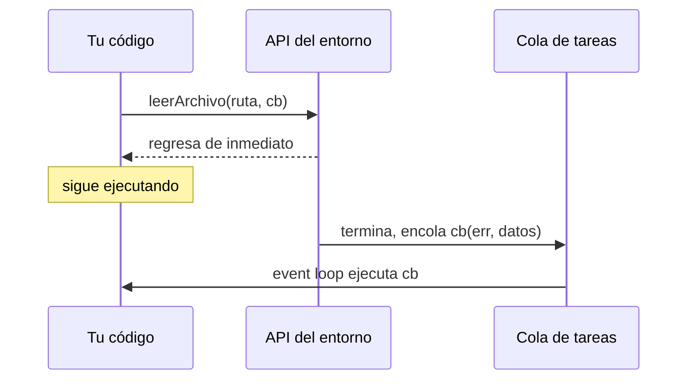

# Callbacks

Parte de: [[04-JavaScript-Web/03 Asincronía en JS/_Índice Asincronía en JS|Asincronía en JS]]

> [!info] Cómo avanzar
> `progreso`: **pendiente** → **viendo** (estudiando) → **visto** (contestaste la autoevaluación sin abrir las respuestas) → **dominado** (hiciste el laboratorio o lo aplicaste de verdad).

## Contenido

### Qué es
Un **callback** es una función que le pasas a otra función para que esta la invoque "después": cuando termine un trabajo, cuando ocurra un evento o por cada elemento de una colección. En JavaScript las funciones son valores, así que pasarlas como argumento es lo más natural del lenguaje. Los callbacks fueron el primer mecanismo de asincronía de JS (eventos del DOM, `setTimeout`, la API clásica de Node) y siguen vivos en todas partes: `addEventListener`, `arr.map(fn)`, `new Promise((resolve) => ...)`.

Conviene distinguir dos tipos:
- **Síncronos**: se ejecutan antes de que regrese la función que los recibe (`map`, `filter`, `sort`).
- **Asíncronos**: se guardan y se ejecutan más tarde, cuando el [[Event loop]] toma la tarea correspondiente (`setTimeout`, eventos, lectura de archivos en Node).

### Cómo funciona
1. Llamas a una API y le entregas la función: `leerArchivo(ruta, alTerminar)`.
2. La API arranca el trabajo (en el navegador o en libuv, fuera de tu pila) y regresa de inmediato.
3. Tu código sigue corriendo; la pila se vacía.
4. Cuando el trabajo termina, el entorno encola una tarea; el event loop la toma y llama a `alTerminar(resultado)`.



#### La convención de Node: *error-first*
En la API clásica de Node el callback siempre recibe el error como **primer argumento** y el resultado después: `(err, datos) => {}`. Si todo salió bien, `err` es `null`. Esa convención permite manejar errores de forma uniforme y es la que aprovecha `util.promisify` para convertir funciones de callback en funciones que devuelven [[Promesas]].

### Ejemplo
Un caso que se vuelve feo rápido: leer configuración, luego un archivo de datos y luego escribir un resultado.

```js
// Node con callbacks error-first: el "callback hell"
import fs from 'node:fs';

fs.readFile('config.json', 'utf8', (err, txt) => {
  if (err) return console.error('No hay config', err);
  const config = JSON.parse(txt);
  fs.readFile(config.entrada, 'utf8', (err2, datos) => {
    if (err2) return console.error('No hay datos', err2);
    const total = datos.split('\n').length;
    fs.writeFile('salida.txt', String(total), (err3) => {
      if (err3) return console.error('No se pudo escribir', err3);
      console.log('Listo');
    });
  });
});
```

La misma lógica con la versión de promesas del módulo y `await` queda plana:

```js
import { readFile, writeFile } from 'node:fs/promises';

try {
  const config = JSON.parse(await readFile('config.json', 'utf8'));
  const datos = await readFile(config.entrada, 'utf8');
  await writeFile('salida.txt', String(datos.split('\n').length));
  console.log('Listo');
} catch (err) {
  console.error('Falló el proceso', err); // un solo lugar para errores
}
```

### El "callback hell" y cómo se evita
El **callback hell** (o "pirámide de la perdición") es el anidamiento profundo que aparece cuando cada paso depende del anterior: el código crece hacia la derecha, cada nivel repite su `if (err)` y es fácil olvidar uno. Además es difícil componer operaciones en paralelo o cancelar. Se evita así:
- **Promesas** y **[[async y await]]**: aplanan la secuencia y centralizan los errores en un `catch`.
- **Funciones con nombre**: sacar cada callback a una función separada reduce la sangría aunque sigas con callbacks.
- **`util.promisify`** o las versiones `*/promises` de los módulos de Node.
- Para varias operaciones independientes, [[Promise.all, allSettled y race]] en lugar de contadores manuales.

### Cuándo usarlo y cuándo no
- **Sí**: eventos que ocurren muchas veces (`addEventListener`), funciones de orden superior síncronas (`map`, `sort`), APIs que lo piden (observers, `requestAnimationFrame`).
- **No**: para operaciones que terminan **una vez** con éxito o error (peticiones, lectura de archivos). Ahí una promesa expresa mejor el resultado único y se integra con `await`.
- Si diseñas una API propia de una sola respuesta, devuelve una promesa; si emite muchos valores, considera eventos o [[Generadores e iteradores]] asíncronos.

### Errores comunes
- **Llamar al callback dos veces** (por ejemplo, en el error y luego también en el éxito por olvidar el `return`). Usa `return cb(err)`.
- **Lanzar con `throw` dentro de un callback asíncrono** esperando que lo atrape un `try` externo: cuando el callback corre, ese `try` ya terminó. Maneja el error dentro o pásalo como argumento.
- **Zalgo**: un callback que a veces corre síncrono y a veces asíncrono vuelve impredecible el orden. Hazlo siempre asíncrono.
- **Perder `this`** al pasar un método como callback (`boton.addEventListener('click', obj.metodo)`); usa flecha o `bind` (ver [[this en JavaScript]]).

### Para profundizar
- [MDN: Callback function](https://developer.mozilla.org/en-US/docs/Glossary/Callback_function)
- [Node.js: util.promisify](https://nodejs.org/api/util.html#utilpromisifyoriginal)
- [Node.js: File system (API de promesas)](https://nodejs.org/api/fs.html#promises-api)

## Autoevaluación

Contesta primero en voz alta o en papel; luego despliega la respuesta.

> [!question]- ¿Qué es un callback?
> Una función que pasas a otra para que la llame después: al terminar una tarea (`setTimeout(fn, 100)`), por cada elemento (`arr.map(fn)`) o ante un evento (`addEventListener('click', fn)`).

> [!question]- ¿Qué es el "callback hell" y cómo se evita?
> Anidar callbacks asíncronos uno dentro de otro, con manejo de errores repetido en cada nivel. Se evita con promesas y `async/await`, o separando en funciones con nombre.

> [!question]- ¿Qué convención usa Node para callbacks?
> *Error first*: `fs.readFile(ruta, (err, datos) => { if (err) ...})`. Hoy la mayoría de APIs tienen versión con promesas (`fs/promises`).

