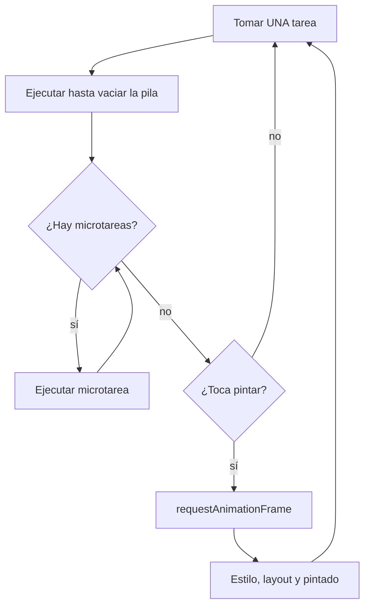

# Event loop

Parte de: [[04-JavaScript-Web/03 Asincronía en JS/_Índice Asincronía en JS|Asincronía en JS]]

> [!info] Cómo avanzar
> `progreso`: **pendiente** → **viendo** (estudiando) → **visto** (contestaste la autoevaluación sin abrir las respuestas) → **dominado** (hiciste el laboratorio o lo aplicaste de verdad).

## Contenido

### Qué es
JavaScript ejecuta tu código en **un solo hilo**: hay una sola pila de llamadas. El **event loop** es el mecanismo del entorno (navegador o Node) que decide qué se ejecuta después cuando esa pila queda vacía. Gracias a él, un programa de un hilo puede esperar red, timers y eventos sin bloquearse: el trabajo lento lo hace el entorno por fuera y, cuando termina, deja un "pendiente" en una cola para que el loop lo ejecute.

Entenderlo te permite predecir el orden de salida de código con promesas y timers, saber por qué la página se congela y elegir dónde poner animaciones o trabajo pesado.

### Cómo funciona
Piezas principales:
- **Pila de llamadas (call stack)**: lo que se está ejecutando ahora.
- **APIs del entorno**: timers, red, DOM, sistema de archivos. Trabajan fuera de la pila.
- **Cola de tareas (macrotareas)**: callbacks de `setTimeout`, `setInterval`, eventos de usuario, `postMessage`, I/O.
- **Cola de microtareas**: reacciones de promesas (`.then`, continuación después de `await`), `queueMicrotask`, callbacks de `MutationObserver`.
- **Renderizado**: en el navegador, entre vueltas puede tocar recalcular estilos, layout y pintar.

Una vuelta del loop, simplificada:
1. Toma **una** tarea de la cola y la ejecuta hasta vaciar la pila.
2. Vacía **toda** la cola de microtareas (incluidas las que se agreguen mientras tanto).
3. Si toca pintar (unas 60 veces por segundo en una pantalla de 60 Hz): corre los callbacks de `requestAnimationFrame`, calcula estilos y layout, pinta.
4. Repite.

El script inicial cuenta como la primera tarea, por eso todo el código síncrono va antes que cualquier microtarea.



El detalle de las dos colas está en [[Microtareas y macrotareas]].

### Ejemplo
Predice antes de leer la explicación:

```js
console.log('1 síncrono');
setTimeout(() => console.log('4 timer (tarea)'), 0);
Promise.resolve().then(() => console.log('3 promesa (microtarea)'));
console.log('2 síncrono');
```

Razonamiento: lo síncrono corre primero (1, 2). Al vaciarse la pila se vacían las microtareas (3). Solo entonces el loop toma la siguiente tarea: el timer (4). Si dentro de una microtarea encolas otra microtarea, esa también corre antes del timer, porque el paso 2 vacía la cola completa.

Por qué un bucle largo congela la página:

```js
boton.addEventListener('click', () => {
  const fin = Date.now() + 3000;
  while (Date.now() < fin) {} // 3 s ocupando la pila
  // Durante esos 3 s: no hay clics, ni scroll con JS, ni pintado
});
```

Mientras la pila está ocupada el loop no puede avanzar al paso de render ni tomar otra tarea. La solución es partir el trabajo en trozos que cedan el control (un `await` sobre un timer entre bloques, o `scheduler.yield()` en navegadores que lo soportan) o mover el cálculo a un Web Worker, que tiene su propio hilo y su propio loop.

### `setTimeout(fn, 0)` y `requestAnimationFrame`
- `setTimeout(fn, 0)` **no** es inmediato: encola una tarea que espera a que termine el código actual y todas las microtareas; además, con timers muy anidados el navegador impone un mínimo de unos 4 ms. Ver [[Timers]].
- `requestAnimationFrame(fn)` no es una tarea ni una microtarea: se ejecuta en el paso de render, justo antes del siguiente pintado. Es el lugar correcto para animaciones y para agrupar lecturas y escrituras de layout (ver [[Pipeline de renderizado del navegador]]).

### Cuándo usarlo y cuándo no
No "usas" el event loop, pero sí decides dónde encolar trabajo:
- Algo que debe ocurrir justo después del código actual pero antes de pintar: microtarea (`queueMicrotask` o una promesa).
- Algo que puede esperar y debe dejar respirar a la página: tarea (`setTimeout`) o, para animación, `requestAnimationFrame`.
- Cálculo pesado (parseo de archivos grandes, compresión): Web Worker.

En Node el loop tiene fases (timers, poll, check, etc.) y además existe `process.nextTick`, que corre incluso antes que las promesas; la idea de "pila vacía, luego microtareas, luego siguiente tarea" se mantiene.

### Errores comunes
- **Creer que `async` crea un hilo**: una función `async` sigue en el mismo hilo; si hace cálculo pesado síncrono, bloquea igual.
- **Microtareas infinitas**: una promesa que encola otra sin fin nunca deja pintar; la página se congela aunque "todo sea asíncrono".
- **Medir orden con timers**: asumir que `setTimeout(a, 0)` corre antes que una promesa ya resuelta. Las microtareas siempre ganan.
- **Leer layout dentro de un bucle de escrituras** en lugar de en `requestAnimationFrame`, provocando reflows forzados.

### Para profundizar
- [MDN: El modelo de concurrencia y el event loop](https://developer.mozilla.org/en-US/docs/Web/JavaScript/Event_loop)
- [HTML Standard: Event loops](https://html.spec.whatwg.org/multipage/webappapis.html#event-loops)
- [Node.js: The Node.js Event Loop](https://nodejs.org/learn/asynchronous-work/event-loop-timers-and-nexttick)

## Ejercicios

Resuélvelos en papel o en la herramienta; la solución está plegada.

> [!question]- ¿Qué imprime este código?
> ```js
> console.log('A');
> setTimeout(() => console.log('B'), 0);
> Promise.resolve().then(() => console.log('C'));
> queueMicrotask(() => console.log('D'));
> console.log('E');
> ```
>
> > [!success]- Respuesta
> > `A E C D B`.

> [!question]- ¿Qué imprime este código?
> ```js
> setTimeout(() => console.log('t1'), 0);
> Promise.resolve().then(() => {
>   console.log('p1');
>   setTimeout(() => console.log('t2'), 0);
>   Promise.resolve().then(() => console.log('p2'));
> });
> console.log('s');
> ```
>
> > [!success]- Respuesta
> > `s p1 p2 t1 t2`: la microtarea nueva `p2` corre antes que cualquier timer.

## Autoevaluación

Contesta primero en voz alta o en papel; luego despliega la respuesta.

> [!question]- Explica el event loop en pocas frases.
> El motor ejecuta tu código en la pila. Cuando la pila queda vacía, se vacía **toda** la cola de microtareas (promesas, `queueMicrotask`); luego el navegador puede renderizar, y después toma **una** tarea (macrotarea) de las colas: timers, eventos, mensajes. Y se repite.

> [!question]- ¿Por qué un `while` largo congela la página?
> Mientras la pila está ocupada no se procesan eventos ni se pinta. Divide el trabajo (en trozos con `setTimeout`/`scheduler.yield` donde exista) o muévelo a un Web Worker.

> [!question]- ¿Un `setTimeout(fn, 0)` se ejecuta inmediatamente?
> No: se encola como tarea y corre después del código actual y de todas las microtareas pendientes; además los navegadores imponen un mínimo de ~4 ms en timers muy anidados.

> [!question]- ¿Qué es `requestAnimationFrame` en relación al event loop?
> Un callback que se ejecuta justo antes del siguiente pintado; es el lugar correcto para animaciones y lecturas/escrituras de layout coordinadas.

## Práctica

- [[Lab 3 - Predecir el orden del event loop]]

