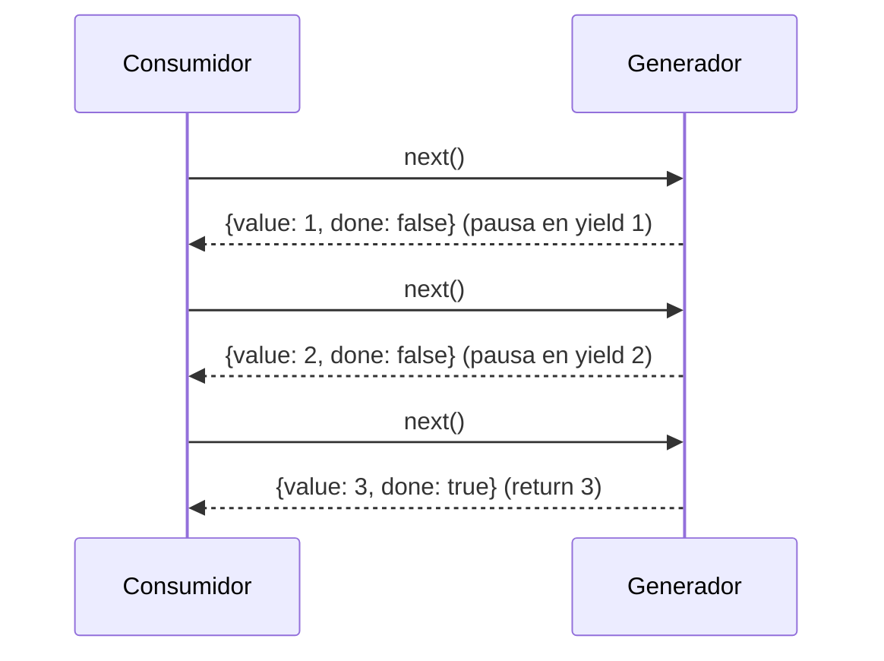

# Generadores e iteradores

Parte de: [[04-JavaScript-Web/03 Asincronía en JS/_Índice Asincronía en JS|Asincronía en JS]]

> [!info] Cómo avanzar
> `progreso`: **pendiente** → **viendo** (estudiando) → **visto** (contestaste la autoevaluación sin abrir las respuestas) → **dominado** (hiciste el laboratorio o lo aplicaste de verdad).

## Contenido

### Qué es
Un **iterador** es un objeto que entrega valores uno por uno mediante un método `next()` que devuelve `{ value, done }`. Un **iterable** es cualquier objeto que sabe crear un iterador a través de su método `[Symbol.iterator]()`. Arrays, strings, `Map`, `Set` y `NodeList` son iterables, y por eso funcionan con `for...of`, el spread `[...x]` y la desestructuración.

Un **generador** es una función especial, declarada con `function*`, que produce un iterador de forma cómoda: cada `yield` entrega un valor y **pausa** la función hasta que alguien pida el siguiente. Sirven para secuencias perezosas (que se calculan conforme se piden), recorridos de estructuras y flujos de datos paginados.

### Cómo funciona
#### El protocolo de iteración
1. `for...of` llama `obj[Symbol.iterator]()` y obtiene un iterador.
2. Llama `iterador.next()` repetidamente.
3. Usa `value` mientras `done` sea `false`; se detiene cuando `done` es `true`.
4. Si sales antes (con `break` o una excepción), llama `iterador.return()` si existe, para que el iterador limpie recursos.

#### Generadores
- Llamar a una función generadora **no ejecuta su cuerpo**: devuelve un objeto generador (que es iterador e iterable a la vez).
- Cada `next()` corre el cuerpo hasta el siguiente `yield` y devuelve `{ value: loQueSeEntregó, done: false }`.
- Un `return x` termina con `{ value: x, done: true }`. Ese valor final **no** lo recogen `for...of` ni el spread, porque ellos descartan el resultado con `done: true`.
- `next(valor)` puede mandar un valor de regreso: se convierte en el resultado de la expresión `yield` donde estaba pausado.
- `yield*` delega en otro iterable.



### Ejemplo
Un rango perezoso y un iterable propio:

```js
function* rango(inicio, fin, paso = 1) {
  for (let i = inicio; i < fin; i += paso) yield i;
}

console.log([...rango(0, 5)]); // [0, 1, 2, 3, 4]

// Secuencia infinita: solo se calcula lo que se pide
function* ids() {
  let n = 1;
  while (true) yield `ORD-${n++}`;
}
const gen = ids();
gen.next().value; // 'ORD-1'
gen.next().value; // 'ORD-2'

// Clase iterable usando un generador como [Symbol.iterator]
class Carrito {
  #items = [];
  agregar(item) { this.#items.push(item); return this; }
  *[Symbol.iterator]() { yield* this.#items; }
}
for (const item of new Carrito().agregar('café').agregar('pan')) console.log(item);
```

Caso práctico con **generador asíncrono** (`async function*` y `for await...of`): recorrer una API paginada, por ejemplo un endpoint de pedidos de Itzamna.Dionisio que devuelve `{ datos, siguiente }`.

```js
async function* paginas(url, signal) {
  while (url) {
    const r = await fetch(url, { signal });
    if (!r.ok) throw new Error(`HTTP ${r.status}`);
    const { datos, siguiente } = await r.json();
    yield* datos;          // entrega cada registro
    url = siguiente;       // null cuando ya no hay más
  }
}

for await (const pedido of paginas('/api/pedidos?pagina=1')) {
  if (pedido.total > 10000) { console.log('Primer pedido grande', pedido.id); break; }
}
```

El `break` detiene el generador y ya no se piden más páginas: la pereza ahorra peticiones.

Un detalle que suele preguntarse: `[...(function* () { yield 1; yield 2; return 3; })()]` da `[1, 2]`, porque el spread ignora el valor de `return`.

### Cuándo usarlo y cuándo no
- **Sí**: secuencias grandes o infinitas, recorridos de árboles, paginación, pipelines de transformación perezosos, hacer iterable una estructura propia.
- **No**: para listas pequeñas que ya tienes en memoria, un array y sus métodos son más claros. Para manejar asincronía general, `async`/`await` sustituyó al viejo truco de usar generadores como corrutinas.
- Si el consumidor necesita varias pasadas, recuerda que un generador se **agota**: después de terminar, `next()` siempre da `done: true`.

### Errores comunes
- **Esperar que llamar a la función ejecute algo**: sin `next()` o `for...of`, el cuerpo no corre.
- **Reusar un generador agotado** pensando que se reinicia; crea uno nuevo llamando otra vez a la función.
- **Contar con el valor de `return`** en un `for...of` o spread; usa `yield` para todo lo que deba entregarse.
- **Olvidar `for await`** con generadores asíncronos: un `for...of` normal falla porque el objeto implementa `Symbol.asyncIterator`, no `Symbol.iterator`.
- **No limpiar recursos**: si el generador abre algo, usa `try...finally` para que se cierre también cuando el consumidor hace `break`.

### Para profundizar
- [MDN: Iteradores y generadores](https://developer.mozilla.org/en-US/docs/Web/JavaScript/Guide/Iterators_and_generators)
- [MDN: Protocolos de iteración](https://developer.mozilla.org/en-US/docs/Web/JavaScript/Reference/Iteration_protocols)
- [MDN: for await...of](https://developer.mozilla.org/en-US/docs/Web/JavaScript/Reference/Statements/for-await...of)

## Ejercicios

Resuélvelos en papel o en la herramienta; la solución está plegada.

> [!question]- ¿Qué imprime este código?
> ```js
> function* gen() { const x = yield 1; console.log('got ' + x); yield x * 2; return 9; }
> const g = gen();
> g.next('ignorado'); g.next(5); g.next(); g.next();
> ```
>
> > [!success]- Respuesta
> > Valores: `{value: 1, done: false}`, imprime `got 5` y da `{value: 10, done: false}`, luego `{value: 9, done: true}` y `{value: undefined, done: true}`. El primer argumento de `next` se ignora.

> [!question]- ¿Qué da `[...(function* () { yield 1; yield 2; return 3; })()]`?
> `[1, 2]`: el valor de `return` no se incluye en la iteración.

## Autoevaluación

Contesta primero en voz alta o en papel; luego despliega la respuesta.

> [!question]- ¿Qué es el protocolo de iteración?
> Un objeto es iterable si tiene un método `[Symbol.iterator]()` que devuelve un iterador con `next()` → `{ value, done }`. Es lo que usan `for...of`, spread y desestructuración.

> [!question]- ¿Qué hace `function*` y `yield`?
> Define un generador: al llamarlo devuelve un iterador; cada `next()` corre hasta el siguiente `yield` y entrega su valor. Lo que pases a `next(x)` es el resultado del `yield` donde estaba pausado.

> [!question]- ¿Para qué sirven en la práctica?
> Secuencias perezosas o infinitas (ids, paginación), recorrer estructuras propias con `for...of`, y con `async function*` + `for await` consumir datos que llegan por partes (streams, páginas de una API).

