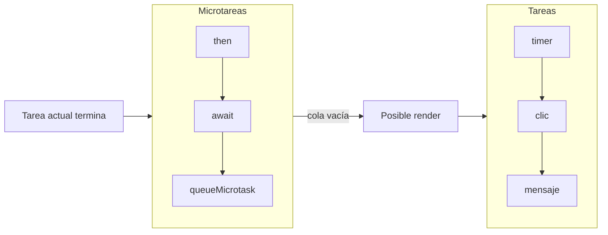

# Microtareas y macrotareas

Parte de: [[04-JavaScript-Web/03 Asincronía en JS/_Índice Asincronía en JS|Asincronía en JS]]

> [!info] Cómo avanzar
> `progreso`: **pendiente** → **viendo** (estudiando) → **visto** (contestaste la autoevaluación sin abrir las respuestas) → **dominado** (hiciste el laboratorio o lo aplicaste de verdad).

## Contenido

### Qué es
El [[Event loop]] no tiene una sola cola, sino dos niveles de prioridad:
- **Tareas (macrotareas)**: unidades de trabajo que el entorno encola cuando algo "externo" ocurre: un timer vence (`setTimeout`, `setInterval`), llega un evento de usuario o de red, se recibe un `postMessage`, termina una operación de I/O en Node. El loop toma **una** por vuelta.
- **Microtareas**: trabajo corto que debe correr "en cuanto termine lo actual", antes de cualquier otra tarea y antes de pintar. Las generan las reacciones de [[Promesas]] (`.then`, `.catch`, `.finally`), la continuación después de un `await`, `queueMicrotask(fn)` y los callbacks de `MutationObserver`.

Saber qué va en cada cola es lo que te permite predecir el orden de ejecución y evitar congelar la interfaz.

### Cómo funciona
1. Termina la tarea actual (la pila queda vacía).
2. El motor ejecuta la cola de microtareas **completa**. Si una microtarea agrega otra, esa nueva también corre en este mismo paso.
3. Solo cuando la cola de microtareas está vacía, el navegador puede renderizar y el loop toma la siguiente tarea.



Consecuencia importante: **las microtareas pueden matar de hambre a las tareas**. Si cada microtarea encola otra indefinidamente, el paso 2 nunca termina: no se pinta, no se atienden clics y la página queda congelada igual que con un `while(true)`. Con tareas eso no pasa, porque entre una y otra el loop puede pintar y atender eventos.

### Ejemplo
```js
setTimeout(() => console.log('T1 tarea'), 0);

Promise.resolve()
  .then(() => {
    console.log('M1 microtarea');
    queueMicrotask(() => console.log('M3 microtarea anidada'));
  })
  .then(() => console.log('M2 segunda reacción'));

console.log('S síncrono');
// Salida: S, M1, M3, M2, T1
```

¿Por qué M3 antes que M2? `M1` encola M3 con `queueMicrotask` durante su ejecución. La reacción M2 se encola cuando la promesa devuelta por el primer `.then` se resuelve, es decir, **al terminar** M1; M3 ya estaba en la cola, así que va primero. Y T1 espera hasta que no quede ninguna microtarea.

Starvation (no lo ejecutes en una pestaña importante):

```js
function sinFin() { queueMicrotask(sinFin); }
// sinFin(); // la página deja de responder: nunca se llega al render
```

Uso legítimo de `queueMicrotask`: agrupar varias notificaciones síncronas en una sola, sin esperar a otra tarea.

```js
// Store mínimo que notifica una sola vez aunque cambien varios campos seguidos
function crearStore(estado) {
  const subs = new Set();
  let pendiente = false;
  return {
    get: () => estado,
    set(parcial) {
      estado = { ...estado, ...parcial };
      if (pendiente) return;
      pendiente = true;
      queueMicrotask(() => { pendiente = false; subs.forEach((fn) => fn(estado)); });
    },
    suscribir(fn) { subs.add(fn); return () => subs.delete(fn); },
  };
}
const store = crearStore({ filtro: '', pagina: 1 });
store.suscribir((e) => console.log('render', e));
store.set({ filtro: 'café' });
store.set({ pagina: 1 }); // un solo "render", antes del siguiente pintado
```

### Cuándo usar cada una
- **`queueMicrotask` / promesa resuelta**: cuando necesitas que algo ocurra después del código síncrono actual pero antes de que el usuario vea un cuadro intermedio (agrupar notificaciones, garantizar que un callback sea siempre asíncrono sin retraso).
- **`setTimeout`**: cuando quieres ceder el control para que el navegador pinte o atienda eventos entre trozos de trabajo, o retrasar algo de verdad. Ver [[Timers]].
- **`requestAnimationFrame`**: trabajo visual sincronizado con el pintado.
- **Web Worker**: cálculo pesado que no debe tocar el hilo principal.

Regla práctica: si dudas, no uses `queueMicrotask`; las promesas y `await` ya lo usan por ti. Recurre a ella solo cuando el orden importa y lo entiendes.

### Errores comunes
- **Partir trabajo pesado con promesas** creyendo que así "cedes" el hilo. `await Promise.resolve()` solo pasa a la siguiente microtarea; la página sigue sin pintar. Para ceder de verdad usa una tarea (`setTimeout`) o `scheduler.yield()` donde exista.
- **Recursión con microtareas** (reintentos, polling) que termina en starvation.
- **Suponer el mismo orden en Node**: ahí además existe `process.nextTick`, que corre antes que las microtareas de promesas, y las tareas se reparten en fases del loop.
- **Lanzar errores dentro de `queueMicrotask`**: no hay promesa que los capture; se reportan como error global (`window.onerror` / `uncaughtException`).

### Para profundizar
- [MDN: Using microtasks in JavaScript with queueMicrotask()](https://developer.mozilla.org/en-US/docs/Web/API/HTML_DOM_API/Microtask_guide)
- [MDN: In depth: Microtasks and the JavaScript runtime environment](https://developer.mozilla.org/en-US/docs/Web/API/HTML_DOM_API/Microtask_guide/In_depth)
- [HTML Standard: Event loop processing model](https://html.spec.whatwg.org/multipage/webappapis.html#event-loop-processing-model)

## Autoevaluación

Contesta primero en voz alta o en papel; luego despliega la respuesta.

> [!question]- ¿Qué va a la cola de microtareas y qué a la de tareas?
> Microtareas: callbacks de promesas (`then/catch/finally`, continuación tras `await`), `queueMicrotask`, `MutationObserver`. Tareas: `setTimeout`/`setInterval`, eventos de usuario, `MessageChannel`, carga de scripts.

> [!question]- ¿Qué pasa si una microtarea encola otra microtarea sin parar?
> La cola nunca se vacía: el navegador no vuelve a renderizar ni atiende eventos. Es posible congelar la página solo con promesas.

> [!question]- ¿Cuándo usarías `queueMicrotask`?
> Para diferir algo "justo después del código actual" pero antes de cualquier evento o pintado, p. ej. agrupar varias actualizaciones de estado en un solo render.

## Práctica

- [[Lab 3 - Predecir el orden del event loop]]

