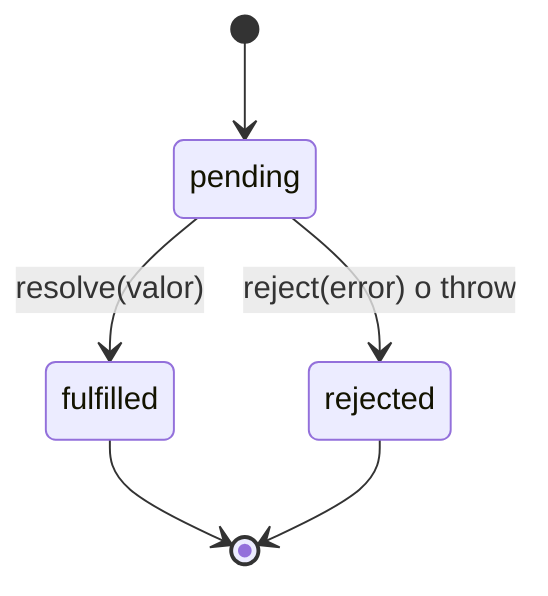

# Promesas

Parte de: [[04-JavaScript-Web/03 Asincronía en JS/_Índice Asincronía en JS|Asincronía en JS]]

> [!info] Cómo avanzar
> `progreso`: **pendiente** → **viendo** (estudiando) → **visto** (contestaste la autoevaluación sin abrir las respuestas) → **dominado** (hiciste el laboratorio o lo aplicaste de verdad).

## Contenido

### Qué es
Una **promesa** (`Promise`) es un objeto que representa el resultado **futuro** de una operación asíncrona: todavía no tienes el valor, pero tienes un objeto al que puedes pedirle "avísame cuando esté". Sustituyen a los [[Callbacks]] para operaciones que terminan una sola vez con éxito o con error (peticiones con [[fetch]], lectura de archivos, temporizadores envueltos) y son la base de [[async y await]].

Es el equivalente de `Task<T>` en .NET: `await` funciona sobre promesas igual que sobre tareas.

### Cómo funciona
#### Estados
Una promesa está en uno de tres estados:
- **pending** (pendiente): aún no termina.
- **fulfilled** (cumplida): terminó con un valor.
- **rejected** (rechazada): terminó con un motivo, normalmente un `Error`.

Cumplida o rechazada se llama **settled** (asentada). El cambio ocurre **una sola vez**: después de asentarse, llamar otra vez a `resolve` o `reject` no tiene efecto.

#### El constructor
`new Promise(executor)` ejecuta el `executor` **de inmediato y de forma síncrona**, dentro del mismo constructor. El executor recibe `resolve` y `reject`. Si el executor lanza una excepción, la promesa se rechaza con ella.

#### Encadenamiento
`.then(onOk, onError)` registra reacciones y **devuelve una promesa nueva**. Esa promesa nueva se resuelve con lo que regrese el callback:
- Si regresas un valor, la siguiente se cumple con él.
- Si regresas otra promesa, la siguiente "la adopta" y espera a que termine.
- Si lanzas, la siguiente se rechaza.

Por eso puedes encadenar pasos `a().then(b).then(c).catch(manejar)`. `.catch(fn)` es `.then(undefined, fn)` y `.finally(fn)` corre en ambos casos sin cambiar el valor.

Las reacciones siempre corren como **microtareas**, aunque la promesa ya esté resuelta: nunca de forma síncrona (ver [[Microtareas y macrotareas]]).



### Ejemplo
Orden de ejecución con el constructor:

```js
console.log('1');
const p = new Promise((resolve) => {
  console.log('2 executor (síncrono)');
  resolve('ok');
  console.log('3 sigue después de resolve');
});
p.then((v) => console.log('5 then', v));
console.log('4');
// 1, 2, 3, 4, 5
```

Envolver una API de callbacks:

```js
function esperar(ms) {
  return new Promise((resolve) => setTimeout(resolve, ms));
}

function cargarImagen(src) {
  return new Promise((resolve, reject) => {
    const img = new Image();
    img.onload = () => resolve(img);
    img.onerror = () => reject(new Error(`No cargó ${src}`));
    img.src = src;
  });
}
```

Encadenamiento correcto (cliente de Itzamna.Clio contra la API):

```js
fetch('/api/clientes/42')
  .then((r) => {
    if (!r.ok) throw new Error(`HTTP ${r.status}`);
    return r.json();                       // regresa una promesa: la cadena la espera
  })
  .then((cliente) => fetch(`/api/clientes/${cliente.id}/pedidos`))
  .then((r) => r.json())
  .then((pedidos) => console.log(pedidos.length))
  .catch((err) => console.error('Falló algún paso', err))
  .finally(() => ocultarSpinner());
```

#### El `return` olvidado
```js
obtenerUsuario()
  .then((u) => { obtenerPermisos(u.id); })  // sin return
  .then((permisos) => console.log(permisos)); // undefined
```
Sin `return`, el callback regresa `undefined`: el siguiente `.then` recibe `undefined` de inmediato, no espera a `obtenerPermisos` y, si esa promesa falla, el error queda **sin manejar** porque nadie la encadenó. Con funciones flecha de una sola expresión (sin llaves) el `return` es implícito.

### Cuándo usarlo y cuándo no
- **Sí**: cualquier operación de resultado único. Para varias a la vez, los combinadores de [[Promise.all, allSettled y race]].
- En código nuevo prefiere `async`/`await` para leer; sigue siendo promesas por debajo.
- **No** para flujos de muchos valores en el tiempo (eventos, websockets): usa eventos, generadores asíncronos u observables.
- `new Promise` solo para envolver APIs de callbacks; si ya tienes una promesa, no la envuelvas en otra (antipatrón "promesa explícita").

### Errores comunes
- **Olvidar el `return`** dentro de `.then` (visto arriba).
- **No poner `.catch`** al final: en el navegador aparece `unhandledrejection`; en Node, el proceso termina por defecto ante un rechazo no manejado.
- **Anidar `.then` dentro de `.then`** en lugar de encadenar: recrea el callback hell.
- **Pensar que el executor es asíncrono**: corre en el acto; si pones trabajo pesado ahí, bloqueas.
- **Rechazar con strings** en vez de `Error`: pierdes la pila de llamadas para depurar.

### Para profundizar
- [MDN: Using promises](https://developer.mozilla.org/en-US/docs/Web/JavaScript/Guide/Using_promises)
- [MDN: Promise](https://developer.mozilla.org/en-US/docs/Web/JavaScript/Reference/Global_Objects/Promise)
- [ECMAScript: Promise Objects](https://tc39.es/ecma262/#sec-promise-objects)

## Ejercicios

Resuélvelos en papel o en la herramienta; la solución está plegada.

> [!question]- ¿Qué imprime este código?
> ```js
> new Promise(res => { console.log('ex'); res('v'); console.log('after'); })
>   .then(v => console.log(v));
> console.log('end');
> ```
>
> > [!success]- Respuesta
> > `ex`, `after`, `end`, `v`.

> [!question]- ¿Qué imprime este código?
> ```js
> Promise.resolve(1)
>   .then(() => { throw new Error('x'); })
>   .then(() => console.log('no'))
>   .catch(e => { console.log('catch ' + e.message); return 5; })
>   .then(v => console.log('then ' + v))
>   .finally(() => console.log('fin'));
> ```
>
> > [!success]- Respuesta
> > `catch x`, `then 5`, `fin`. El `.then` intermedio se salta y `catch` recupera la cadena.

## Autoevaluación

Contesta primero en voz alta o en papel; luego despliega la respuesta.

> [!question]- ¿Qué estados tiene una promesa?
> `pending` (pendiente), `fulfilled` (cumplida) o `rejected` (rechazada). Una vez resuelta ya no cambia.

> [!question]- ¿Cuándo se ejecuta el cuerpo de `new Promise(executor)`?
> De inmediato y de forma síncrona. Lo asíncrono son los `.then/.catch`, que se encolan como microtareas.

> [!question]- ¿Qué devuelve `.then()` y por qué permite encadenar?
> Una promesa nueva que se resuelve con lo que retorne el callback (o se rechaza si lanza). Si retornas otra promesa, la cadena espera a esa.

> [!question]- Error común: olvidar el `return` dentro de un `.then`. ¿Qué pasa?
> La siguiente etapa recibe `undefined` y no espera la operación interna; los errores de esa operación quedan sin manejar.

## Práctica

- [[Lab 3 - Predecir el orden del event loop]]

