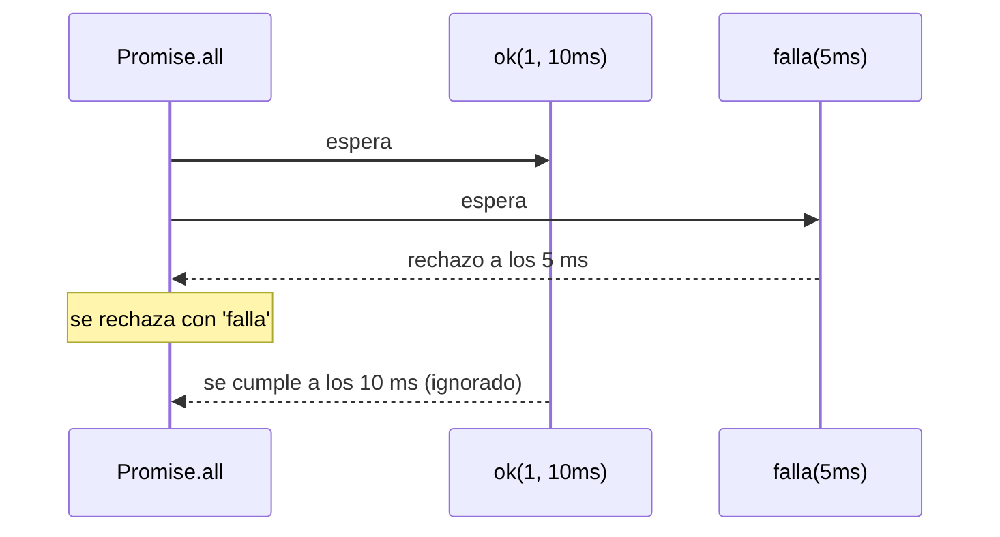

# Promise.all, allSettled y race

Parte de: [[04-JavaScript-Web/03 Asincronía en JS/_Índice Asincronía en JS|Asincronía en JS]]

> [!info] Cómo avanzar
> `progreso`: **pendiente** → **viendo** (estudiando) → **visto** (contestaste la autoevaluación sin abrir las respuestas) → **dominado** (hiciste el laboratorio o lo aplicaste de verdad).

## Contenido

### Qué es
Son los **combinadores** estáticos de `Promise`: reciben un iterable de promesas (o valores) y devuelven **una** promesa que representa al grupo. Sirven para lanzar varias operaciones a la vez y decidir cómo esperar sus resultados. Son cuatro y conviene conocerlos juntos:

| Método | Se cumple cuando… | Se rechaza cuando… | Resultado |
|---|---|---|---|
| `Promise.all` | todas se cumplen | **la primera** se rechaza | arreglo de valores en el orden de entrada |
| `Promise.allSettled` | todas se asientan | nunca | arreglo de `{status, value}` o `{status, reason}` |
| `Promise.race` | la primera en asentarse se cumple | la primera en asentarse se rechaza | valor o error de esa primera |
| `Promise.any` | la primera se cumple | todas se rechazan | valor, o `AggregateError` con todos los errores |

Equivalencias en .NET: `Task.WhenAll` (parecido a `all`) y `Task.WhenAny` (parecido a `race`).

### Cómo funciona
- Las operaciones **ya están corriendo** cuando llamas al combinador: lo que paralelizas es la espera. `Promise.all([a(), b()])` arranca `a` y `b` en el momento de evaluar el arreglo.
- `all` falla rápido: en cuanto una se rechaza, la promesa del grupo se rechaza con ese error; las demás **siguen ejecutándose** (no se cancelan), solo se ignoran sus resultados. Para cancelarlas de verdad usa un [[AbortController]] compartido.
- El orden del arreglo de resultados es el de entrada, no el de terminación.
- Con un iterable vacío: `all([])` y `allSettled([])` se cumplen con `[]`; `any([])` se rechaza con `AggregateError`; `race([])` queda **pendiente para siempre**.
- Los valores que no son promesas se tratan como promesas ya cumplidas.



### Ejemplo
Funciones de prueba:

```js
const ok = (v, ms) => new Promise((res) => setTimeout(() => res(v), ms));
const falla = (motivo, ms) => new Promise((_, rej) => setTimeout(() => rej(new Error(motivo)), ms));

await Promise.all([ok(1, 10), ok(2, 5)]);          // [1, 2] (orden de entrada)
await Promise.all([ok(1, 10), falla('x', 5)]);     // rechaza con Error('x') a los 5 ms

await Promise.allSettled([ok(1, 10), falla('x', 5)]);
// [ { status: 'fulfilled', value: 1 },
//   { status: 'rejected',  reason: Error('x') } ]

await Promise.race([ok('lento', 20), ok('rápido', 5)]);  // 'rápido'
await Promise.any([falla('a', 5), ok('b', 10)]);         // 'b' (ignora el rechazo)
```

Caso real: el tablero de Itzamna.Clio carga clientes, pedidos y catálogos al mismo tiempo. Si todo es indispensable, `all`; si cada widget puede mostrarse por separado, `allSettled`.

```js
async function cargarTablero(signal) {
  const pedir = (url) => fetch(url, { signal }).then((r) => {
    if (!r.ok) throw new Error(`${url}: HTTP ${r.status}`);
    return r.json();
  });

  const [clientes, pedidos, catalogos] = await Promise.allSettled([
    pedir('/api/clientes'),
    pedir('/api/pedidos?estado=abierto'),
    pedir('/api/catalogos'),
  ]);

  return {
    clientes: clientes.status === 'fulfilled' ? clientes.value : null,
    pedidos: pedidos.status === 'fulfilled' ? pedidos.value : null,
    catalogos: catalogos.status === 'fulfilled' ? catalogos.value : null,
    errores: [clientes, pedidos, catalogos].filter((r) => r.status === 'rejected').map((r) => r.reason.message),
  };
}
```

#### Tiempo límite con `race`
```js
function conLimite(promesa, ms) {
  let id;
  const limite = new Promise((_, rej) => {
    id = setTimeout(() => rej(new Error(`Tiempo agotado (${ms} ms)`)), ms);
  });
  return Promise.race([promesa, limite]).finally(() => clearTimeout(id));
}

const datos = await conLimite(fetch('/api/reportes/ventas'), 5000);
```
Ojo: `race` deja de esperar, pero la petición sigue en vuelo. Con `fetch` es mejor `fetch(url, { signal: AbortSignal.timeout(5000) })`, que sí la cancela.

### Cuándo usarlo y cuándo no
- **`all`**: todas son necesarias y un fallo invalida el conjunto (guardar varias partes de un formulario, cargar datos imprescindibles).
- **`allSettled`**: quieres el reporte de cada una (envío masivo, widgets independientes).
- **`race`**: tiempo límite, "lo que llegue primero" entre caché y red.
- **`any`**: varias fuentes equivalentes y te basta una que funcione (espejos, CDNs).
- **No** los uses si las operaciones dependen una de otra: ahí va `await` en secuencia. Y si son cientos, limita la concurrencia (lotes) para no saturar la API o el navegador.

### Errores comunes
- **`await` en secuencia para operaciones independientes**: tarda la suma en vez del máximo. Lanza primero y espera con `all`.
- **Creer que `all` cancela las demás** al fallar una.
- **`race([])`** se queda pendiente para siempre.
- **No revisar `status`** en `allSettled` y tratar `value` como si siempre existiera.
- **Pasar funciones en vez de promesas**: `Promise.all([cargar])` devuelve la función, no la ejecuta. Debe ser `cargar()`.

### Para profundizar
- [MDN: Promise.all()](https://developer.mozilla.org/en-US/docs/Web/JavaScript/Reference/Global_Objects/Promise/all)
- [MDN: Promise.allSettled()](https://developer.mozilla.org/en-US/docs/Web/JavaScript/Reference/Global_Objects/Promise/allSettled)
- [MDN: Promise.race()](https://developer.mozilla.org/en-US/docs/Web/JavaScript/Reference/Global_Objects/Promise/race)
- [MDN: Promise.any()](https://developer.mozilla.org/en-US/docs/Web/JavaScript/Reference/Global_Objects/Promise/any)

## Ejercicios

Resuélvelos en papel o en la herramienta; la solución está plegada.

> [!question]- `Promise.all([ok(1, 10ms), falla('falla', 5ms)])`. ¿Qué pasa?
> Se rechaza con `Error('falla')` a los ~5 ms.

> [!question]- Lo mismo con `allSettled`. ¿Qué estados devuelve?
> `['fulfilled', 'rejected']`.

> [!question]- `Promise.race([ok('lento', 20ms), ok('rapido', 5ms)])` y `Promise.any([falla(5ms), ok('b', 10ms)])`.
> `'rapido'` y `'b'`.

> [!question]- ¿Qué devuelve `await Promise.all([])`?
> `[]` de inmediato.

## Autoevaluación

Contesta primero en voz alta o en papel; luego despliega la respuesta.

> [!question]- ¿Qué diferencia hay entre `Promise.all` y `Promise.allSettled`?
> `all` se rechaza en cuanto **una** falla (las demás siguen corriendo, pero ignoras su resultado). `allSettled` espera a todas y devuelve `{status, value|reason}` de cada una.

> [!question]- ¿Qué hacen `race` y `any`?
> `race` se resuelve o rechaza con la **primera que termine**. `any` se cumple con la primera que **se cumpla** y solo se rechaza (con `AggregateError`) si todas fallan.

> [!question]- ¿Cómo implementas un tiempo límite con `race`?
> `Promise.race([fetch(url), new Promise((_, rej) => setTimeout(() => rej(new Error('timeout')), 5000))])`. Mejor aún: `fetch(url, { signal: AbortSignal.timeout(5000) })`, que sí cancela la petición.

## Práctica

- [[Lab 4 - fetch con AbortController y manejo de errores]]

