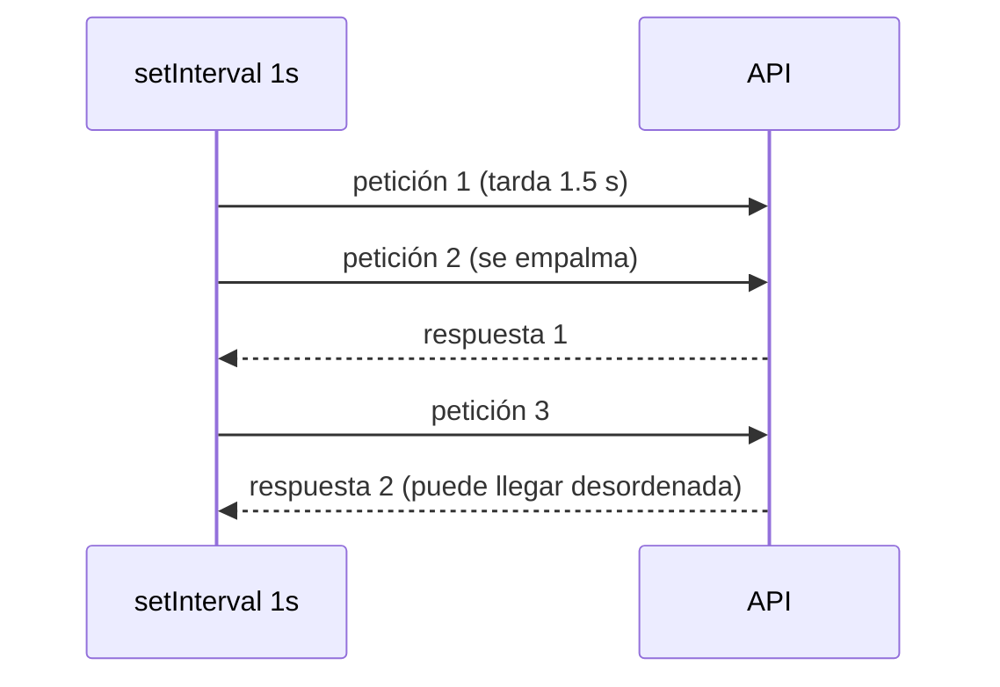

# Timers

Parte de: [[04-JavaScript-Web/03 Asincronía en JS/_Índice Asincronía en JS|Asincronía en JS]]

> [!info] Cómo avanzar
> `progreso`: **pendiente** → **viendo** (estudiando) → **visto** (contestaste la autoevaluación sin abrir las respuestas) → **dominado** (hiciste el laboratorio o lo aplicaste de verdad).

## Contenido

### Qué es
Los **timers** son las funciones del entorno para ejecutar código más tarde:
- `setTimeout(fn, ms, ...args)`: ejecuta `fn` **una vez**, como mínimo después de `ms` milisegundos. Devuelve un identificador que se cancela con `clearTimeout(id)`.
- `setInterval(fn, ms, ...args)`: ejecuta `fn` **repetidamente** cada `ms`. Se detiene con `clearInterval(id)`.
- Relacionado: `requestAnimationFrame(fn)` para trabajo visual (antes del siguiente pintado) y `requestIdleCallback(fn)` para trabajo de baja prioridad cuando el navegador está libre (no disponible en todos los navegadores).

No forman parte del lenguaje ECMAScript: los define el estándar HTML en el navegador, y Node tiene su propia implementación (donde `setTimeout` devuelve un objeto `Timeout`, no un número).

### Cómo funciona
1. Llamas `setTimeout(fn, 1000)`; el entorno registra el timer y regresa de inmediato.
2. Cuando vence el plazo, el entorno **encola una tarea** con `fn`.
3. `fn` corre cuando el [[Event loop]] llega a esa tarea: después del código que esté corriendo y de todas las microtareas.

Por eso el retraso es un **mínimo**, no una garantía: si la pila está ocupada, el timer espera. Otros detalles:
- Cuando los timers se anidan mucho (un timeout que programa otro, cinco niveles o más), el navegador impone un mínimo de unos **4 ms**.
- Los valores mayores a 2,147,483,647 ms (unos 24.8 días) se desbordan y el timer se dispara casi de inmediato.
- En **pestañas en segundo plano** los navegadores limitan los timers para ahorrar batería: típicamente a lo mucho una vez por segundo, y Chrome puede ser todavía más agresivo con cadenas de timers en pestañas ocultas mucho tiempo. No confíes en timers para medir tiempo real ni para sincronizar con el servidor.

#### Por qué `setInterval` puede dar problemas
- **No espera a que termine el trabajo asíncrono**: si cada vuelta hace un `fetch` que tarda más que el intervalo, las peticiones se empalman.
- Si el callback síncrono tarda más que el intervalo, las ejecuciones se recorren y no hay "ponerse al día" confiable.
- Es fácil **olvidar `clearInterval`** al salir de una pantalla: el intervalo sigue vivo, retiene memoria por closures y sigue pegándole a la API (ver [[Fugas de memoria]]).

La alternativa robusta es un `setTimeout` **recursivo** que programa la siguiente vuelta solo cuando terminó la actual.



### Ejemplo
`esperar(ms)` con promesas:

```js
const esperar = (ms) => new Promise((resolve) => setTimeout(resolve, ms));

await esperar(500);
console.log('pasó medio segundo (como mínimo)');
```

Con soporte de cancelación mediante `AbortSignal`:

```js
function esperarCancelable(ms, signal) {
  return new Promise((resolve, reject) => {
    if (signal?.aborted) return reject(signal.reason);
    const id = setTimeout(resolve, ms);
    signal?.addEventListener('abort', () => {
      clearTimeout(id);
      reject(signal.reason);
    }, { once: true });
  });
}
```

En Node existe la versión ya hecha: `import { setTimeout as esperar } from 'node:timers/promises'`.

Polling sin empalmes, por ejemplo para revisar el estado de un reporte de Excel que genera Wee.Reporteria en segundo plano:

```js
async function vigilarReporte(id, signal) {
  while (!signal.aborted) {
    const r = await fetch(`/api/reportes/${id}/estado`, { signal });
    const { estado } = await r.json();
    if (estado === 'listo') return true;
    if (estado === 'error') throw new Error('El reporte falló');
    await esperarCancelable(3000, signal); // la siguiente vuelta empieza al terminar esta
  }
}

const control = new AbortController();
vigilarReporte(17, control.signal).then(() => mostrarDescarga(17)).catch(() => {});
// Al salir de la pantalla: control.abort();
```

### Cuándo usarlo y cuándo no
- **`setTimeout`**: retrasos, reintentos con espera, [[Debounce y throttle]], ceder el hilo entre trozos de trabajo.
- **`setInterval`**: tareas periódicas síncronas y baratas (un reloj en pantalla), siempre con su `clearInterval`.
- **`requestAnimationFrame`**: animaciones y mediciones de layout; se pausa en pestañas ocultas.
- **No** para precisión: para tiempo transcurrido usa `performance.now()` o `Date.now()` y calcula la diferencia; para datos en tiempo real, mejor WebSockets o Server-Sent Events que polling.

### Errores comunes
- **Pasar la llamada en lugar de la función**: `setTimeout(guardar(), 1000)` ejecuta `guardar` ya y programa `undefined`. Debe ser `setTimeout(guardar, 1000)` o `() => guardar()`.
- **Pasar un string** (`setTimeout('hacer()', 10)`): se evalúa como código, es lento e inseguro, y lo bloquea una CSP estricta.
- **No guardar el id** y no poder cancelar.
- **Asumir puntualidad** en pestañas en segundo plano o con la pila ocupada.
- **`this` perdido** al pasar un método (`setTimeout(obj.metodo, 0)`).

### Para profundizar
- [MDN: setTimeout()](https://developer.mozilla.org/en-US/docs/Web/API/Window/setTimeout)
- [MDN: setInterval()](https://developer.mozilla.org/en-US/docs/Web/API/Window/setInterval)
- [HTML Standard: Timers](https://html.spec.whatwg.org/multipage/timers-and-user-prompts.html#timers)
- [Node.js: Timers Promises API](https://nodejs.org/api/timers.html#timers-promises-api)

## Autoevaluación

Contesta primero en voz alta o en papel; luego despliega la respuesta.

> [!question]- ¿Qué diferencia hay entre `setTimeout` y `setInterval`?
> `setTimeout` ejecuta una vez después del retraso; `setInterval` repite cada N ms. Ambos devuelven un id que cancelas con `clearTimeout`/`clearInterval`.

> [!question]- ¿Por qué `setInterval` puede ser problemático?
> Si el callback tarda más que el intervalo o hace algo asíncrono, las ejecuciones se encimán. Un `setTimeout` que se reprograma al terminar asegura una pausa entre ejecuciones.

> [!question]- ¿Qué pasa con los timers en una pestaña en segundo plano?
> Los navegadores los ralentizan (por ejemplo, a una vez por segundo o menos) para ahorrar batería. No confíes en ellos para medir tiempo exacto: usa `Date.now()`/`performance.now()`.

> [!question]- ¿Cómo haces un `esperar(ms)` con promesas?
> `const esperar = ms => new Promise(r => setTimeout(r, ms));` y luego `await esperar(500)`.

## Práctica

- [[Lab 3 - Predecir el orden del event loop]]

