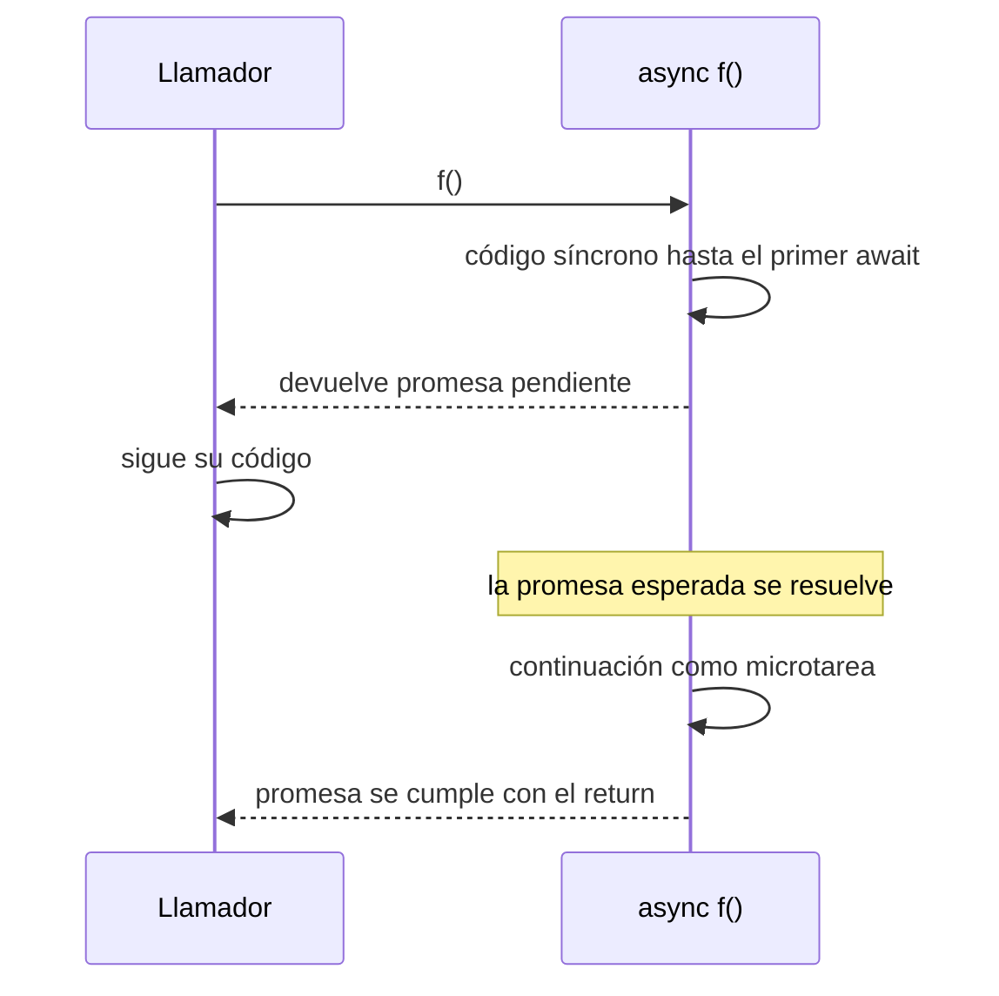

# async y await

Parte de: [[04-JavaScript-Web/03 Asincronía en JS/_Índice Asincronía en JS|Asincronía en JS]]

> [!info] Cómo avanzar
> `progreso`: **pendiente** → **viendo** (estudiando) → **visto** (contestaste la autoevaluación sin abrir las respuestas) → **dominado** (hiciste el laboratorio o lo aplicaste de verdad).

## Contenido

### Qué es
`async` y `await` son sintaxis para escribir código basado en [[Promesas]] como si fuera secuencial. Una función marcada con `async` **siempre devuelve una promesa**; dentro de ella, `await expresión` pausa la función hasta que esa promesa se asiente y te da su valor (o lanza su error). No crean hilos ni hacen nada que las promesas no hagan: solo hacen el código más legible y permiten usar `try/catch` normal.

Si vienes de C#, el modelo mental es casi el mismo que `async Task<T>` y `await`, con una diferencia: en JS no hay `ConfigureAwait` ni contexto de sincronización, todo continúa en el mismo hilo único.

### Cómo funciona
- **Valor de retorno**: lo que regreses con `return x` se convierte en `Promise.resolve(x)`; si lanzas, la promesa se rechaza. Aunque la función no tenga ningún `await`, sigue devolviendo una promesa.
- **`await`**:
  1. Evalúa la expresión y la convierte en promesa si no lo es.
  2. **Suspende** la función y regresa el control a quien la llamó (la pila sigue con lo demás).
  3. Cuando la promesa se asienta, la continuación de la función se encola como **microtarea**.
  4. Al reanudar, `await` devuelve el valor o lanza el motivo del rechazo, que puedes atrapar con `try/catch`.
- El código **antes** del primer `await` corre de forma síncrona en cuanto llamas a la función.
- `await` de nivel superior (*top-level await*) está permitido en módulos ES (ver [[ES Modules e import maps]]).



### Ejemplo
Orden de ejecución:

```js
async function f() {
  console.log('2 dentro de f, antes del await');
  await null;
  console.log('4 después del await (microtarea)');
  return 'listo';
}
console.log('1');
f().then((v) => console.log('5', v));
console.log('3');
// 1, 2, 3, 4, 5
```

Servicio para Itzamna.Clio que lee un ProblemDetails con `codigo` cuando la API responde con error:

```js
export class ApiError extends Error {
  constructor(status, problema) {
    super(problema?.title ?? `HTTP ${status}`);
    this.status = status;
    this.codigo = problema?.codigo;
  }
}

export async function obtenerJson(url, { signal } = {}) {
  const r = await fetch(url, { signal, headers: { Accept: 'application/json' } });
  if (!r.ok) {
    const problema = await r.json().catch(() => null);
    throw new ApiError(r.status, problema);
  }
  return r.json();
}

// Uso
try {
  const cliente = await obtenerJson('/api/clientes/42');
  pintar(cliente);
} catch (err) {
  if (err.name === 'AbortError') return;          // cancelado, no es error real
  mostrarAviso(err.codigo ?? 'ERROR_DESCONOCIDO');
}
```

#### Secuencial vs paralelo
```js
// Lento: la segunda espera a que termine la primera (suma de tiempos)
const clientes = await obtenerJson('/api/clientes');
const productos = await obtenerJson('/api/productos');

// Mejor: arrancan juntas y se espera el máximo de los tiempos
const [clientes2, productos2] = await Promise.all([
  obtenerJson('/api/clientes'),
  obtenerJson('/api/productos'),
]);
```
Ver [[Promise.all, allSettled y race]].

#### `forEach` con `async`
```js
// MAL: forEach ignora las promesas que devuelve el callback
ids.forEach(async (id) => { await borrar(id); });
console.log('terminé'); // se imprime antes de borrar nada; los errores quedan sin manejar

// En serie
for (const id of ids) await borrar(id);

// En paralelo
await Promise.all(ids.map((id) => borrar(id)));
```

### Cuándo usarlo y cuándo no
- **Sí**: casi siempre que consumas promesas; el flujo con `if`, bucles y `try/catch` es mucho más claro que cadenas de `.then`.
- `.then` sigue siendo práctico para una transformación corta o fuera de una función `async`.
- **No** marques `async` funciones que no esperan nada solo "por si acaso": cambias su tipo de retorno a promesa y obligas a todos a esperar.
- Para trabajo pesado de CPU no ayuda: sigue en el hilo principal. Usa un Web Worker.

### Errores comunes
- **Olvidar el `await`**: obtienes una promesa en lugar del valor (`if (await existe())` vs `if (existe())`, que siempre es verdadero).
- **`await` en serie** cuando las operaciones son independientes.
- **`forEach` con callbacks `async`** (visto arriba); tampoco funciona bien con `map` sin `Promise.all` ni con `reduce` sin cuidado.
- **No manejar errores**: una función `async` llamada sin `await` ni `.catch` genera un rechazo no manejado.
- **`return await` innecesario** fuera de `try`: no es un error, pero dentro de un `try` sí importa ponerlo para que el `catch` atrape el rechazo.

### Para profundizar
- [MDN: async function](https://developer.mozilla.org/en-US/docs/Web/JavaScript/Reference/Statements/async_function)
- [MDN: await](https://developer.mozilla.org/en-US/docs/Web/JavaScript/Reference/Operators/await)
- [MDN: Cómo usar promesas](https://developer.mozilla.org/en-US/docs/Learn_web_development/Extensions/Async_JS/Promises)

## Ejercicios

Resuélvelos en papel o en la herramienta; la solución está plegada.

> [!question]- ¿Qué imprime este código?
> ```js
> async function f() { console.log('1'); await null; console.log('2'); }
> console.log('3'); f(); console.log('4');
> ```
>
> > [!success]- Respuesta
> > `3 1 4 2`: `f` corre síncrona hasta el `await`.

> [!question]- ¿Qué imprime este código?
> ```js
> const out = [];
> [3, 1, 2].forEach(async n => { await esperar(n * 5); out.push(n); });
> out.push('fin');
> // tras 30 ms:
> console.log(out.join(','));
> ```
>
> > [!success]- Respuesta
> > `fin,1,2,3`: `forEach` no espera; luego cada uno entra según su tiempo.

## Autoevaluación

Contesta primero en voz alta o en papel; luego despliega la respuesta.

> [!question]- ¿Qué devuelve siempre una función `async`?
> Una promesa: si retornas un valor, se cumple con él; si lanzas, se rechaza.

> [!question]- ¿Qué hace `await` exactamente?
> Pausa la función `async` hasta que la promesa se resuelva y continúa el resto como microtarea; el hilo no se bloquea, otras tareas siguen corriendo.

> [!question]- Caso: dos peticiones independientes con `await` una tras otra. ¿Cómo lo mejoras?
> Lánzalas a la vez y espera ambas: `const [a, b] = await Promise.all([pedirA(), pedirB()])`. En serie tardan la suma; en paralelo, la más lenta.

> [!question]- Error común: `await` dentro de `arr.forEach(async ...)`. ¿Qué pasa?
> `forEach` no espera las promesas: el código siguiente corre antes de que terminen. Usa `for...of` (en serie) o `Promise.all(arr.map(async ...))` (en paralelo).

## Práctica

- [[Lab 3 - Predecir el orden del event loop]]
- [[Lab 4 - fetch con AbortController y manejo de errores]]

