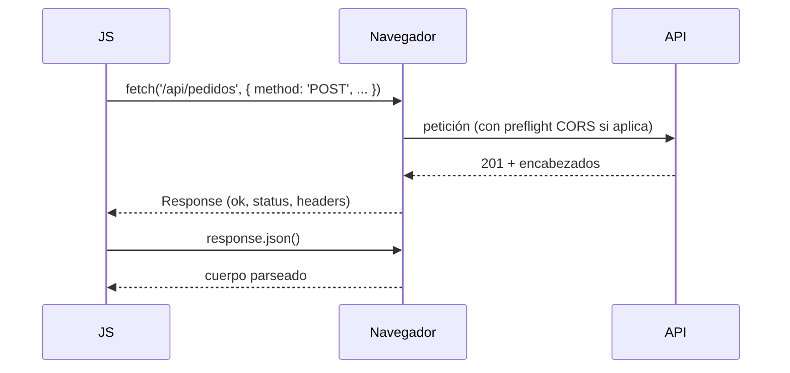

# fetch

Parte de: [[04-JavaScript-Web/03 Asincronía en JS/_Índice Asincronía en JS|Asincronía en JS]]

> [!info] Cómo avanzar
> `progreso`: **pendiente** → **viendo** (estudiando) → **visto** (contestaste la autoevaluación sin abrir las respuestas) → **dominado** (hiciste el laboratorio o lo aplicaste de verdad).

## Contenido

### Qué es
`fetch` es la API estándar para hacer peticiones HTTP desde el navegador (y desde Node, que la incluye de forma nativa en sus versiones actuales). Devuelve una promesa que se resuelve con un objeto `Response` en cuanto llegan los **encabezados** de la respuesta; el cuerpo se lee después con métodos como `json()`, `text()` o `blob()`. Sustituyó a `XMLHttpRequest` y es la base de cualquier capa de servicios en un front sin librerías.

### Cómo funciona
1. `fetch(url, opciones)` arma una `Request` (método, encabezados, cuerpo, credenciales, `signal`).
2. La promesa se **rechaza solo por fallas de red**: sin conexión, DNS, CORS bloqueado o petición abortada. Un **404 o un 500 no rechazan**: la promesa se cumple con una `Response` cuyo `ok` es `false`.
3. Revisas `response.ok` (true si el estado está entre 200 y 299) o `response.status`.
4. Lees el cuerpo **una sola vez**: `await response.json()`. El cuerpo es un stream; después de consumirlo, `bodyUsed` queda en `true` y otra lectura lanza `TypeError`. Si necesitas leerlo dos veces (por ejemplo, para registrar el texto y luego parsear), usa `response.clone()` **antes** de leer.



#### Opciones que más usarás
- `method`: `'GET'` por defecto.
- `headers`: objeto o instancia de `Headers`.
- `body`: string (JSON con `JSON.stringify`), `FormData`, `Blob`, `URLSearchParams`. Con `FormData` **no** pongas `Content-Type`: el navegador agrega el `boundary` correcto (ver [[Formularios y FormData]]).
- `signal`: para cancelar con [[AbortController]] o `AbortSignal.timeout(ms)`.
- `credentials`: controla el envío de cookies y autenticación HTTP:
  - `'same-origin'` (por defecto): solo a tu mismo origen.
  - `'include'`: también en peticiones a **otros orígenes**. El servidor debe responder `Access-Control-Allow-Credentials: true` y un `Access-Control-Allow-Origin` con el origen exacto (no `*`); si no, el navegador oculta la respuesta.
  - `'omit'`: nunca.
- `cache`, `mode`, `keepalive` para casos específicos.

### Ejemplo
Un cliente pequeño para Itzamna.Clio que habla con la API ASP.NET Core (Itzamna.Dionisio). La API responde errores como ProblemDetails con una propiedad `codigo`.

```js
const BASE = '/api';

async function solicitar(ruta, { method = 'GET', json, signal, token } = {}) {
  const headers = { Accept: 'application/json' };
  if (json !== undefined) headers['Content-Type'] = 'application/json';
  if (token) headers.Authorization = `Bearer ${token}`;

  const r = await fetch(BASE + ruta, {
    method,
    headers,
    body: json !== undefined ? JSON.stringify(json) : undefined,
    signal: signal ?? AbortSignal.timeout(10000),
  });

  if (r.status === 204) return null;
  const tipo = r.headers.get('Content-Type') ?? '';
  const cuerpo = tipo.includes('json') ? await r.json() : await r.text();

  if (!r.ok) {
    const err = new Error(cuerpo?.title ?? `HTTP ${r.status}`);
    err.status = r.status;
    err.codigo = cuerpo?.codigo;
    err.errores = cuerpo?.errors;   // errores de FluentValidation, si vienen
    throw err;
  }
  return cuerpo;
}

// POST con JSON
const nuevo = await solicitar('/clientes', {
  method: 'POST',
  json: { nombre: 'Ana López', email: 'ana@ejemplo.mx' },
});
```

Si la API vive en otro origen y la sesión va en una cookie (por ejemplo, el BFF de Xolotl.Hecate), la petición necesita `credentials: 'include'` y el servidor debe tener CORS configurado con credenciales para ese origen.

### Cuándo usarlo y cuándo no
- **Sí**: en cualquier front moderno y en Node para llamadas simples. Envuélvelo en una función propia para centralizar base URL, encabezados, manejo de errores y tiempo límite.
- **Considera algo más** si necesitas progreso de subida (fetch no lo reporta de forma sencilla; `XMLHttpRequest` sí), reintentos y caché de datos en React (librerías de data fetching) o tiempo real (WebSockets, Server-Sent Events).
- No pongas secretos (API keys privadas) en el front: todo lo que va en `fetch` lo puede ver el usuario.

### Errores comunes
- **Asumir que un 4xx/5xx cae en el `catch`**: siempre revisa `r.ok`.
- **Leer el cuerpo dos veces** (`await r.text()` y luego `await r.json()`); usa `clone()` o lee una vez y parsea tú.
- **Mandar un objeto como `body`** sin `JSON.stringify` (se envía `"[object Object]"`) u olvidar el `Content-Type: application/json`, y el controller de ASP.NET responde 415.
- **Poner `Content-Type` a mano con `FormData`**: rompe el `boundary` y el servidor no entiende el cuerpo.
- **Confundir errores de CORS**: el navegador bloquea la lectura y `fetch` rechaza con un `TypeError` genérico; el detalle está en la consola y se arregla en el servidor, no en el cliente.

### Para profundizar
- [MDN: Using the Fetch API](https://developer.mozilla.org/en-US/docs/Web/API/Fetch_API/Using_Fetch)
- [MDN: RequestInit (opciones de fetch)](https://developer.mozilla.org/en-US/docs/Web/API/RequestInit)
- [WHATWG Fetch Standard](https://fetch.spec.whatwg.org/)
- [Microsoft Learn: Habilitar CORS en ASP.NET Core](https://learn.microsoft.com/aspnet/core/security/cors)

## Autoevaluación

Contesta primero en voz alta o en papel; luego despliega la respuesta.

> [!question]- ¿`fetch` rechaza la promesa con una respuesta 404 o 500?
> No. Solo rechaza por fallos de red (sin conexión, CORS, DNS) o si la abortas. Tienes que revisar `res.ok` (status 200–299) o `res.status` tú mismo.

> [!question]- ¿Cómo envías JSON en un POST?
> ```js
> await fetch('/api/items', {
>   method: 'POST',
>   headers: { 'Content-Type': 'application/json' },
>   body: JSON.stringify(datos),
> });
> ```

> [!question]- ¿Se puede leer el cuerpo de una respuesta dos veces?
> No: `res.json()` / `res.text()` consumen el stream. Si necesitas ambos, usa `res.clone()` antes o lee como texto y luego `JSON.parse`.

> [!question]- ¿Qué hace `credentials: 'include'`?
> Envía cookies también en peticiones a otro origen (el servidor debe permitirlo con CORS y `Access-Control-Allow-Credentials`). Por defecto (`same-origin`) solo se mandan al mismo origen.

## Práctica

- [[Lab 4 - fetch con AbortController y manejo de errores]]

