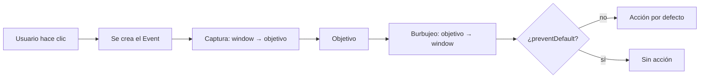

# DOM - eventos

Parte de: [[04-JavaScript-Web/04 El navegador/_Índice El navegador|El navegador]]

> [!info] Cómo avanzar
> `progreso`: **pendiente** → **viendo** (estudiando) → **visto** (contestaste la autoevaluación sin abrir las respuestas) → **dominado** (hiciste el laboratorio o lo aplicaste de verdad).

## Contenido

### Qué es
Un **evento** es una notificación de que algo pasó en la página: un clic, una tecla, el envío de un formulario, el fin de una carga, un cambio de tamaño. Con `elemento.addEventListener(tipo, handler, opciones)` registras una función (el *listener* o *handler*) que el navegador llamará cada vez que ese evento ocurra en ese elemento o, gracias a la propagación, en alguno de sus descendientes. Es la forma en que un front sin framework reacciona al usuario.

### Cómo funciona
1. El usuario hace clic; el navegador crea un objeto `Event` (en este caso `PointerEvent`) con datos como coordenadas, teclas modificadoras y el elemento de origen.
2. El evento recorre el árbol: baja desde `window` hasta el elemento (captura), llega al objetivo y sube de regreso (burbujeo). Ver [[Propagación de eventos (bubbling y capturing)]].
3. En cada nodo del camino se ejecutan los listeners registrados para esa fase, como **tareas** del [[Event loop]].
4. Si nadie lo impidió, el navegador realiza la **acción por defecto** (seguir el enlace, enviar el formulario, escribir la tecla).

#### `target` vs `currentTarget`
- `event.target`: el elemento **donde se originó** el evento (el más profundo; por ejemplo, el `<span>` dentro del botón).
- `event.currentTarget`: el elemento **cuyo listener se está ejecutando ahora** (el que llamó `addEventListener`). Solo tiene valor durante el despacho; si lo lees después de un `await`, ya es `null`.

#### Cancelar cosas
- `preventDefault()`: evita la **acción por defecto** del navegador (no navegar, no enviar el formulario), pero el evento **sigue propagándose**.
- `stopPropagation()`: detiene la **propagación** hacia otros nodos, pero la acción por defecto sí ocurre. `stopImmediatePropagation()` además impide los demás listeners del mismo elemento.

#### Opciones de `addEventListener`
- `once: true`: el listener se quita solo después de la primera ejecución.
- `passive: true`: prometes no llamar `preventDefault()`; el navegador puede hacer scroll sin esperarte (importante en `touchstart`, `wheel`).
- `capture: true`: escuchar en la fase de captura.
- `signal`: un `AbortSignal`; al abortarlo se quitan todos los listeners asociados (ver [[AbortController]]).



### Ejemplo
```js
const menu = document.querySelector('#menu');
const control = new AbortController();

menu.addEventListener('click', (e) => {
  const enlace = e.target.closest('a[data-ruta]');
  if (!enlace) return;
  e.preventDefault();                       // no navegues con recarga
  console.log('Origen:', e.target.tagName, '| Listener en:', e.currentTarget.id);
  irA(enlace.dataset.ruta);
}, { signal: control.signal });

window.addEventListener('scroll', actualizarSombra, { passive: true, signal: control.signal });
document.querySelector('#aviso').addEventListener('click', cerrarAviso, { once: true });

// Al desmontar la vista: todos los listeners con esa signal se van
function desmontar() { control.abort(); }
```

#### Eventos personalizados
Los componentes pueden emitir sus propios eventos:

```js
tarjeta.dispatchEvent(new CustomEvent('producto:agregado', {
  detail: { id: 15, cantidad: 2 },
  bubbles: true,          // para que lo escuche un ancestro
}));
document.addEventListener('producto:agregado', (e) => actualizarCarrito(e.detail));
```

#### Por qué no se quita el listener
```js
boton.addEventListener('click', () => guardar());
boton.removeEventListener('click', () => guardar()); // no quita nada
```
`removeEventListener` busca **la misma referencia** de función (y la misma opción `capture`). Dos flechas con el mismo texto son dos funciones distintas. Guarda la función en una constante, o mejor usa `signal`.

### Cuándo usarlo y cuándo no
- `addEventListener` siempre en lugar de atributos `onclick="..."` en el HTML (mezclan marcado y lógica, y los bloquea una CSP estricta) o de la propiedad `el.onclick = fn` (solo admite un handler).
- Para listas o contenido dinámico, en lugar de un listener por elemento usa [[Delegación de eventos]].
- Para eventos muy frecuentes (`scroll`, `resize`, `input`) combina con [[Debounce y throttle]] o `requestAnimationFrame`.
- Para formularios escucha `submit`, no el clic del botón (ver [[Formularios y FormData]]).

### Errores comunes
- **Confundir `target` y `currentTarget`**, sobre todo cuando el botón tiene íconos o `<span>` adentro.
- **Usar `stopPropagation` para "arreglar" algo**: rompe la delegación y la analítica de otros; prefiere revisar `e.target.closest(...)` o `e.defaultPrevented`.
- **Listeners que nunca se quitan** al cambiar de vista: se duplican y retienen memoria ([[Fugas de memoria]]).
- **Llamar `preventDefault` en un listener `passive`**: el navegador lo ignora y avisa en la consola.
- **Leer `currentTarget` después de un `await`**: guárdalo en una variable antes.

### Para profundizar
- [MDN: EventTarget.addEventListener()](https://developer.mozilla.org/en-US/docs/Web/API/EventTarget/addEventListener)
- [MDN: Event.currentTarget](https://developer.mozilla.org/en-US/docs/Web/API/Event/currentTarget)
- [MDN: CustomEvent](https://developer.mozilla.org/en-US/docs/Web/API/CustomEvent)
- [DOM Standard: Events](https://dom.spec.whatwg.org/#events)

## Autoevaluación

Contesta primero en voz alta o en papel; luego despliega la respuesta.

> [!question]- ¿Qué diferencia hay entre `event.target` y `event.currentTarget`?
> `target`: el elemento donde ocurrió el evento (p. ej. el `<span>` dentro del botón). `currentTarget`: el elemento que tiene el listener que se está ejecutando.

> [!question]- ¿Qué hace `preventDefault()` y qué `stopPropagation()`?
> `preventDefault` cancela la acción por defecto del navegador (enviar el form, seguir el enlace). `stopPropagation` evita que el evento siga subiendo a los ancestros. Son independientes.

> [!question]- ¿Qué opciones útiles tiene `addEventListener`?
> `{ once: true }` (se quita solo tras la primera vez), `{ passive: true }` (prometes no llamar `preventDefault`, mejora el scroll), `{ capture: true }` y `{ signal }` para quitarlo con un `AbortController`.

> [!question]- Error común: `removeEventListener('click', () => {...})`. ¿Por qué no quita nada?
> Debe recibir **la misma referencia** de función que se registró; una flecha nueva es otra función. Guarda la referencia o usa `signal`.

## Práctica

- [[Lab 5 - Lista de tareas con delegación de eventos]]
- [[Lab 6 - Web Component con Shadow DOM]]

