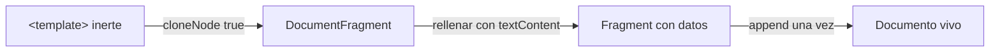

# DOM - selección y creación

Parte de: [[04-JavaScript-Web/04 El navegador/_Índice El navegador|El navegador]]

> [!info] Cómo avanzar
> `progreso`: **pendiente** → **viendo** (estudiando) → **visto** (contestaste la autoevaluación sin abrir las respuestas) → **dominado** (hiciste el laboratorio o lo aplicaste de verdad).

## Contenido

### Qué es
El **DOM** (Document Object Model) es la representación en objetos del documento HTML: un árbol de nodos que JavaScript puede leer y modificar. Esta nota cubre las dos operaciones básicas: **seleccionar** nodos que ya existen y **crear e insertar** nodos nuevos de forma eficiente y segura.

### Cómo funciona
#### Selección
- `document.querySelector(css)`: el **primer** elemento que cumple el selector, o `null`.
- `document.querySelectorAll(css)`: **todos**, como `NodeList` **estática** (una foto del momento; si luego agregas elementos, no aparecen). Tiene `forEach` y es iterable.
- `getElementById(id)`: el más directo para un id.
- `getElementsByClassName` / `getElementsByTagName`: devuelven una `HTMLCollection` **viva**: se actualiza sola cuando cambia el DOM. Eso sorprende si la recorres mientras quitas elementos (los índices se recorren) y no tiene `forEach`.
- Desde un elemento: `el.querySelector(...)` busca solo dentro de él; `el.closest(css)` sube por los ancestros (incluido él mismo) hasta encontrar uno que coincida; `el.matches(css)` dice si el elemento cumple el selector.

#### Creación e inserción
- `document.createElement('li')`, luego asignas `textContent`, atributos, `classList`, `dataset`.
- Insertar: `padre.append(a, b, 'texto')`, `prepend`, `el.before(...)`, `el.after(...)`, `el.replaceWith(...)`, `padre.replaceChildren(...)` (vacía y reemplaza), `el.remove()`.
- **Muchos elementos**: cada inserción en el documento vivo puede invalidar estilos y layout. Construye todo en un `DocumentFragment` (o en un arreglo) y agrégalo de **una sola vez**. Así el navegador recalcula una vez, no cien (ver [[Pipeline de renderizado del navegador]]).

#### `textContent`, `innerText`, `innerHTML`
| Propiedad | Qué hace | Costo y riesgo |
|---|---|---|
| `textContent` | Lee o escribe texto plano, incluido el de nodos ocultos | Rápido; **seguro** para texto del usuario |
| `innerText` | Texto **tal como se ve** (respeta CSS, oculta lo invisible) | Obliga a calcular layout; más lento |
| `innerHTML` | Lee o escribe HTML que se **parsea** | Riesgo de XSS con datos externos ([[Seguridad del DOM (innerHTML y escape de datos)]]) |

#### `<template>`
El elemento `<template>` guarda HTML **inerte**: no se pinta, sus imágenes no se descargan y sus scripts no corren hasta que lo clonas. Con `template.content.cloneNode(true)` obtienes un fragmento listo para rellenar. Es ideal para filas, tarjetas y para el Shadow DOM de [[Web Components]].



### Ejemplo
Pintar la tabla de clientes de Itzamna.Clio sin framework:

```html
<table><tbody id="clientes"></tbody></table>

<template id="fila-cliente">
  <tr>
    <td class="nombre"></td>
    <td class="email"></td>
    <td><button type="button" data-accion="editar">Editar</button></td>
  </tr>
</template>
```

```js
const tbody = document.querySelector('#clientes');
const plantilla = document.querySelector('#fila-cliente');

function pintarClientes(clientes) {
  const fragmento = document.createDocumentFragment();
  for (const c of clientes) {
    const fila = plantilla.content.cloneNode(true);
    fila.querySelector('.nombre').textContent = c.nombre;   // texto seguro
    fila.querySelector('.email').textContent = c.email ?? '—';
    fila.querySelector('tr').dataset.id = c.id;
    fragmento.append(fila);
  }
  tbody.replaceChildren(fragmento); // una sola inserción en el documento
}
```

Diferencia viva/estática en acción:

```js
const vivos = document.getElementsByClassName('pendiente');
const foto = document.querySelectorAll('.pendiente');
document.querySelector('.pendiente')?.classList.remove('pendiente');
console.log(vivos.length, foto.length); // vivos bajó en 1; foto no cambió
```

### Cuándo usarlo y cuándo no
- `querySelector`/`querySelectorAll` como opción por defecto: aceptan cualquier selector CSS y su resultado estático es predecible.
- `closest` para encontrar el contenedor de un clic en [[Delegación de eventos]].
- `<template>` + `textContent` para pintar listas; reserva `innerHTML` para HTML **tuyo y constante**.
- Si la vista se vuelve compleja (muchos estados, re-render frecuente), una librería de plantillas como [[lit-html]] o React evita reescribir el DOM a mano.

### Errores comunes
- **No validar `null`**: `querySelector` devuelve `null` si no encuentra; usa `?.` o verifica antes.
- **Insertar en un bucle** directamente en el documento: muchos recálculos. Usa fragmento o `replaceChildren` con todo.
- **`innerHTML +=` en un bucle**: reparsea todo el contenido cada vez y destruye los listeners existentes.
- **Recorrer una `HTMLCollection` viva mientras la modificas**: se saltan elementos. Convierte con `Array.from` o usa `querySelectorAll`.
- **Seleccionar antes de que exista el DOM**: carga tus scripts con `defer` o `type="module"`.

### Para profundizar
- [MDN: Document.querySelectorAll()](https://developer.mozilla.org/en-US/docs/Web/API/Document/querySelectorAll)
- [MDN: DocumentFragment](https://developer.mozilla.org/en-US/docs/Web/API/DocumentFragment)
- [MDN: El elemento template](https://developer.mozilla.org/en-US/docs/Web/HTML/Reference/Elements/template)
- [MDN: Node.textContent (diferencias con innerText e innerHTML)](https://developer.mozilla.org/en-US/docs/Web/API/Node/textContent)

## Autoevaluación

Contesta primero en voz alta o en papel; luego despliega la respuesta.

> [!question]- ¿Qué diferencia hay entre `querySelectorAll` y `getElementsByClassName`?
> `querySelectorAll` acepta cualquier selector CSS y devuelve una `NodeList` **estática** (foto del momento). `getElementsBy*` devuelve una `HTMLCollection` **viva** que cambia si cambia el DOM.

> [!question]- ¿Cómo creas e insertas muchos elementos sin provocar muchos reflows?
> Constrúyelos en un `DocumentFragment` (o arma el arreglo y usa `el.append(...nodos)`/`replaceChildren`) e insértalos una sola vez.

> [!question]- ¿Qué diferencia hay entre `textContent`, `innerText` e `innerHTML`?
> `textContent`: texto plano, rápido y seguro. `innerText`: texto como se ve (respeta CSS, provoca layout). `innerHTML`: interpreta HTML (riesgo de XSS con datos del usuario).

> [!question]- ¿Para qué sirve `<template>`?
> Guarda HTML inerte que no se renderiza; lo clonas con `tpl.content.cloneNode(true)` para crear elementos repetidos.

## Práctica

- [[Lab 5 - Lista de tareas con delegación de eventos]]

