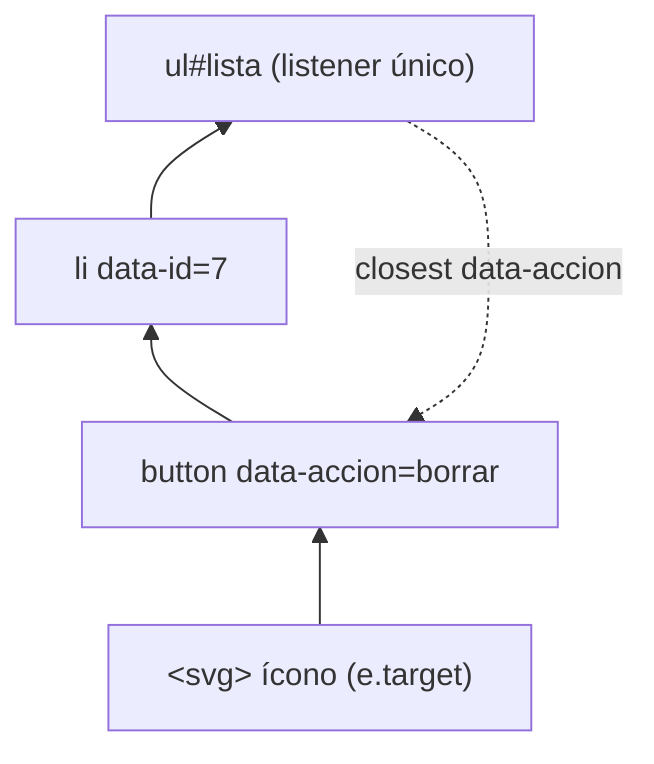

# Delegación de eventos

Parte de: [[04-JavaScript-Web/04 El navegador/_Índice El navegador|El navegador]]

> [!info] Cómo avanzar
> `progreso`: **pendiente** → **viendo** (estudiando) → **visto** (contestaste la autoevaluación sin abrir las respuestas) → **dominado** (hiciste el laboratorio o lo aplicaste de verdad).

## Contenido

### Qué es
La **delegación de eventos** es la técnica de poner **un solo listener en un contenedor** en lugar de uno en cada hijo. Funciona porque la mayoría de los eventos **burbujean**: un clic en un botón dentro de una lista llega también a la lista. En el listener del contenedor averiguas qué elemento originó el evento y actúas en consecuencia.

Es el patrón base de listas, tablas y menús en un front sin framework, y lo que usa por dentro React para sus eventos.

### Cómo funciona
1. Registras `addEventListener` en un ancestro estable (la `ul`, la `tbody`, la sección de la vista).
2. El usuario hace clic en un elemento hijo; el evento sube por el árbol ([[Propagación de eventos (bubbling y capturing)]]) y llega al contenedor.
3. En el handler, `e.target` es el nodo más profundo donde se hizo clic. Con `e.target.closest(selector)` subes hasta el elemento "accionable" que te interesa.
4. Verificas que ese elemento pertenezca al contenedor y lees sus datos (`dataset`) para decidir la acción.



#### Por qué `closest` y no comparar `e.target`
Los botones reales tienen contenido: un ícono, un `<span>` con el texto, un contador. Si el usuario hace clic sobre el ícono, `e.target` es el `<svg>` o el `<path>`, no el botón. Una comparación como `e.target.matches('button')` falla en esos casos. `closest('[data-accion]')` sube desde donde sea que cayó el clic hasta el botón. Después de encontrarlo, conviene verificar `contenedor.contains(boton)` para no reaccionar a un elemento que está fuera (cuando el contenedor está dentro de otra estructura con los mismos atributos).

### Ejemplo
Lista de tareas con borrar y completar, sin listeners por fila:

```html
<ul id="lista">
  <li data-id="7">
    <span class="texto">Revisar PR de Itzamna.Dionisio</span>
    <button type="button" data-accion="completar" aria-label="Completar">✔</button>
    <button type="button" data-accion="borrar" aria-label="Borrar"><svg aria-hidden="true">…</svg></button>
  </li>
</ul>
```

```js
const lista = document.querySelector('#lista');

const acciones = {
  borrar(li) { li.remove(); /* aquí llamarías a la API */ },
  completar(li) { li.classList.toggle('hecha'); },
};

lista.addEventListener('click', (e) => {
  const boton = e.target.closest('button[data-accion]');
  if (!boton || !lista.contains(boton)) return;   // clic en otra parte
  const li = boton.closest('li[data-id]');
  const accion = acciones[boton.dataset.accion];
  if (li && accion) accion(li, Number(li.dataset.id));
});

// Las filas nuevas funcionan sin registrar nada
function agregar(id, texto) {
  const li = document.createElement('li');
  li.dataset.id = id;
  const span = document.createElement('span');
  span.className = 'texto';
  span.textContent = texto;
  const borrar = document.createElement('button');
  borrar.type = 'button';
  borrar.dataset.accion = 'borrar';
  borrar.textContent = 'Borrar';
  li.append(span, borrar);
  lista.append(li);
}
```

El mapa `acciones` separa el "qué botón fue" del "qué hacer", lo que encaja con el [[Molde Service-View-Handlers-Events]]: la vista pinta, los handlers deciden.

### Ventajas
- **Menos memoria y menos trabajo**: un listener en lugar de cientos.
- **Elementos dinámicos**: las filas que agregas después ya "funcionan" sin registrar nada; las que quitas no dejan listeners huérfanos.
- **Limpieza sencilla**: al desmontar la vista quitas un solo listener (o abortas una `signal`).
- **Un solo lugar** para la lógica de la lista, más fácil de leer y probar.

### Cuándo usarlo y cuándo no
- **Sí**: listas, tablas, menús, grids de tarjetas, cualquier colección que cambie.
- **Cuidado con eventos que no burbujean** (`focus`, `blur`, `mouseenter`, `mouseleave`): usa sus equivalentes que sí burbujean (`focusin`, `focusout`, `mouseover`, `mouseout`) o escucha en fase de captura.
- **No** para un único elemento aislado: un listener directo es más claro.
- **Eventos muy frecuentes** (`mousemove`, `pointermove`) en un contenedor grande: funcionan, pero el handler corre muchísimas veces; mantenlo barato.
- Con [[Shadow DOM]], `e.target` se "retargetea" al host del componente al cruzar la frontera; si necesitas el nodo interno, usa `e.composedPath()`.

### Errores comunes
- **Comparar `e.target` directamente** en lugar de usar `closest` (falla con íconos y `<span>` internos).
- **No verificar `null`** del resultado de `closest`: el clic pudo caer en el espacio entre botones.
- **Que un hijo haga `stopPropagation()`**: el evento nunca llega al contenedor y la delegación "deja de funcionar" sin error visible.
- **Poner el listener en `document` para todo**: funciona, pero acopla vistas distintas y complica la limpieza; prefiere el contenedor de la vista.
- **Guardar datos en el texto visible** en lugar de `data-*`: si cambias la redacción, se rompe la lógica.

### Para profundizar
- [MDN: Event bubbling y delegación](https://developer.mozilla.org/en-US/docs/Learn_web_development/Core/Scripting/Event_bubbling)
- [MDN: Element.closest()](https://developer.mozilla.org/en-US/docs/Web/API/Element/closest)
- [MDN: Event.composedPath()](https://developer.mozilla.org/en-US/docs/Web/API/Event/composedPath)

## Ejercicios

Resuélvelos en papel o en la herramienta; la solución está plegada.

> [!question]- Escribe la delegación para una `ul#lista` donde cada `li` tiene un botón `data-accion="borrar"` y `data-id`.
> ```js
> lista.addEventListener('click', (e) => {
>   const btn = e.target.closest('[data-accion="borrar"]');
>   if (!btn || !lista.contains(btn)) return;
>   borrar(btn.dataset.id);
> });
> ```

## Autoevaluación

Contesta primero en voz alta o en papel; luego despliega la respuesta.

> [!question]- ¿Qué es la delegación de eventos?
> Poner **un** listener en un ancestro común y, aprovechando el burbujeo, decidir qué hijo lo originó con `e.target.closest(selector)`.

> [!question]- ¿Qué ventajas tiene?
> Un solo listener para muchos elementos (menos memoria) y funciona con elementos que se agregan después sin volver a registrar nada. Encaja con vistas que se re-renderizan (como lit-html o tu molde Handlers).

> [!question]- ¿Por qué usar `closest` y no comparar `e.target` directo?
> Porque el clic puede caer en un hijo del botón (ícono, `<span>`): `e.target` sería ese hijo. `closest('[data-accion]')` sube hasta el elemento que te interesa. Verifica además que esté dentro del contenedor (`contenedor.contains(btn)`).

## Práctica

- [[Lab 5 - Lista de tareas con delegación de eventos]]

