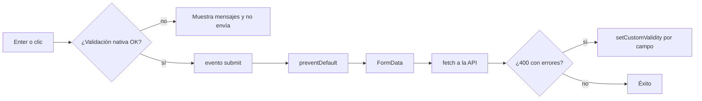

# Formularios y FormData

Parte de: [[04-JavaScript-Web/04 El navegador/_Índice El navegador|El navegador]]

> [!info] Cómo avanzar
> `progreso`: **pendiente** → **viendo** (estudiando) → **visto** (contestaste la autoevaluación sin abrir las respuestas) → **dominado** (hiciste el laboratorio o lo aplicaste de verdad).

## Contenido

### Qué es
Un formulario HTML ya trae mucho resuelto: campos con nombre, validación nativa (`required`, `type="email"`, `min`, `pattern`), envío con Enter y accesibilidad. Desde JavaScript lo normal es **interceptar el envío**, leer todos los campos con `FormData` y mandarlos con [[fetch]] sin recargar la página. `FormData` es un objeto que representa pares nombre-valor de un formulario, incluidos archivos.

### Cómo funciona
#### El evento correcto: `submit`
Escucha `submit` en el `<form>`, no `click` en el botón. El evento `submit` se dispara con cualquier forma de envío: clic en el botón, **Enter** en un campo de texto, o `form.requestSubmit()` desde código. Además, solo se dispara si la validación nativa pasó, así que no tienes que repetirla. Llamas `e.preventDefault()` para evitar la navegación tradicional.

#### Leer los campos
- `new FormData(form)` recoge todos los controles **con atributo `name`** que no estén deshabilitados. Los checkbox sin marcar no aparecen.
- `fd.get('nombre')` da el primer valor; `fd.getAll('etiquetas')` todos (para checkboxes o `select multiple`).
- `Object.fromEntries(fd)` lo convierte en objeto plano, pero **pierde los valores repetidos** (se queda con el último).
- `new FormData(form, e.submitter)` incluye el botón que envió, útil si hay "Guardar" y "Guardar y cerrar".

#### Enviarlo
- Con `fetch(url, { method: 'POST', body: fd })` se envía como `multipart/form-data`. **No pongas `Content-Type`**: el navegador lo pone con el `boundary` correcto. En ASP.NET Core lo recibes con `[FromForm]` (y `IFormFile` para archivos).
- Si tu API espera JSON (lo usual en un controller con `[FromBody]`), conviértelo: `JSON.stringify(Object.fromEntries(fd))`, cuidando los tipos (todo llega como string).
- `new URLSearchParams(fd)` para `application/x-www-form-urlencoded` o para armar un query string de filtros.

#### Validación con mensajes propios
La **Constraint Validation API** te deja usar la validación nativa con tus textos:
- `input.setCustomValidity('Mensaje')` marca el campo como inválido con ese mensaje; `setCustomValidity('')` lo vuelve válido.
- `form.checkValidity()` devuelve true/false; `form.reportValidity()` además muestra los mensajes.
- `input.validity` dice el motivo (`valueMissing`, `typeMismatch`, `patternMismatch`...).
- En CSS, `:user-invalid` marca el campo solo después de que el usuario interactuó con él.



### Ejemplo
Alta de cliente en Itzamna.Clio. La API valida con FluentValidation y, si algo falla, responde 400 con ProblemDetails cuyo `errors` trae los mensajes por propiedad.

```html
<form id="form-cliente" novalidate>
  <label>Nombre <input name="nombre" required maxlength="100"></label>
  <label>Email <input name="email" type="email" required></label>
  <label>Límite de crédito <input name="limite" type="number" min="0" step="0.01"></label>
  <button>Guardar</button>
</form>
```

```js
const form = document.querySelector('#form-cliente');

form.addEventListener('input', (e) => e.target.setCustomValidity?.('')); // limpia errores al escribir

form.addEventListener('submit', async (e) => {
  e.preventDefault();
  if (!form.reportValidity()) return;          // con novalidate, validamos a mano

  const fd = new FormData(form);
  const cuerpo = {
    nombre: fd.get('nombre').trim(),
    email: fd.get('email'),
    limite: fd.get('limite') ? Number(fd.get('limite')) : null,
  };

  const boton = e.submitter;
  boton.disabled = true;
  try {
    const r = await fetch('/api/clientes', {
      method: 'POST',
      headers: { 'Content-Type': 'application/json' },
      body: JSON.stringify(cuerpo),
    });
    if (r.status === 400) {
      const problema = await r.json();
      for (const [campo, mensajes] of Object.entries(problema.errors ?? {})) {
        const input = form.elements.namedItem(campo.charAt(0).toLowerCase() + campo.slice(1));
        input?.setCustomValidity(mensajes.join(' '));
      }
      form.reportValidity();
      return;
    }
    if (!r.ok) throw new Error(`HTTP ${r.status}`);
    form.reset();
  } finally {
    boton.disabled = false;
  }
});
```

Usamos `novalidate` para controlar cuándo mostrar mensajes y `reportValidity()` para seguir aprovechando las reglas nativas.

### Cuándo usarlo y cuándo no
- **Sí**: cualquier formulario; empieza por la validación nativa y agrega lógica solo donde haga falta.
- **`FormData` como cuerpo**: cuando hay archivos o la API espera `multipart`.
- **JSON**: cuando la API espera `[FromBody]`; convierte tipos tú.
- La validación del cliente es para la **experiencia de usuario**; la regla real vive en el servidor (FluentValidation). Nunca confíes solo en el front.

### Errores comunes
- **Escuchar `click` del botón**: no capturas el Enter y te saltas la validación nativa.
- **Campos sin `name`**: `FormData` los ignora en silencio.
- **Poner `Content-Type` a mano con `FormData`**: el servidor no puede separar las partes.
- **Olvidar limpiar `setCustomValidity`**: el campo queda inválido para siempre aunque el usuario lo corrija.
- **Tratar valores como números**: `FormData` siempre entrega strings (o `File`).

### Para profundizar
- [MDN: FormData](https://developer.mozilla.org/en-US/docs/Web/API/FormData)
- [MDN: Client-side form validation](https://developer.mozilla.org/en-US/docs/Learn_web_development/Extensions/Forms/Form_validation)
- [MDN: Constraint validation](https://developer.mozilla.org/en-US/docs/Web/HTML/Guides/Constraint_validation)
- [Microsoft Learn: Model binding en ASP.NET Core](https://learn.microsoft.com/aspnet/core/mvc/models/model-binding)

## Autoevaluación

Contesta primero en voz alta o en papel; luego despliega la respuesta.

> [!question]- ¿Cómo lees todos los campos de un formulario de una vez?
> `const datos = Object.fromEntries(new FormData(form))`. Para campos con varios valores (checkboxes con el mismo `name`) usa `fd.getAll('nombre')`.

> [!question]- ¿Qué evento escuchas para enviar un formulario y por qué no el clic del botón?
> `submit` en el `<form>`: se dispara con el botón y también con Enter en un campo. Llama `e.preventDefault()` si lo procesas con JS.

> [!question]- ¿Se puede enviar un `FormData` con `fetch`?
> Sí, `body: formData`. No pongas `Content-Type` a mano: el navegador lo pone como `multipart/form-data` con su *boundary*. Sirve para subir archivos.

> [!question]- ¿Cómo muestras mensajes de validación propios usando la validación nativa?
> `input.setCustomValidity('Mensaje')` (cadena vacía para limpiar) y `form.reportValidity()`; o `form.checkValidity()` y pintas tú los errores.

## Práctica

- [[Lab 5 - Lista de tareas con delegación de eventos]]

