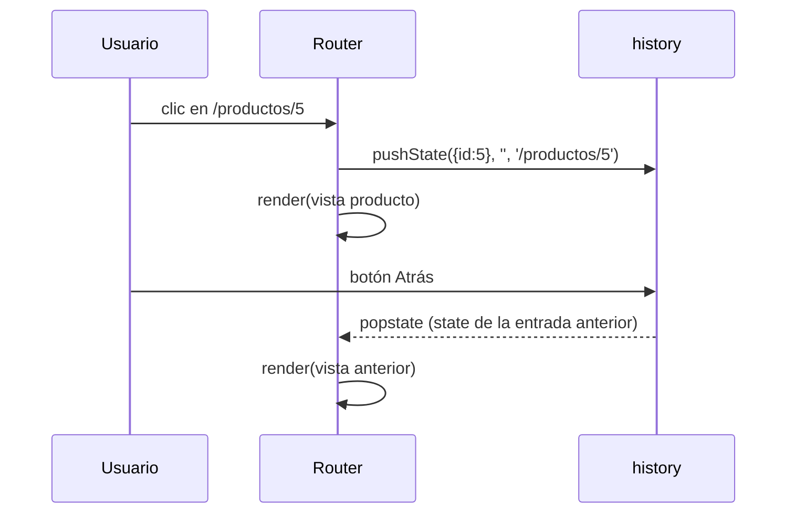

# History API y navegación

Parte de: [[04-JavaScript-Web/04 El navegador/_Índice El navegador|El navegador]]

> [!info] Cómo avanzar
> `progreso`: **pendiente** → **viendo** (estudiando) → **visto** (contestaste la autoevaluación sin abrir las respuestas) → **dominado** (hiciste el laboratorio o lo aplicaste de verdad).

## Contenido

### Qué es
La **History API** (`window.history`) permite a una SPA cambiar la URL de la barra de direcciones y agregar entradas al historial **sin recargar la página**. Así cada pantalla tiene una URL que se puede compartir, recargar y recorrer con los botones atrás y adelante, aunque todo lo pinte JavaScript. Es la alternativa "limpia" (rutas tipo `/productos/5`) al [[SPA y router por hash]] (rutas tipo `#/productos/5`).

### Cómo funciona
- `history.pushState(estado, '', url)`: **agrega** una entrada nueva al historial y cambia la URL. No hace petición al servidor ni dispara ningún evento: tú debes pintar la vista correspondiente justo después.
- `history.replaceState(estado, '', url)`: igual, pero **reemplaza** la entrada actual (útil para guardar filtros o el número de página sin llenar el historial).
- El primer argumento es un objeto de estado clonable (con *structured clone*) que recuperas en `history.state`; el segundo parámetro está en desuso y se pasa vacío.
- La URL nueva debe ser del **mismo origen**; si no, se lanza un error de seguridad.
- `history.back()`, `forward()`, `go(n)` navegan por el historial.

#### El evento `popstate`
Se dispara en `window` cuando el usuario (o tu código con `back`/`go`) **se mueve entre entradas** del historial de la misma página: botones atrás y adelante. **No** se dispara al llamar `pushState` o `replaceState`. En el handler lees `location.pathname` y `e.state` y pintas la vista que corresponde.



#### Lo que necesita el servidor
Si el usuario recarga en `/productos/5` o abre ese enlace directo, el navegador **sí pide** `/productos/5` al servidor. Si el servidor no tiene ese archivo, responde 404. Hay que configurar un **fallback**: cualquier ruta que no sea un archivo estático ni de la API debe devolver `index.html`, y el router del cliente decide qué pintar.
- En ASP.NET Core: `app.MapFallbackToFile("index.html")` después de los archivos estáticos y los controllers.
- En Azure Static Web Apps: `navigationFallback` en `staticwebapp.config.json`.
- En el servidor de desarrollo de [[Vite]] ya viene configurado para SPAs.

### Ejemplo
Router mínimo con History API para un front sin bundler:

```js
const rutas = [
  { patron: /^\/$/, vista: () => '<h1>Inicio</h1>' },
  { patron: /^\/productos\/(\d+)$/, vista: (id) => `<h1>Producto ${id}</h1>` },
];
const app = document.querySelector('#app');

function render(path = location.pathname) {
  const ruta = rutas.find((r) => r.patron.test(path));
  if (!ruta) { app.textContent = 'No encontrado'; return; }
  const [, ...params] = path.match(ruta.patron);
  app.innerHTML = ruta.vista(...params); // plantillas propias y constantes; datos externos van con textContent
  document.title = `Mi tienda – ${path}`;
}

export function navegar(url, { reemplazar = false } = {}) {
  history[reemplazar ? 'replaceState' : 'pushState']({ desde: location.pathname }, '', url);
  render();                                   // pushState no avisa: pintamos nosotros
}

// Interceptar enlaces internos con delegación
document.addEventListener('click', (e) => {
  const a = e.target.closest('a[href^="/"]');
  if (!a || e.ctrlKey || e.metaKey || a.target === '_blank') return; // respeta "abrir en otra pestaña"
  e.preventDefault();
  navegar(a.getAttribute('href'));
});

window.addEventListener('popstate', () => render());
render();
```

Y en el `Program.cs` del host:

```csharp
app.UseStaticFiles();
app.MapControllers();
app.MapFallbackToFile("index.html"); // rutas del cliente devuelven la SPA
```

### Cuándo usarlo y cuándo no
- **History API**: URLs limpias, mejor para SEO y para compartir; requiere configurar el fallback del servidor.
- **Router por hash**: funciona en cualquier hosting estático sin configurar nada, a costa de URLs con `#`.
- En React se usa un router (React Router u otro) que encapsula esto; conviene entender lo que hace por debajo.
- Existe la **Navigation API** (`navigation.navigate`, evento `navigate`), más moderna y completa; revisa su compatibilidad en MDN antes de depender de ella (Pendiente de confirmar el soporte actual en todos los navegadores).

### Errores comunes
- **Esperar `popstate` después de `pushState`**: no ocurre; renderiza tú.
- **No configurar el fallback**: todo funciona hasta que alguien recarga y obtiene 404.
- **Interceptar todos los clics** sin respetar Ctrl/Cmd o `target="_blank"`.
- **Guardar objetos no clonables** (funciones, nodos DOM) en el estado: `pushState` lanza `DataCloneError`.
- **Olvidar el scroll y el foco**: al cambiar de vista, mueve el foco al encabezado principal para lectores de pantalla y resetea el scroll si corresponde.

### Para profundizar
- [MDN: History API](https://developer.mozilla.org/en-US/docs/Web/API/History_API)
- [MDN: Window: popstate event](https://developer.mozilla.org/en-US/docs/Web/API/Window/popstate_event)
- [Microsoft Learn: Archivos estáticos y MapFallbackToFile en ASP.NET Core](https://learn.microsoft.com/aspnet/core/fundamentals/static-files)
- [Microsoft Learn: Configurar Azure Static Web Apps (navigationFallback)](https://learn.microsoft.com/azure/static-web-apps/configuration)

## Autoevaluación

Contesta primero en voz alta o en papel; luego despliega la respuesta.

> [!question]- ¿Qué hacen `history.pushState` y `replaceState`?
> Cambian la URL (y guardan un `state`) sin recargar: `pushState` agrega una entrada al historial; `replaceState` sustituye la actual. No disparan `popstate`.

> [!question]- ¿Cuándo se dispara `popstate`?
> Cuando el usuario navega con atrás/adelante (o con `history.back()`). Ahí debes leer `location` y renderizar la vista correspondiente.

> [!question]- ¿Qué necesita el servidor si usas rutas tipo `/productos/5` en una SPA?
> Devolver el mismo `index.html` para cualquier ruta del front (*fallback*); si no, una recarga en `/productos/5` da 404. Con rutas por hash (`#/productos/5`) no hace falta.

