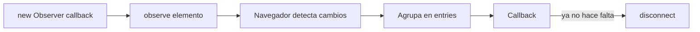

# IntersectionObserver y MutationObserver

Parte de: [[04-JavaScript-Web/04 El navegador/_Índice El navegador|El navegador]]

> [!info] Cómo avanzar
> `progreso`: **pendiente** → **viendo** (estudiando) → **visto** (contestaste la autoevaluación sin abrir las respuestas) → **dominado** (hiciste el laboratorio o lo aplicaste de verdad).

## Contenido

### Qué es
Son dos APIs del navegador para **reaccionar a cambios sin estar preguntando** a cada rato (sin *polling* ni escuchar `scroll` en cada píxel):
- **`IntersectionObserver`**: te avisa cuando un elemento **entra o sale del área visible** (del viewport o de un contenedor con scroll), y en qué proporción. Sirve para *lazy loading*, scroll infinito, animaciones al aparecer, analítica de impresiones y marcar la sección activa de un índice.
- **`MutationObserver`**: te avisa cuando **cambia el DOM**: se agregan o quitan nodos, cambian atributos o texto. Sirve para reaccionar a contenido que inserta otro código (un widget de terceros, un CMS), sincronizar algo con atributos o pruebas que esperan cambios.

Hay un tercero de la misma familia, `ResizeObserver`, que avisa cuando cambia el tamaño de un elemento.

### Cómo funciona
Los tres siguen el mismo patrón:
1. Creas el observer con un **callback**: `new IntersectionObserver(callback, opciones)`.
2. Le dices qué observar: `observer.observe(elemento)` (y en `MutationObserver`, qué tipo de cambios).
3. El navegador **agrupa** los cambios y llama al callback con una lista de entradas (`entries` o `mutations`).
4. Cuando ya no te interesa: `unobserve(el)` para uno o `disconnect()` para todos.

#### Opciones de `IntersectionObserver`
- `root`: el contenedor de referencia (`null` = viewport).
- `rootMargin`: agranda o encoge el área de `root` como un margen CSS. Con `'200px'` el área se extiende 200 px hacia todos lados, así que el callback se dispara **200 px antes** de que el elemento se vea: da tiempo de precargar.
- `threshold`: proporción visible que dispara el aviso (`0` = en cuanto asoma un píxel, `1` = completo, o un arreglo como `[0, 0.5, 1]`).

Cada entrada trae `isIntersecting`, `intersectionRatio`, `target` y medidas, calculadas por el navegador fuera del camino crítico, sin que tu código fuerce layout.

#### Opciones de `MutationObserver`
`observer.observe(nodo, { childList: true, subtree: true, attributes: true, attributeFilter: ['data-estado'], characterData: true })`. Al menos uno de `childList`, `attributes` o `characterData` debe ser `true`. Los callbacks corren como **microtareas** (ver [[Microtareas y macrotareas]]), agrupando todos los cambios de un mismo bloque de código.



### Ejemplo
Scroll infinito en el catálogo de Itzamna.Clio con un "centinela" al final de la lista:

```js
const lista = document.querySelector('#productos');
const centinela = document.querySelector('#centinela'); // <div> vacío después de la lista
let pagina = 1;
let cargando = false;

const io = new IntersectionObserver(async ([entrada]) => {
  if (!entrada.isIntersecting || cargando) return;
  cargando = true;
  const r = await fetch(`/api/productos?pagina=${++pagina}`);
  const { datos, hayMas } = await r.json();
  pintarProductos(lista, datos);
  cargando = false;
  if (!hayMas) io.disconnect();            // no hay más páginas
}, { rootMargin: '200px' });               // empieza a cargar 200 px antes

io.observe(centinela);
```

Imágenes diferidas con `data-src` (aunque hoy basta `loading="lazy"` para la mayoría de los casos):

```js
const imgs = new IntersectionObserver((entradas, obs) => {
  for (const e of entradas) {
    if (!e.isIntersecting) continue;
    e.target.src = e.target.dataset.src;
    obs.unobserve(e.target);                // cada imagen se carga una vez
  }
});
document.querySelectorAll('img[data-src]').forEach((img) => imgs.observe(img));
```

`MutationObserver` para detectar cuando un widget de terceros inserta su botón:

```js
const mo = new MutationObserver((mutaciones) => {
  for (const m of mutaciones) {
    for (const nodo of m.addedNodes) {
      if (nodo instanceof HTMLElement && nodo.matches('.chat-boton')) {
        nodo.setAttribute('aria-label', 'Abrir chat de soporte');
        mo.disconnect();
      }
    }
  }
});
mo.observe(document.body, { childList: true, subtree: true });
```

### Cuándo usarlo y cuándo no
- **IntersectionObserver** en lugar de `scroll` + `getBoundingClientRect()`: más barato y no provoca *layout thrashing* ([[Pipeline de renderizado del navegador]]).
- Para imágenes y iframes simples, el atributo nativo `loading="lazy"` es suficiente.
- **MutationObserver** solo cuando **no controlas** el código que cambia el DOM. Si el cambio lo haces tú, llama directamente a la función que reacciona; es más claro.
- `ResizeObserver` para componentes que se adaptan a su propio tamaño (gráficas, tablas).

### Errores comunes
- **No desconectar al desmontar la vista**: el observer sigue vivo, retiene los nodos y los closures, y su callback puede correr sobre elementos que ya no existen ([[Fugas de memoria]]). Llama `disconnect()` en la limpieza.
- **Observar `document.body` con `subtree` y `attributes`** sin filtro: el callback recibe muchísimas mutaciones y se vuelve lento.
- **Modificar el DOM observado dentro del callback de `MutationObserver`** sin cuidado: provoca un ciclo infinito.
- **Olvidar revisar `isIntersecting`**: el callback también se llama al **salir** y al empezar a observar.
- **Cargas duplicadas** en scroll infinito por no usar una bandera `cargando`.

### Para profundizar
- [MDN: Intersection Observer API](https://developer.mozilla.org/en-US/docs/Web/API/Intersection_Observer_API)
- [MDN: MutationObserver](https://developer.mozilla.org/en-US/docs/Web/API/MutationObserver)
- [MDN: ResizeObserver](https://developer.mozilla.org/en-US/docs/Web/API/ResizeObserver)

## Autoevaluación

Contesta primero en voz alta o en papel; luego despliega la respuesta.

> [!question]- ¿Para qué sirve `IntersectionObserver`?
> Avisa cuando un elemento entra o sale del viewport (o de un contenedor) sin escuchar `scroll`: carga perezosa, scroll infinito, animaciones al aparecer, medir visibilidad.

> [!question]- ¿Para qué sirve `MutationObserver`?
> Avisa cuando cambian nodos hijos, atributos o texto de un elemento. Sus callbacks se ejecutan como microtareas, agrupados.

> [!question]- Error común con observers. ¿Qué olvidas al desmontar una vista?
> Llamar `observer.disconnect()` (o `unobserve(el)`); si no, siguen vivos y retienen nodos en memoria.

> [!question]- ¿Qué hace `rootMargin: '200px'` en IntersectionObserver?
> Amplía el área de detección 200px: el aviso llega antes de que el elemento sea visible (útil para precargar).

