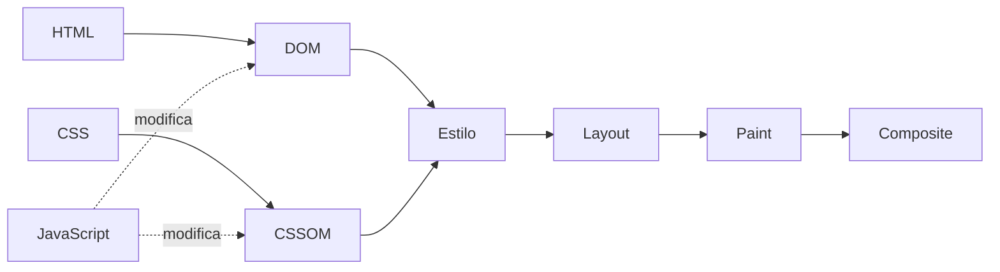

# Pipeline de renderizado del navegador

Parte de: [[04-JavaScript-Web/04 El navegador/_Índice El navegador|El navegador]]

> [!info] Cómo avanzar
> `progreso`: **pendiente** → **viendo** (estudiando) → **visto** (contestaste la autoevaluación sin abrir las respuestas) → **dominado** (hiciste el laboratorio o lo aplicaste de verdad).

## Contenido

### Qué es
El **pipeline de renderizado** (o *critical rendering path*) es la secuencia de pasos que sigue el navegador para convertir HTML, CSS y JavaScript en píxeles en la pantalla. Conocerlo explica por qué una página tarda en mostrarse, por qué ciertas animaciones se traban y qué cambios de código son baratos o caros. Es la base para entender las [[Rendimiento web y Core Web Vitals|Core Web Vitals]].

### Cómo funciona
#### Las etapas
1. **Parseo de HTML → DOM**: el navegador lee el HTML conforme llega por la red y construye el árbol de nodos.
2. **Parseo de CSS → CSSOM**: construye el modelo de estilos a partir de hojas externas, `<style>` y estilos en línea.
3. **Estilo (style / recalc style)**: combina DOM y CSSOM y calcula los estilos finales de cada elemento visible (el *render tree*; los elementos con `display: none` no entran).
4. **Layout (reflow)**: calcula geometría: posición y tamaño de cada caja según el box model, flexbox, grid y el tamaño del viewport.
5. **Paint**: dibuja en capas los píxeles de texto, colores, bordes, sombras, imágenes.
6. **Composite**: junta las capas en el orden correcto, en la GPU, y muestra el cuadro.



Cada cambio posterior vuelve a entrar al pipeline desde algún punto:
- Cambiar `width`, `top`, `font-size` o agregar nodos → **layout + paint + composite** (lo más caro).
- Cambiar `color` o `background` → **paint + composite**.
- Cambiar `transform` u `opacity` → normalmente **solo composite** (lo más barato). Por eso las animaciones fluidas se hacen con esas dos propiedades.

#### Recursos que bloquean el render inicial
- **CSS** en el `<head>` es *render-blocking*: el navegador no pinta nada hasta tener el CSSOM, para no mostrar contenido sin estilo.
- **`<script>` clásicos sin `defer` ni `async`** son *parser-blocking*: el parseo del HTML se detiene mientras se descarga y ejecuta el script (y el script espera además al CSS previo, porque podría leer estilos).
- **Fuentes web** pueden retrasar la aparición del texto; `font-display: swap` muestra una fuente de respaldo mientras tanto.
- Los scripts con `defer` y los `type="module"` se descargan en paralelo y se ejecutan después del parseo: no bloquean.

#### Layout thrashing
El navegador agrupa los cambios y recalcula el layout una vez antes de pintar. Pero si **lees** una propiedad geométrica (`offsetHeight`, `getBoundingClientRect()`, `scrollTop`) después de **escribir** algo que la afecta, lo obligas a recalcular **en ese momento** (*forced synchronous layout*). Alternar lectura y escritura dentro de un bucle provoca un recálculo por iteración: eso es *layout thrashing*.

### Ejemplo
```js
const tarjetas = document.querySelectorAll('.tarjeta');

// MAL: leer y escribir alternado → un layout forzado por tarjeta
tarjetas.forEach((t) => {
  const alto = t.offsetHeight;          // lectura (fuerza layout si hubo escritura antes)
  t.style.height = `${alto + 10}px`;    // escritura (invalida el layout)
});

// BIEN: primero todas las lecturas, luego todas las escrituras
const altos = [...tarjetas].map((t) => t.offsetHeight);
requestAnimationFrame(() => {
  tarjetas.forEach((t, i) => { t.style.height = `${altos[i] + 10}px`; });
});
```

Carga de recursos sin bloquear de más:

```html
<head>
  <link rel="stylesheet" href="/css/app.css">            <!-- bloquea, pero es necesario -->
  <link rel="preload" href="/img/portada.avif" as="image" fetchpriority="high">
  <script type="module" src="/js/main.js"></script>      <!-- diferido por defecto -->
</head>
```

Animación barata:

```css
.panel { transition: transform 200ms ease, opacity 200ms ease; }
.panel.oculto { transform: translateY(-8px); opacity: 0; }   /* solo composite */
```

### Cuándo usarlo y cuándo no
- Al diagnosticar lentitud, abre el panel **Performance** de DevTools: verás bloques morados (estilo y layout) y verdes (paint). Ver [[Depuración con DevTools]].
- Anima `transform` y `opacity`; evita animar `width`, `height`, `top`, `left`.
- Agrupa cambios del DOM (fragmentos, `replaceChildren`) y mediciones en `requestAnimationFrame` (ver [[DOM - selección y creación]]).
- `will-change: transform` puede promover un elemento a su propia capa, pero cada capa consume memoria de GPU: úsalo solo en lo que realmente animas.
- No optimices a ciegas: mide primero.

### Errores comunes
- **Scripts en el `<head>` sin `defer`**: página en blanco mientras se descargan.
- **Layout thrashing** en bucles que miden y escriben.
- **Animar propiedades de layout** con JavaScript en cada cuadro.
- **CSS enorme y sin usar** en la ruta crítica: retrasa el primer pintado. Divide o carga diferido lo que no se ve al inicio.
- **Imágenes sin dimensiones**: al llegar empujan el contenido y provocan saltos ([[CLS (Cumulative Layout Shift)]]).

### Para profundizar
- [MDN: Populating the page: how browsers work](https://developer.mozilla.org/en-US/docs/Web/Performance/Guides/How_browsers_work)
- [MDN: Critical rendering path](https://developer.mozilla.org/en-US/docs/Web/Performance/Guides/Critical_rendering_path)
- [web.dev: Avoid large, complex layouts and layout thrashing](https://web.dev/articles/avoid-large-complex-layouts-and-layout-thrashing)
- [web.dev: Render-blocking resources](https://web.dev/learn/performance/understanding-the-critical-path)

## Autoevaluación

Contesta primero en voz alta o en papel; luego despliega la respuesta.

> [!question]- ¿Qué etapas sigue el navegador para pintar?
> HTML → DOM y CSS → CSSOM; se combinan en el árbol de render → **layout** (calcula tamaños y posiciones) → **paint** (rellena píxeles por capas) → **composite** (une capas, en GPU).

> [!question]- ¿Qué es *layout thrashing*?
> Alternar lecturas de geometría (`offsetHeight`, `getBoundingClientRect`) y escrituras de estilo en un bucle: cada lectura obliga a recalcular el layout. Agrupa todas las lecturas y luego todas las escrituras.

> [!question]- ¿Qué recursos bloquean el render inicial?
> El CSS en `<head>` y los `<script>` clásicos sin `defer`/`async`. Usa `defer` o `type="module"`, y CSS crítico pequeño.

## Práctica

- [[Lab 8 - Medir Core Web Vitals con DevTools y Lighthouse]]

