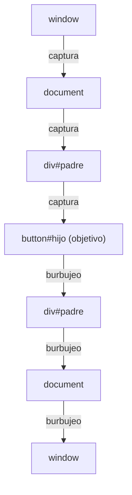

# Propagación de eventos (bubbling y capturing)

Parte de: [[04-JavaScript-Web/04 El navegador/_Índice El navegador|El navegador]]

> [!info] Cómo avanzar
> `progreso`: **pendiente** → **viendo** (estudiando) → **visto** (contestaste la autoevaluación sin abrir las respuestas) → **dominado** (hiciste el laboratorio o lo aplicaste de verdad).

## Contenido

### Qué es
Cuando ocurre un evento en un elemento, no se queda solo ahí: **viaja por el árbol del DOM**. Primero baja desde `window` hasta el elemento (fase de **captura**), luego se procesa en el propio elemento (fase **objetivo**) y por último sube de regreso hasta `window` (fase de **burbujeo** o *bubbling*). Esa propagación permite que un ancestro reaccione a lo que pasa en sus hijos, que es la base de la [[Delegación de eventos]].

### Cómo funciona
#### Las tres fases
1. **Captura (fase 1)**: el evento recorre `window → document → html → body → ... → padre del objetivo`. Se ejecutan los listeners registrados con `{ capture: true }`.
2. **Objetivo (fase 2)**: en el elemento donde se originó el evento se ejecutan sus listeners en el orden en que se registraron (sean de captura o no).
3. **Burbujeo (fase 3)**: el evento sube `padre → ... → document → window` y se ejecutan los listeners normales (sin `capture`).

Puedes ver la fase actual en `event.eventPhase` (1, 2 o 3) y el camino completo con `event.composedPath()`.



#### ¿Todos burbujean?
No. Cada tipo de evento define si burbujea (`event.bubbles`). Los más comunes que **no** burbujean:
- `focus` y `blur` (usa `focusin` y `focusout`, que sí).
- `mouseenter` y `mouseleave` (usa `mouseover` y `mouseout`, o `pointerover`/`pointerout`).
- `load`, `error` y `scroll` en elementos individuales (en el documento, `scroll` llega a `window`).

Aun así, **todos** pasan por la fase de captura, así que un listener con `capture: true` en un ancestro también los detecta.

#### Detener la propagación
- `e.stopPropagation()`: el evento no sigue a los siguientes nodos (los demás listeners del nodo actual sí corren).
- `e.stopImmediatePropagation()`: además no corren los listeners restantes del mismo nodo.
- No confundir con `preventDefault()`, que cancela la acción por defecto (ver [[DOM - eventos]]).

### Ejemplo
Orden con captura y burbujeo:

```html
<div id="padre"><button id="hijo">Clic</button></div>
```

```js
const padre = document.querySelector('#padre');
const hijo = document.querySelector('#hijo');

padre.addEventListener('click', () => console.log('P1 padre captura'), { capture: true });
padre.addEventListener('click', () => console.log('P2 padre burbujeo'));
hijo.addEventListener('click', () => console.log('H hijo'));
// Clic en el botón: P1, H, P2
```

El padre en captura va primero porque el evento "baja" antes de llegar al objetivo; el padre normal va al final porque el evento "sube".

#### Tarjeta clicable con un botón adentro
Problema típico: toda la tarjeta de producto abre el detalle, y el botón "Agregar al carrito" dentro de ella también dispara la apertura.

```js
// Opción 1: el contenedor ignora clics que vienen de controles internos
tarjeta.addEventListener('click', (e) => {
  if (e.target.closest('button, a, input')) return; // el clic era para un control
  abrirDetalle(tarjeta.dataset.id);
});

// Opción 2: un solo listener delegado que decide por prioridad
lista.addEventListener('click', (e) => {
  const boton = e.target.closest('[data-accion="agregar"]');
  if (boton) return agregarAlCarrito(boton.closest('[data-id]').dataset.id);
  const card = e.target.closest('.tarjeta');
  if (card) abrirDetalle(card.dataset.id);
});
```

Ambas evitan `stopPropagation()`. Llamarlo en el botón también "funciona", pero impide que cualquier otro listener superior (analítica, cierre de menús abiertos, delegación) se entere del clic; úsalo solo cuando de verdad quieres aislar el evento.

#### Captura para cerrar un menú al hacer clic fuera
```js
document.addEventListener('click', (e) => {
  if (!menu.contains(e.target)) menu.hidden = true;
}, { capture: true }); // se entera aunque algún hijo detenga el burbujeo
```

### Cuándo usarlo y cuándo no
- **Burbujeo** (el modo por defecto) para casi todo y para delegación.
- **Captura** cuando necesitas enterarte **antes** que los hijos: cerrar popovers al hacer clic fuera, interceptar eventos para analítica, o escuchar eventos que no burbujean como `focus` en un formulario completo.
- **`stopPropagation`** como último recurso y documentado.
- Con [[Shadow DOM]], los eventos que cruzan la frontera se retargetean al host y solo salen si son `composed`.

### Errores comunes
- **Pensar que el padre se entera primero** de forma normal: en burbujeo, el hijo va primero.
- **Delegar eventos que no burbujean** (`focus`, `mouseenter`) y que nunca lleguen.
- **Abusar de `stopPropagation`**, rompiendo funcionalidades de otros componentes sin errores visibles.
- **Registrar con `capture: true` y quitar sin él**: `removeEventListener` debe recibir la misma opción `capture` para encontrar el listener.

### Para profundizar
- [MDN: Event bubbling](https://developer.mozilla.org/en-US/docs/Learn_web_development/Core/Scripting/Event_bubbling)
- [MDN: Event.eventPhase](https://developer.mozilla.org/en-US/docs/Web/API/Event/eventPhase)
- [DOM Standard: Dispatching events](https://dom.spec.whatwg.org/#dispatching-events)

## Ejercicios

Resuélvelos en papel o en la herramienta; la solución está plegada.

> [!question]- `div#padre > button#hijo`. Listeners: `padre` (captura) imprime P1, `padre` (burbujeo) imprime P2, `hijo` imprime H. ¿Orden al hacer clic en el botón?
> `P1 H P2`.

## Autoevaluación

Contesta primero en voz alta o en papel; luego despliega la respuesta.

> [!question]- ¿Cuáles son las fases de un evento?
> Captura (de `window` hacia el objetivo), objetivo, y burbujeo (del objetivo hacia `window`). Por defecto los listeners corren en burbujeo.

> [!question]- ¿Todos los eventos burbujean?
> No: `focus`, `blur`, `mouseenter`, `mouseleave` y `load` no. Para delegar foco usa `focusin`/`focusout`, que sí burbujean.

> [!question]- Caso: un clic en un botón dentro de una tarjeta clicable dispara ambos. ¿Cómo lo resuelves?
> En el handler de la tarjeta, ignora si `e.target.closest('button')` existe; o en el del botón llama `e.stopPropagation()` (con cuidado: rompe a otros que escuchen arriba, como analíticas).

## Práctica

- [[Lab 5 - Lista de tareas con delegación de eventos]]

