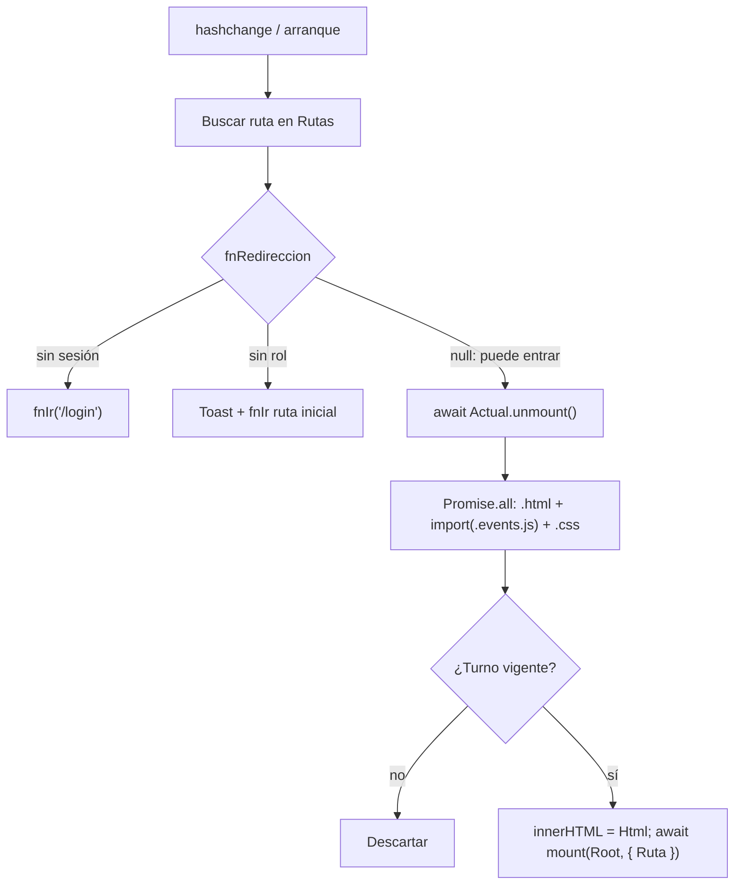

# SPA y router por hash

> Aplicación de una sola página donde la navegación cambia solo el fragmento `#/ruta` de la URL y un router en JavaScript monta y desmonta la pantalla correspondiente sin recargar.

## Qué es y qué problema resuelve
Una **SPA** (*Single Page Application*) carga un único HTML y reemplaza el contenido con JavaScript al navegar. Así se conservan las conexiones abiertas (SignalR), el estado global (sesión) y el layout, y la navegación es instantánea.

Un **router por hash** usa la parte `#...` de la URL (`index.html#/ingresos`). Cambiar el hash no recarga la página ni hace una petición al servidor; el navegador solo dispara el evento `hashchange`. Esto es clave cuando la app se abre con `file://` (como en [[Electron]]), donde no hay servidor que responda rutas como `/ingresos`.

## Cómo funciona por dentro
1. Una tabla de rutas mapea `Path` → pantalla y metadatos (roles, si es pública, si usa layout).
2. El router escucha `hashchange` y también navega al arrancar.
3. **Guardias**: antes de entrar decide si redirigir (sin sesión → login; sin rol → pantalla inicial).
4. **unmount** de la pantalla anterior: limpia listeners, suscripciones y peticiones en curso.
5. Carga los recursos de la pantalla nueva y la **mount**ea en el contenedor.
6. Un contador de "turno" descarta navegaciones viejas si el usuario hace clic rápido (evita condiciones de carrera).



## Cuándo usarla y cuándo no
### Ventajas
- Funciona con `file://` y sin servidor (no necesita *rewrites* como la History API).
- Simple de implementar (~100 líneas en Iris).
- Mantiene vivo lo global (layout, SignalR, sesión) entre pantallas.
- Carga perezosa: cada pantalla se baja solo cuando se visita.
### Desventajas
- URLs con `#`, menos "limpias" (irrelevante en escritorio).
- Hay que gestionar a mano el ciclo de vida y la limpieza de cada pantalla (fugas si se olvida `unmount`).
- Las guardias en el cliente **no son seguridad**: la autorización real debe estar en el backend ([[Ocelotl.Hermes]]).

## Alternativas
| Alternativa | En qué se diferencia |
|---|---|
| History API (`pushState`) | URLs sin `#`; requiere servidor que devuelva el `index.html` en cualquier ruta. |
| Routers de framework (React Router, Vue Router) | Más funciones (rutas anidadas, parámetros, loaders); atados al framework. |
| Navigation API | API moderna del navegador para interceptar navegaciones; soporte más reciente. |
| Multi-página (MPA) | Cada pantalla es un HTML; recarga todo y pierde conexiones en cada cambio. |

## Cómo se usó en Ocelotl
En [[Ocelotl.Iris]]:
- `core/rutas.js` define las pantallas: `/login`, `/inicio`, `/ingresos`, `/dispensar`, `/configuracion`, `/reportes`, `/soporte`, cada una con `Feature` (carpeta en `features/`), `Titulo`, `Icono`, `Roles` y banderas `isSinLayout`, `isPublica`, `isOculta`. El sidebar se arma con `fnRutasDelMenu()` filtrando por rol.
- `core/router.js` implementa guardias de sesión y rol (con `core/sesion.js`), desmonta la pantalla actual, carga `features/<x>/<x>.html` (con `import.meta.glob(..., { query: '?raw' })` de [[Vite]], un chunk por pantalla; antes era `XMLHttpRequest` en `core/cargador.js`), el `.css` (una sola vez) y el `<x>.events.js` con `import()` dinámico, y llama `mount(Root, { Ruta })`.
- Cada pantalla expone `mount` / `unmount` en su `*.events.js`; dentro, un [[AbortController]] cancela todo al salir (ver [[Molde Service-View-Handlers-Events]]).
- Header, sidebar, footer y SignalR no se tocan al navegar (`core/layout.js`, [[SignalR]]).
- Si una pantalla falla al cargar, se muestra un aviso en `#AppContent` en vez de romper la app.

Funcionalidades relacionadas: [[Sesión y roles]] (guardias), [[Secciones pendientes]] (pantalla `en-construccion`).

Guardias (`Ocelotl.Iris/src/core/router.js`):
```js
function fnRedireccion(Ruta) {
    if (!Ruta) return Sesion.fnHaySesion() ? fnRutaInicial() : RutaLogin
    if (!Ruta.isPublica && !Sesion.fnHaySesion()) return RutaLogin
    if (Ruta.Path == RutaLogin && Sesion.fnHaySesion()) return fnRutaInicial()
    if (!Ruta.isPublica && !Sesion.fnTieneRol(Ruta.Roles)) {
        Toast.fnAviso(Mensajes.SinPermiso)
        return fnRutaInicial()
    }
    return null
}
```

Ciclo mount/unmount de una pantalla (`Ocelotl.Iris/src/features/ingresos/ingresos.events.js`):
```js
export function mount(Root) {
    Controlador = new AbortController()
    const { signal: Signal } = Controlador

    IngresosHandler.fnIniciar(Root, { Signal, Acciones })
    RobotEvents.fnSuscribir(RobotEvents.Eventos.PackAlmacenado, IngresosHandler.fnAlAlmacenarCaja, { Signal })
}

export function unmount() {
    Controlador?.abort()
    IngresosHandler.fnLimpiar()
}
```

> [!note]
> La pantalla `features/en-construccion/` existe para "rutas del menú que aún no se migran", pero ninguna entrada actual de `core/rutas.js` la usa como `Feature`.

> [!tip] Reutilizable
> `router.js` + `rutas.js` + contrato `mount(Root, { Ruta })` / `unmount()` es un mini-router sin dependencias que se puede llevar a cualquier SPA estática o Electron.

## Errores comunes y buenas prácticas

- Olvidar limpiar en `unmount` → eventos duplicados y peticiones que pintan sobre otra pantalla.
- No proteger contra navegaciones concurrentes: Iris usa el contador `Navegacion` y descarta resultados con turno viejo.
- Si se navega al mismo hash, `hashchange` no se dispara: Iris lo resuelve en `fnIr` llamando `fnNavegar()` directamente.
- Nunca confiar solo en guardias del cliente. Hermes exige sesión en sus controllers con el atributo `[RequiereSesion]` (`Ocelotl.Hermes/src/Ocelotl.Hermes.Api/Security/RequiereSesionAttribute.cs`) y responde `sesion_requerida`, que Iris convierte en redirección al login.
- Hacer `import()` solo de rutas de la tabla, nunca con texto del usuario.

> [!warning] Pendiente de confirmar
> En Hermes no se encontró una validación de **rol** por endpoint (solo de sesión): las restricciones por rol (p. ej. Reportes solo Administrador) parecen aplicarse únicamente en el router de Iris.

## Qué estudiar después
- [[AbortController]]
- [[Molde Service-View-Handlers-Events]]
- [[ES Modules e import maps]]
- [[Sesión y roles]]
- History API y Navigation API.

## Documentación oficial
- https://developer.mozilla.org/en-US/docs/Web/API/Window/hashchange_event
- https://developer.mozilla.org/en-US/docs/Web/API/Location/hash
- https://developer.mozilla.org/en-US/docs/Glossary/SPA

## Autoevaluación

Contesta primero en voz alta o en papel; luego despliega la respuesta.

> [!question]- ¿Cómo funciona un router por hash?
> La ruta vive después del `#` (`#/clientes/3`). Cambiar el hash no recarga ni llega al servidor; escuchas `hashchange` (y la carga inicial), parseas `location.hash` y pintas la vista.

> [!question]- ¿Qué ventajas y desventajas tiene frente a History API?
> Ventaja: funciona en cualquier hosting estático sin configurar el servidor. Desventajas: URLs menos limpias y el hash no se envía al servidor (no sirve para SSR).

> [!question]- Error común: al cambiar de vista quedan listeners o peticiones de la vista anterior. ¿Cómo lo evitas?
> Que cada vista devuelva una función de limpieza (o use un `AbortController`) que el router llama antes de montar la siguiente.

