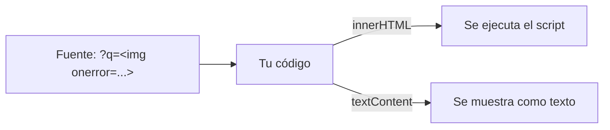

# Seguridad del DOM (innerHTML y escape de datos)

Parte de: [[04-JavaScript-Web/04 El navegador/_Índice El navegador|El navegador]]

> [!info] Cómo avanzar
> `progreso`: **pendiente** → **viendo** (estudiando) → **visto** (contestaste la autoevaluación sin abrir las respuestas) → **dominado** (hiciste el laboratorio o lo aplicaste de verdad).

## Contenido

### Qué es
El **XSS** (*cross-site scripting*) ocurre cuando datos que controla un atacante terminan ejecutándose como código en la página de otra persona. En el **XSS basado en DOM**, el problema está completamente en el JavaScript del cliente: el código toma un dato no confiable (parámetros de la URL, `location.hash`, una respuesta de API con texto de usuarios, `postMessage`) y lo mete en un "sumidero" peligroso del DOM, como `innerHTML`, sin escaparlo. El servidor puede estar perfecto y aun así la página es vulnerable.

Con un XSS, el atacante ejecuta código con tus permisos: lee datos de la pantalla, hace peticiones a tu API con la sesión del usuario y puede robar tokens guardados en `localStorage`.

### Cómo funciona
1. **Fuente** (*source*): de dónde viene el dato no confiable: `location.search`, `location.hash`, `document.referrer`, mensajes, respuestas de API con contenido de usuarios.
2. **Sumidero** (*sink*): una API que interpreta el dato como HTML, URL o código: `innerHTML`, `outerHTML`, `insertAdjacentHTML`, `document.write`, `eval`, `new Function`, `setTimeout('string')`, y atributos como `href`/`src` con URLs `javascript:`.
3. Si un dato va de una fuente a un sumidero sin pasar por escape o validación, hay vulnerabilidad.



#### Ejemplo de ataque
```js
// Buscador que muestra lo que escribiste
const q = new URLSearchParams(location.search).get('q');
resultado.innerHTML = `Resultados para <b>${q}</b>`; // VULNERABLE
// URL maliciosa: /buscar?q=
```

`<script>` insertado con `innerHTML` no se ejecuta, pero los atributos de eventos (`onerror`, `onload`) sí.

### Cómo insertarlo de forma segura
- **Texto**: usa `textContent` (o `createTextNode`). El navegador lo trata como texto literal; los `<` se muestran como `<`, no se interpretan.
- **Estructura + datos**: crea elementos con `createElement` o clona un `<template>` y rellena con `textContent` ([[DOM - selección y creación]]).
- **Atributos**: `setAttribute` y propiedades como `el.title = dato` son seguras para atributos normales; el riesgo está en los que cargan URLs o eventos.
- **Plantillas**: librerías como [[lit-html]] escapan por defecto los valores interpolados; React también. El peligro vuelve si usas sus "escapes" explícitos (`unsafeHTML`, `dangerouslySetInnerHTML`).
- **Si de verdad necesitas HTML de usuario** (un editor enriquecido): sanitiza con una librería probada como DOMPurify antes de insertar. La API nativa `Element.setHTML()` (Sanitizer API) está llegando a los navegadores; revisa su compatibilidad (Pendiente de confirmar el soporte actual).

#### URLs del usuario
`img.src = datos.url` o `a.href = datos.url` con una URL controlada por el usuario **sí tiene riesgo**:
- En `a.href`, una URL `javascript:alert(1)` se ejecuta al hacer clic.
- En `img.src`, `javascript:` no se ejecuta en navegadores modernos, pero el atacante puede apuntar a cualquier servidor (rastreo, peticiones a recursos internos, contenido ofensivo).
Valida el esquema y, si aplica, el dominio:

```js
function urlSegura(texto, permitidos = ['https:']) {
  try {
    const u = new URL(texto, location.origin);
    return permitidos.includes(u.protocol) ? u.href : null;
  } catch { return null; }
}

const url = urlSegura(cliente.sitioWeb);
if (url) { enlace.href = url; enlace.rel = 'noopener noreferrer'; }
```

### Defensa en profundidad: Content Security Policy
Una **CSP** es un encabezado HTTP que le dice al navegador de dónde puede cargar y ejecutar recursos. Aunque se cuele un XSS, la CSP puede impedir que se ejecute:
- `script-src 'self'` bloquea scripts en línea (incluidos atributos `onclick` y `onerror`) y scripts de otros dominios.
- Bloquea `eval` salvo que se permita con `'unsafe-eval'`.
- `connect-src` limita a qué servidores puede hacer `fetch` la página, dificultando exfiltrar datos.
- `require-trusted-types-for 'script'` (Trusted Types, donde está soportado) obliga a que los sumideros solo acepten valores tratados.

En ASP.NET Core puedes agregarla con un middleware:

```csharp
app.Use(async (ctx, next) =>
{
    ctx.Response.Headers.ContentSecurityPolicy =
        "default-src 'self'; script-src 'self'; object-src 'none'; base-uri 'self'; frame-ancestors 'none'";
    await next();
});
```

### Cuándo usarlo y cuándo no
- `textContent` por defecto para todo lo que venga de afuera; `innerHTML` solo con **cadenas constantes tuyas**.
- Sanitizador cuando el producto realmente requiere HTML de usuarios.
- CSP siempre en producción; empieza en modo `Content-Security-Policy-Report-Only` para ver qué rompería.
- No guardes tokens de acceso de larga vida en `localStorage` si puedes evitarlo: un XSS los roba. Un BFF con cookie `HttpOnly` (como el de Xolotl.Hecate) reduce el impacto.

### Errores comunes
- **Confiar en datos "de nuestra propia API"**: si contienen texto que escribió un usuario, no son confiables.
- **Escapar a mano con `replace`** y olvidar casos (comillas en atributos, contextos de URL o CSS).
- **Usar `insertAdjacentHTML` o `outerHTML`** pensando que son distintos de `innerHTML`: son el mismo sumidero.
- **Permitir `javascript:`** en enlaces construidos con datos del usuario.
- **CSP con `'unsafe-inline'`** para "que funcione": anula gran parte de la protección.

### Para profundizar
- [OWASP: DOM based XSS Prevention Cheat Sheet](https://cheatsheetseries.owasp.org/cheatsheets/DOM_based_XSS_Prevention_Cheat_Sheet.html)
- [MDN: Cross-site scripting (XSS)](https://developer.mozilla.org/en-US/docs/Web/Security/Attacks/XSS)
- [MDN: Content Security Policy (CSP)](https://developer.mozilla.org/en-US/docs/Web/HTTP/Guides/CSP)
- [DOMPurify](https://github.com/cure53/DOMPurify)

## Autoevaluación

Contesta primero en voz alta o en papel; luego despliega la respuesta.

> [!question]- ¿Qué es un XSS basado en DOM?
> Cuando tu JS toma datos controlables por el usuario (URL, respuesta de API, `postMessage`) y los inserta como HTML/JS (`innerHTML`, `insertAdjacentHTML`, `eval`, `href="javascript:..."`), permitiendo ejecutar código en tu página.

> [!question]- ¿Cómo insertas texto de un usuario de forma segura?
> Con `textContent`, `createElement` + propiedades, o una plantilla que escape por defecto (lit-html). Si de verdad necesitas HTML del usuario, sanitízalo con DOMPurify.

> [!question]- Caso: `img.src = datos.url` con una URL del usuario. ¿Hay riesgo?
> Menor que `innerHTML`, pero en enlaces (`a.href`) una URL `javascript:` sí ejecuta código. Valida el esquema (`http:`/`https:`) con `new URL(...)`.

> [!question]- ¿Qué agrega una Content Security Policy?
> Una cabecera que limita de dónde se cargan scripts y prohíbe scripts en línea: si se cuela un XSS, el navegador bloquea su ejecución. Es defensa en profundidad, no reemplaza el escape.

## Práctica

- [[Lab 5 - Lista de tareas con delegación de eventos]]

