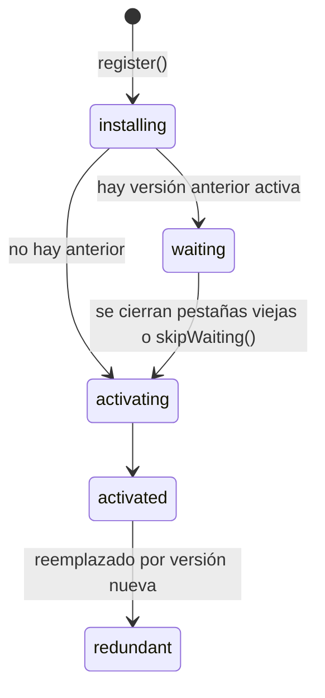

# Service Workers y PWA

Parte de: [[04-JavaScript-Web/04 El navegador/_Índice El navegador|El navegador]]

> [!info] Cómo avanzar
> `progreso`: **pendiente** → **viendo** (estudiando) → **visto** (contestaste la autoevaluación sin abrir las respuestas) → **dominado** (hiciste el laboratorio o lo aplicaste de verdad).

## Contenido

### Qué es
Un **Service Worker** es un script que el navegador ejecuta **en segundo plano, separado de la página**, y que actúa como un proxy programable entre tu aplicación y la red. Puede interceptar cada petición (`fetch`) que hace la página y decidir si responde desde una caché, desde la red o con una combinación. También recibe notificaciones push y sincronizaciones en segundo plano. No tiene acceso al DOM y solo funciona en contextos seguros (HTTPS o `localhost`).

Una **PWA** (*Progressive Web App*) es una aplicación web que, con un **manifiesto** y normalmente un service worker, se puede **instalar** como app (icono propio, ventana sin barra del navegador) y funcionar sin conexión o con conexión mala.

### Cómo funciona
#### Ciclo de vida
1. **Registro**: la página llama `navigator.serviceWorker.register('/sw.js')`. El *scope* (las URLs que controla) depende de la ubicación del archivo: en la raíz controla todo el sitio.
2. **Instalación** (`install`): momento de precargar en caché los archivos básicos (el *app shell*).
3. **Espera** (`waiting`): si ya había otra versión controlando pestañas abiertas, la nueva **espera** hasta que todas esas pestañas se cierren.
4. **Activación** (`activate`): momento de borrar cachés viejas. A partir de aquí controla las páginas que se abran (o las abiertas, si llama `clients.claim()`).
5. **Funcionamiento**: atiende eventos `fetch`, `push`, `message`. El navegador lo detiene cuando está inactivo y lo despierta cuando hay eventos, así que no guardes estado en variables globales.



#### Estrategias de caché comunes
- **Cache first**: responde de la caché y solo va a la red si no está. Para archivos versionados (con hash en el nombre), fuentes, íconos.
- **Network first**: intenta la red y, si falla, la caché. Para HTML y datos que deben estar frescos.
- **Stale-while-revalidate**: responde de caché de inmediato y actualiza en segundo plano.

#### Qué necesita una PWA para ser instalable
- Servirse por **HTTPS**.
- Un **manifiesto web** (`<link rel="manifest" href="/manifest.webmanifest">`) con al menos `name` o `short_name`, `icons` (lo usual: 192 px y 512 px), `start_url` y `display` (`standalone`, `fullscreen` o `minimal-ui`).
- Un service worker: en Chrome dejó de ser obligatorio que tenga manejador `fetch` para instalar desde el menú (desde Chrome 108 en móvil y 112 en escritorio); el aviso automático de instalación sí lo requería según el anuncio de 2023 (Pendiente de confirmar el criterio actual). Cada navegador tiene reglas propias; Safari en iOS instala desde "Agregar a pantalla de inicio".

### Ejemplo
Registro desde la página:

```js
if ('serviceWorker' in navigator) {
  const reg = await navigator.serviceWorker.register('/sw.js', { type: 'module' });
  reg.addEventListener('updatefound', () => {
    const nuevo = reg.installing;
    nuevo?.addEventListener('statechange', () => {
      if (nuevo.state === 'installed' && navigator.serviceWorker.controller) {
        mostrarAviso('Hay una versión nueva', () => nuevo.postMessage({ tipo: 'SKIP_WAITING' }));
      }
    });
  });
  navigator.serviceWorker.addEventListener('controllerchange', () => location.reload());
}
```

`sw.js` con app shell y estrategias por tipo de recurso:

```js
const VERSION = 'v12';
const SHELL = ['/', '/index.html', '/css/app.css', '/js/main.js', '/img/logo-192.png'];

self.addEventListener('install', (e) => {
  e.waitUntil(caches.open(VERSION).then((c) => c.addAll(SHELL)));
});

self.addEventListener('activate', (e) => {
  e.waitUntil(caches.keys().then((ks) => Promise.all(ks.filter((k) => k !== VERSION).map((k) => caches.delete(k)))));
});

self.addEventListener('message', (e) => {
  if (e.data?.tipo === 'SKIP_WAITING') self.skipWaiting();
});

self.addEventListener('fetch', (e) => {
  const url = new URL(e.request.url);
  if (url.pathname.startsWith('/api/')) return;            // API: sin caché del SW
  if (e.request.mode === 'navigate') {                      // HTML: network first
    e.respondWith(fetch(e.request).catch(() => caches.match('/index.html')));
    return;
  }
  e.respondWith(caches.match(e.request).then((r) => r ?? fetch(e.request))); // estáticos: cache first
});
```

### "Desplegué y siguen viendo la versión vieja"
Pasa por una combinación de:
- El SW nuevo quedó en **waiting** porque hay pestañas controladas por el viejo; mientras tanto el viejo sigue sirviendo su caché.
- Estrategia **cache first para el HTML** o el JS sin hash: el SW responde siempre la copia guardada.
- No se **cambió la versión** de la caché, así que `activate` no borra nada.
- El servidor envía `sw.js` con caché HTTP larga (los navegadores revisan el script al navegar, pero conviene servirlo con `Cache-Control: no-cache`).
Solución: versiona la caché, usa network first para navegación, nombres con hash para estáticos y un flujo de "hay versión nueva" con `skipWaiting()`.

### Cuándo usarlo y cuándo no
- **Sí**: apps que deben abrir rápido o funcionar con mala conexión (captura en campo, catálogos), apps que el usuario quiere "instalar".
- **No** como primera optimización de un sitio normal: un mal SW causa más problemas (contenido viejo, depuración difícil) que los que resuelve. Primero caché HTTP bien configurada.
- Para no escribirlo a mano, herramientas como Workbox o el plugin PWA de [[Vite]] generan el SW y el manifiesto.
- No caches respuestas de API con datos sensibles por usuario sin pensarlo.

### Errores comunes
- **Cache first para `index.html`**: los usuarios quedan atrapados en una versión.
- **No borrar cachés viejas** en `activate`: el almacenamiento crece.
- **Registrar el SW en una subcarpeta** y esperar que controle todo el sitio (el scope no sube).
- **Olvidar `event.waitUntil`**: el navegador puede detener el SW antes de terminar la precarga.
- **Depurar sin la pestaña Application** de DevTools, donde puedes ver el estado, forzar "Update on reload" y borrar cachés.

### Para profundizar
- [MDN: Service Worker API](https://developer.mozilla.org/en-US/docs/Web/API/Service_Worker_API)
- [web.dev: The service worker lifecycle](https://web.dev/articles/service-worker-lifecycle)
- [MDN: Progressive web apps](https://developer.mozilla.org/en-US/docs/Web/Progressive_web_apps)
- [Chrome for Developers: Revisiting Chrome's installability criteria](https://developer.chrome.com/blog/update-install-criteria)

## Autoevaluación

Contesta primero en voz alta o en papel; luego despliega la respuesta.

> [!question]- ¿Qué es un Service Worker?
> Un script que corre aparte de la página, en su propio hilo, y puede interceptar las peticiones de su alcance (evento `fetch`) para responder desde caché: permite funcionar sin conexión y recibir notificaciones push.

> [!question]- ¿Qué necesita una PWA para ser instalable?
> HTTPS (o localhost), un manifiesto web (`manifest.webmanifest` con nombre, íconos, `start_url`, `display`) y, según el navegador, un Service Worker. Los requisitos exactos varían por navegador.

> [!question]- Error común: después de desplegar, los usuarios siguen viendo la versión vieja. ¿Por qué?
> El SW nuevo queda en espera hasta que se cierren todas las pestañas con el viejo, y la caché sirve archivos antiguos. Versiona las cachés, borra las viejas en `activate` y ofrece "Actualizar" (con `skipWaiting`).

