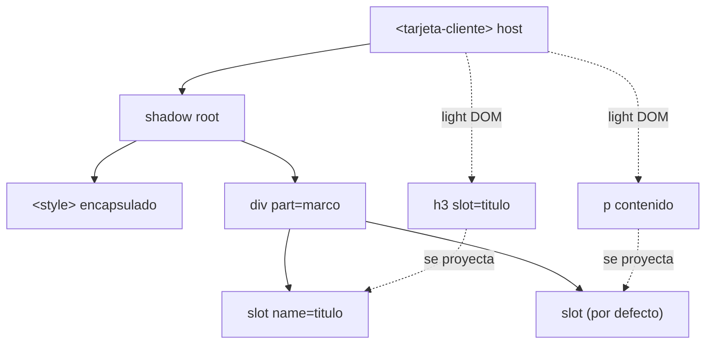

# Shadow DOM

Parte de: [[04-JavaScript-Web/04 El navegador/_Índice El navegador|El navegador]]

> [!info] Cómo avanzar
> `progreso`: **pendiente** → **viendo** (estudiando) → **visto** (contestaste la autoevaluación sin abrir las respuestas) → **dominado** (hiciste el laboratorio o lo aplicaste de verdad).

## Contenido

### Qué es
El **Shadow DOM** es un subárbol del DOM **oculto y encapsulado** que se adjunta a un elemento (el *host*). Lo que está dentro tiene su propio alcance de estilos y no lo alcanzan los selectores de la página, y viceversa. Es una de las piezas de los [[Web Components]] y es el mismo mecanismo que usa el navegador para elementos como `<video>` o `<input type="range">`, cuyos controles internos no ves en el DOM normal.

### Cómo funciona
`elemento.attachShadow({ mode: 'open' })` crea una **shadow root** dentro del host. A partir de ahí:
- **Estilos encapsulados**: un `<style>` dentro de la shadow root solo aplica ahí adentro; el CSS de la página no entra con selectores normales (`.boton` de la página no pinta el `.boton` interno). Así no hay colisiones de nombres de clases.
- **DOM encapsulado**: `document.querySelector` no encuentra nodos internos; hay que pasar por `host.shadowRoot`.
- **Eventos retargeteados**: un clic en un botón interno, visto desde afuera, parece venir del host. Solo cruzan la frontera los eventos con `composed: true` (los de usuario, como `click`, lo son; un `CustomEvent` propio necesita `composed: true` para salir).

#### Qué sí atraviesa la frontera
No todo está aislado, y eso es lo que permite personalizar el componente:
- **Propiedades heredables** como `color`, `font-family` y `line-height` se heredan del host hacia adentro.
- **Variables CSS (custom properties)** también se heredan: es la forma principal de exponer "perillas" de tema (`--boton-fondo`).
- **`::part()`**: el componente marca elementos internos con `part="etiqueta"` y la página los estiliza con `mi-componente::part(etiqueta) { ... }`.
- **`:host`** permite al componente estilizarse a sí mismo (y `:host([variante="peligro"])` según atributos); la página puede ganar con estilos sobre el elemento host.

#### `<slot>`: contenido de la página dentro del componente
Un `<slot>` es un hueco en la plantilla del Shadow DOM donde se **proyecta** el contenido que la página pone como hijo del host (el *light DOM*). Los slots con nombre (`<slot name="titulo">`) reciben los hijos con `slot="titulo"`. El contenido proyectado **sigue perteneciendo a la página**: lo estilizan los estilos de la página, y desde dentro solo se puede ajustar un poco con `::slotted()`.

#### `open` vs `closed`
- `mode: 'open'`: `host.shadowRoot` devuelve la shadow root; cualquier script (y las pruebas) puede entrar.
- `mode: 'closed'`: `host.shadowRoot` devuelve `null`; solo quien guardó la referencia que regresa `attachShadow` puede acceder. No es una medida de seguridad real (un script en la misma página tiene muchas otras formas de interferir) y complica pruebas y herramientas; por eso lo usual es `open`.



### Ejemplo
```js
class TarjetaCliente extends HTMLElement {
  constructor() {
    super();
    const raiz = this.attachShadow({ mode: 'open' });
    raiz.innerHTML = `
      <style>
        :host { display: block; font-family: inherit; }
        .marco {
          border: 1px solid var(--tarjeta-borde, #ccc);
          background: var(--tarjeta-fondo, white);
          border-radius: 8px; padding: 1rem;
        }
        ::slotted(h3) { margin-top: 0; }
      </style>
      <div class="marco" part="marco">
        <slot name="titulo"></slot>
        <slot>Sin detalles</slot>
      </div>`;
  }
}
customElements.define('tarjeta-cliente', TarjetaCliente);
```

Uso y personalización desde la página:

```html
<tarjeta-cliente>
  <h3 slot="titulo">Ana López</h3>
  <p>Cliente desde 2021 · Crédito autorizado</p>
</tarjeta-cliente>

<style>
  tarjeta-cliente { --tarjeta-fondo: #f7f9fc; }          /* variable que entra */
  tarjeta-cliente::part(marco) { box-shadow: 0 1px 3px rgb(0 0 0 / .2); }
  .marco { border: 5px solid red; }                      /* NO afecta al componente */
</style>
```

El `innerHTML` de la plantilla es seguro aquí porque es una cadena constante del componente; los datos externos van por slots o con `textContent` ([[Seguridad del DOM (innerHTML y escape de datos)]]).

### Cuándo usarlo y cuándo no
- **Sí**: componentes reutilizables que deben verse igual en cualquier página (widgets embebibles, librerías compartidas entre apps, [[Librería de componentes propia en JS plano]]).
- **No** (o con cuidado) si tu equipo depende de un CSS global o de utilidades tipo framework de clases: no entrará al Shadow DOM y tendrás que duplicar o adoptar hojas (`adoptedStyleSheets`).
- Formularios: un input dentro del Shadow DOM no participa del `<form>` de la página salvo que uses `ElementInternals` (*form-associated custom elements*).
- Accesibilidad: las referencias por id (`aria-labelledby`, `<label for>`) no cruzan la frontera; diseña la estructura con eso en mente.

### Errores comunes
- **Esperar que el CSS global estilice el interior**: no lo hace; expón variables y `part`.
- **Usar `mode: 'closed'` como "seguridad"**: no protege y estorba en pruebas.
- **CustomEvent que no sale del componente**: falta `bubbles: true, composed: true`.
- **Estilizar a fondo el contenido proyectado con `::slotted`**: solo acepta selectores simples del hijo directo; el resto lo estiliza la página.
- **Buscar nodos internos con `document.querySelector`**: usa `host.shadowRoot.querySelector`.

### Para profundizar
- [MDN: Using shadow DOM](https://developer.mozilla.org/en-US/docs/Web/API/Web_components/Using_shadow_DOM)
- [MDN: Using templates and slots](https://developer.mozilla.org/en-US/docs/Web/API/Web_components/Using_templates_and_slots)
- [MDN: ::part()](https://developer.mozilla.org/en-US/docs/Web/CSS/::part)

## Autoevaluación

Contesta primero en voz alta o en papel; luego despliega la respuesta.

> [!question]- ¿Qué encapsula el Shadow DOM?
> Su DOM interno no es visible para `document.querySelector` y sus estilos no se escapan ni le entran los de la página (salvo propiedades heredadas como `color`/`font` y las variables CSS).

> [!question]- ¿Cómo dejas que la página personalice estilos de tu componente?
> Con variables CSS (`var(--mi-color, azul)`), `::part()` para partes que expones con `part="..."`, y `:host` para estilizar el propio elemento.

> [!question]- ¿Qué es un `<slot>`?
> Un hueco donde se proyecta el contenido hijo que el usuario puso dentro del componente (*light DOM*). Con `name` puedes tener varios slots.

> [!question]- ¿Qué diferencia hay entre `mode: 'open'` y `'closed'`?
> En `open`, `el.shadowRoot` da acceso desde fuera; en `closed`, es `null`. `closed` no es una medida de seguridad real; casi siempre se usa `open`.

## Práctica

- [[Lab 6 - Web Component con Shadow DOM]]

