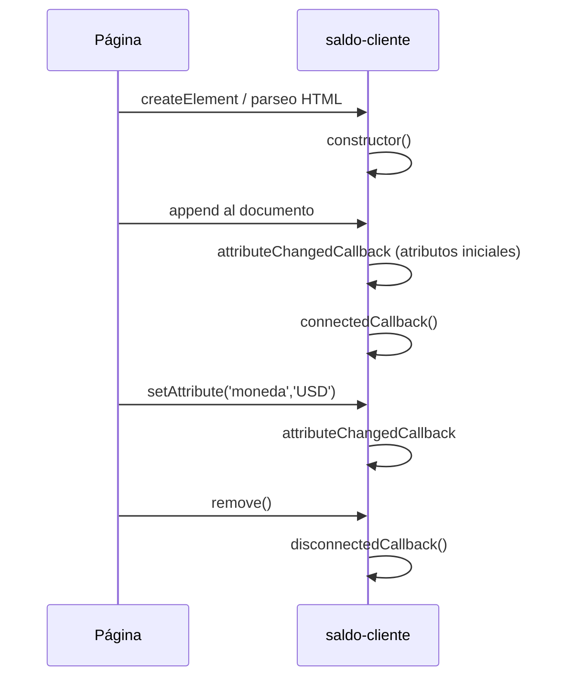

# Web Components

Parte de: [[04-JavaScript-Web/04 El navegador/_Índice El navegador|El navegador]]

> [!info] Cómo avanzar
> `progreso`: **pendiente** → **viendo** (estudiando) → **visto** (contestaste la autoevaluación sin abrir las respuestas) → **dominado** (hiciste el laboratorio o lo aplicaste de verdad).

## Contenido

### Qué es
**Web Components** es el nombre de un conjunto de estándares del navegador para crear **elementos HTML propios**, reutilizables y encapsulados, sin framework. Un componente se usa como cualquier etiqueta (`<selector-fecha>`, `<tabla-pedidos>`) y funciona en HTML plano, en React, en Angular o en lo que venga, porque es parte de la plataforma.

Las piezas son:
- **Custom Elements**: la API para definir una etiqueta nueva y su comportamiento con una clase (`customElements.define`).
- **[[Shadow DOM]]**: encapsulación de estructura y estilos.
- **`<template>` y `<slot>`**: marcado inerte reutilizable y huecos para proyectar contenido de la página ([[DOM - selección y creación]]).
- Los **ES Modules** son la forma natural de distribuirlos ([[ES Modules e import maps]]).

### Cómo funciona
#### Definir el elemento
Una clase que extiende `HTMLElement` y se registra con un nombre: `customElements.define('saldo-cliente', SaldoCliente)`. A partir de ese momento, el navegador "mejora" (*upgrade*) cada `<saldo-cliente>` que exista o se cree.

#### Reglas del nombre
- Debe **contener un guion** (`mi-boton`, no `miboton`): así nunca choca con etiquetas que agregue el estándar en el futuro.
- Debe empezar con una **letra minúscula** ASCII y no usar mayúsculas.
- No puede ser uno de los nombres reservados con guion que ya existen en SVG/MathML (como `font-face` o `annotation-xml`).
- Un nombre solo se puede definir **una vez** por página; definirlo de nuevo lanza error.

#### Ciclo de vida
- `constructor()`: se crea la instancia. Llama `super()` primero; prepara estado y la shadow root, pero **no** leas atributos ni hijos todavía (aún pueden no existir).
- `connectedCallback()`: el elemento se insertó en el documento. Aquí se pinta, se registran listeners y se piden datos. Puede llamarse varias veces si lo mueves.
- `disconnectedCallback()`: se quitó del documento. Aquí se limpian listeners globales, timers, observers y peticiones (por ejemplo con un [[AbortController]]).
- `attributeChangedCallback(nombre, viejo, nuevo)`: cambió un atributo listado en `static observedAttributes`.
- `adoptedCallback()`: se movió a otro documento (raro, por ejemplo a un iframe).



#### Comunicación
- **Hacia adentro**: atributos (strings, buenos para configuración simple y para HTML) y **propiedades** (cualquier tipo, para datos ricos como arreglos y objetos).
- **Hacia afuera**: **eventos**. El componente emite `CustomEvent` con datos en `detail` y, si debe atravesar el Shadow DOM y subir, `bubbles: true` y `composed: true`. Así el componente no conoce a quien lo usa.

### Ejemplo
Un componente que muestra el saldo de un cliente y avisa cuando se pide el detalle:

```js
const formatos = new Map();
const formato = (moneda) => {
  if (!formatos.has(moneda)) formatos.set(moneda, new Intl.NumberFormat('es-MX', { style: 'currency', currency: moneda }));
  return formatos.get(moneda);
};

class SaldoCliente extends HTMLElement {
  static observedAttributes = ['monto', 'moneda'];
  #control;

  constructor() {
    super();
    this.attachShadow({ mode: 'open' }).innerHTML = `
      <style>:host{display:inline-flex;gap:.5rem;align-items:center} .neg{color:var(--color-peligro,#b00020)}</style>
      <span part="monto"></span><button part="boton" type="button">Detalle</button>`;
  }

  connectedCallback() {
    this.#control = new AbortController();
    this.shadowRoot.querySelector('button').addEventListener('click', () => {
      this.dispatchEvent(new CustomEvent('saldo:detalle', {
        detail: { clienteId: this.dataset.clienteId },
        bubbles: true, composed: true,
      }));
    }, { signal: this.#control.signal });
    this.#pintar();
  }

  disconnectedCallback() { this.#control.abort(); }

  attributeChangedCallback() { if (this.isConnected) this.#pintar(); }

  #pintar() {
    const monto = Number(this.getAttribute('monto') ?? 0);
    const span = this.shadowRoot.querySelector('span');
    span.textContent = formato(this.getAttribute('moneda') ?? 'MXN').format(monto);
    span.classList.toggle('neg', monto < 0);
  }
}

if (!customElements.get('saldo-cliente')) customElements.define('saldo-cliente', SaldoCliente);
```

```html
<saldo-cliente data-cliente-id="42" monto="-1250.5" moneda="MXN"></saldo-cliente>
<script type="module">
  document.addEventListener('saldo:detalle', (e) => abrirEstadoDeCuenta(e.detail.clienteId));
</script>
```

### Cuándo usarlo y cuándo no
- **Sí**: componentes que deben vivir en varias apps o tecnologías (un selector de cliente usado en Itzamna.Clio con React y en una página sin bundler), widgets embebibles, design systems agnósticos de framework ([[Design systems]]).
- **Sí**, en un front sin bundler, como forma estándar de organizar piezas con ciclo de vida.
- **No** como reemplazo completo de un framework en apps grandes con mucho estado: no traen reactividad ni plantillas declarativas; para eso se combinan con [[lit-html]] (o la librería Lit).
- Considera el renderizado en servidor: un custom element no muestra nada hasta que su JS se carga (Declarative Shadow DOM ayuda en ese caso).

### Errores comunes
- **Leer atributos o hijos en el constructor**: todavía pueden no estar; hazlo en `connectedCallback`.
- **No limpiar en `disconnectedCallback`**: listeners en `window`, timers y observers quedan vivos ([[Fugas de memoria]]).
- **Definir dos veces** el mismo nombre (por cargar el módulo dos veces): verifica con `customElements.get`.
- **Pasar objetos como atributos** (`datos="[object Object]"`); usa propiedades.
- **Olvidar `composed: true`** en eventos que deben salir del Shadow DOM.

### Para profundizar
- [MDN: Web Components](https://developer.mozilla.org/en-US/docs/Web/API/Web_components)
- [MDN: Using custom elements](https://developer.mozilla.org/en-US/docs/Web/API/Web_components/Using_custom_elements)
- [HTML Standard: Custom elements (nombres válidos)](https://html.spec.whatwg.org/multipage/custom-elements.html#valid-custom-element-name)

## Autoevaluación

Contesta primero en voz alta o en papel; luego despliega la respuesta.

> [!question]- ¿Qué piezas forman los Web Components?
> Custom Elements (`customElements.define('mi-boton', class extends HTMLElement {...})`), Shadow DOM (encapsulación de DOM y estilos) y `<template>`/`<slot>`.

> [!question]- ¿Qué ciclo de vida tiene un custom element?
> `constructor`, `connectedCallback` (al insertarse en el DOM), `disconnectedCallback` (al quitarse; limpia aquí), `attributeChangedCallback` para los atributos listados en `static observedAttributes`.

> [!question]- ¿Qué reglas tiene el nombre de un custom element?
> Debe llevar un guion (`mi-tarjeta`), estar en minúsculas y no puede registrarse dos veces.

> [!question]- ¿Cómo comunica un componente hacia afuera?
> Con `this.dispatchEvent(new CustomEvent('cambio', { detail, bubbles: true, composed: true }))`. `composed: true` permite que el evento cruce el límite del Shadow DOM.

## Práctica

- [[Lab 6 - Web Component con Shadow DOM]]

