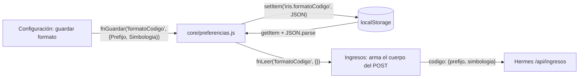

# localStorage

> Almacén clave-valor de texto del navegador, síncrono y persistente entre reinicios, ligado al origen de la página.

## Qué es y qué problema resuelve
`localStorage` guarda pares `clave → cadena` que sobreviven a recargas y a cerrar la aplicación. Sirve para preferencias locales pequeñas (ajustes de la estación de trabajo) sin necesidad de un backend.

En una app [[Electron]], los datos se guardan en el perfil de usuario de la app en esa PC: son **por máquina**, no por operador ni compartidos con otras PCs.

## Cómo funciona por dentro
- API: `getItem(clave)` (devuelve `null` si no existe), `setItem(clave, valor)`, `removeItem(clave)`, `clear()`, `key(i)`, `length`.
- Solo almacena **cadenas**: los objetos se guardan con `JSON.stringify` y se leen con `JSON.parse`.
- Es **síncrono**: bloquea el hilo principal mientras lee o escribe (aceptable para datos pequeños).
- Separado por **origen** (esquema + host + puerto). Con `file://` el origen es especial; todas las páginas locales de la app comparten el almacén.
- Cuota limitada (del orden de pocos MB por origen); `setItem` lanza `QuotaExceededError` si se excede. También puede lanzar si el almacenamiento está deshabilitado.
- No está cifrado: cualquiera con acceso al perfil o a la consola puede leerlo.



## Cuándo usarla y cuándo no
### Ventajas
- API mínima y disponible siempre, sin dependencias ni permisos.
- Persistente y local a la estación: ideal para "cómo está configurado este punto de operación".
### Desventajas
- Solo texto, síncrono y con poca capacidad.
- Sin esquema ni versionado: hay que tolerar formatos viejos a mano.
- Inseguro para secretos, tokens o datos personales.
- No se sincroniza entre PCs ni con el backend.

## Alternativas
| Alternativa | En qué se diferencia |
|---|---|
| `sessionStorage` | Misma API, pero se borra al cerrar la ventana/pestaña. |
| IndexedDB | Asíncrona, guarda objetos y grandes volúmenes, con índices; más compleja. |
| Archivo de configuración vía main de Electron (p. ej. `app.getPath('userData')`) | Controlado por el proceso principal; requiere IPC. |
| Guardar en el backend ([[SQLite]] de Hermes) | Centralizado y validado; sería la opción si el ajuste debe ser compartido o auditable. |
| Cookies | Viajan con cada petición HTTP; no aportan aquí. |

## Cómo se usó en Ocelotl
En [[Ocelotl.Iris]], `core/preferencias.js` envuelve `localStorage`:
- Prefija todas las claves con `iris.`.
- Serializa en JSON y, ante cualquier error (JSON corrupto, almacenamiento no disponible), devuelve el valor por defecto en lugar de romper.
- `fnGuardar` devuelve `true`/`false` para que la pantalla avise si no se pudo guardar.
- Su comentario lo limita a "ajustes del punto de operación, nunca datos sensibles": la sesión vive en Hermes (`core/sesion.js` solo la tiene en memoria) y el secreto de arranque llega por IPC (ver [[Preload y contextBridge]]).

`Ocelotl.Iris/src/core/preferencias.js`:
```js
const Prefijo = 'iris.'

export function fnLeer(Clave, ValorPorDefecto) {
    try {
        const Crudo = localStorage.getItem(Prefijo + Clave)
        return Crudo === null ? ValorPorDefecto : JSON.parse(Crudo)
    } catch {
        return ValorPorDefecto
    }
}
```

### Formato de códigos
Hoy el único uso es el formato de los códigos de ingreso ([[Formato de códigos de ingreso]]):
- **Clave**: `iris.formatoCodigo`.
- **Valor**: `{ "Prefijo": "OCL", "Simbologia": "Code128" }`. Simbologías permitidas: `Code128`, `DataMatrix`. Valores por defecto: `OCL` y `Code128`.
- **Validación del prefijo** al guardar (en `configuracion.handlers.js`, "igual que Hermes"): `/^[A-Z][A-Z0-9-]{0,9}$/` (1 a 10 caracteres, empieza con letra, solo A-Z, 0-9 y guion); se pasa a mayúsculas. La vista muestra un ejemplo como `OCL-000123`.
- **Compatibilidad**: antes se guardaba como `{ prefijo, simbologia }` (minúsculas); al leer se aceptan ambas formas.
- Se escribe desde Configuración y se lee en [[Ingresos]], que lo manda a Hermes con cada registro como `codigo: { prefijo, simbologia }`.

`Ocelotl.Iris/src/features/configuracion/configuracion.service.js`:
```js
export function fnFormatoCodigo() {
    const Guardado = Preferencias.fnLeer(ClavesPreferencias.FormatoCodigo, {})
    return {
        Prefijo: Guardado.Prefijo ?? Guardado.prefijo ?? FormatoPorDefecto.Prefijo,
        Simbologia: Guardado.Simbologia ?? Guardado.simbologia ?? FormatoPorDefecto.Simbologia
    }
}

export const fnGuardarFormatoCodigo = ({ Prefijo, Simbologia }) =>
    Preferencias.fnGuardar(ClavesPreferencias.FormatoCodigo, { Prefijo, Simbologia })
```

> [!note]
> La lectura del formato está **duplicada** a propósito en `configuracion.service.js` e `ingresos.service.js` ("pantalla autocontenida"): la clave `'formatoCodigo'` y los valores por defecto (`OCL`, `Code128`) se repiten en ambos. Si cambian, hay que cambiarlos en los dos.

> [!warning] Pendiente de confirmar
> Como el formato se guarda por PC, dos estaciones podrían registrar ingresos con prefijos distintos. No está claro en el código si eso es intencional o si en el futuro se centralizará en Hermes/[[Argo]].

> [!tip] Reutilizable
> `core/preferencias.js` (prefijo de app + JSON + `try/catch` con valor por defecto + `true/false` al guardar) es un envoltorio de 20 líneas reutilizable en cualquier frontend.

## Errores comunes y buenas prácticas
- Guardar objetos sin `JSON.stringify` → se guarda `"[object Object]"`.
- No proteger `JSON.parse`: un valor corrupto rompe la pantalla al arrancar.
- Guardar tokens, contraseñas o datos de pacientes: nunca en `localStorage`.
- Usar un prefijo por app para evitar choques de claves.
- Planear la migración de formatos (leer el viejo, escribir el nuevo), como hace Iris con `prefijo`/`Prefijo`.
- Validar lo leído: el usuario puede editarlo desde DevTools.

## Qué estudiar después
- [[Formato de códigos de ingreso]]
- IndexedDB y `sessionStorage`.
- [[Options pattern]] (cómo Hermes maneja su configuración del lado servidor).
- [[Preload y contextBridge]] (alternativa: guardar ajustes desde el main de Electron).

## Documentación oficial
- https://developer.mozilla.org/en-US/docs/Web/API/Window/localStorage
- https://developer.mozilla.org/en-US/docs/Web/API/Web_Storage_API

## Autoevaluación

Contesta primero en voz alta o en papel; luego despliega la respuesta.

> [!question]- ¿Qué diferencia hay entre `localStorage` y `sessionStorage`?
> Misma API. `localStorage` persiste hasta que se borre y se comparte entre pestañas del mismo origen. `sessionStorage` es por pestaña y se borra al cerrarla (sobrevive a recargas).

> [!question]- ¿Qué tipo de dato guarda?
> Solo strings: guarda objetos con `JSON.stringify` y léelos con `JSON.parse`, protegiendo con `try/catch` por si el valor está corrupto.

> [!question]- ¿Debes guardar tokens de sesión en `localStorage`?
> Es arriesgado: cualquier XSS puede leerlo. Si es posible, usa cookies `HttpOnly; Secure; SameSite`. Si lo guardas en el cliente, `sessionStorage` reduce la exposición pero no la elimina.

> [!question]- ¿Cómo te enteras de que otra pestaña cambió un valor?
> Con el evento `storage` en `window`; se dispara en las **otras** pestañas, no en la que hizo el cambio. Solo aplica a `localStorage`.

## Práctica

- [[Lab 5 - Lista de tareas con delegación de eventos]]

