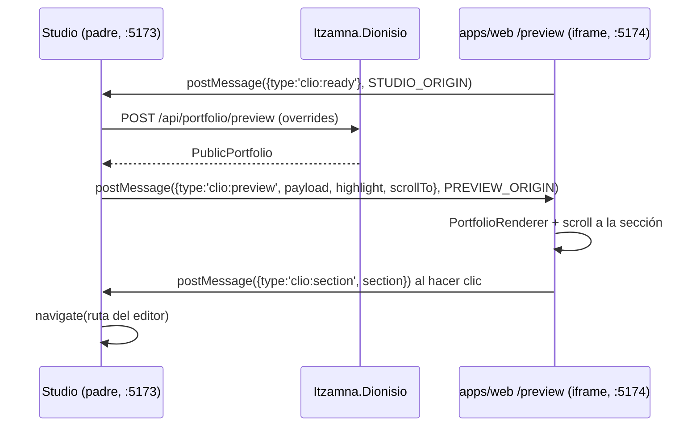

# postMessage e iframes

> `window.postMessage` permite que dos ventanas de orígenes distintos (una página y su iframe) se manden mensajes de forma segura, si cada lado indica y valida el origen.

## Qué es y qué problema resuelve
Un `<iframe>` de otro origen está aislado por la *same-origin policy*: el padre no puede leer ni tocar su DOM, y viceversa. Para cooperar (p. ej. un editor que muestra una vista previa en otra app) se usa `postMessage`:
- Emisor: `otraVentana.postMessage(datos, origenDestino)`.
- Receptor: `window.addEventListener('message', (e) => { e.origin; e.data; e.source })`.

Los datos se copian con *structured clone* (objetos, arreglos, fechas; no funciones). Además, el **servidor** del iframe decide quién puede incrustarlo con `frame-ancestors` (ver [[Content Security Policy]]) o `X-Frame-Options`.

## Cómo funciona por dentro
- `targetOrigin` en el emisor: el navegador solo entrega el mensaje si la ventana destino tiene ese origen. Con `'*'` lo recibe cualquiera.
- `e.origin` en el receptor: quién lo mandó. **Siempre** hay que compararlo con un origen esperado.
- Protocolo de "listo": el padre no sabe cuándo el iframe ya registró su listener; el iframe avisa (`ready`) y el padre envía entonces.



## Cuándo usarla y cuándo no
### Ventajas
- Aislamiento real: la vista previa corre con su propio CSS y JS, igual que el sitio público.
- Comunicación explícita y tipable (mensajes con `type`).
- Funciona entre dominios distintos.
### Desventajas
- Hay que validar origen y forma del mensaje en ambos lados.
- Asíncrono y sin respuesta directa: se arma un pequeño protocolo (`ready`, reintentos).
- Escalar y medir el iframe (dispositivo simulado) es trabajo extra.

## Alternativas
| Alternativa | En qué se diferencia |
|---|---|
| Renderizar la plantilla dentro del mismo Studio | Sin iframe; el CSS de la plantilla y del Studio pueden chocar. |
| `iframe src` con datos en la URL | Recarga completa en cada cambio; límite de tamaño de URL. |
| `BroadcastChannel` | Solo mismo origen. |
| MessageChannel (puertos) | Canal dedicado tras un primer `postMessage`; útil para mucho tráfico. |
| IPC de Electron (en [[Ocelotl.Iris]], ver [[Preload y contextBridge]]) | Otro contexto: comunicación página ↔ proceso principal, no entre orígenes web. |

## Cómo se usó en Itzamna
Es la base de [[Vista previa en vivo]]. El Studio (`apps/studio/src/layout/PreviewPane.tsx`) incrusta `${VITE_PUBLIC_SITE_URL}/preview` y el sitio público (`apps/web/src/PreviewPage.tsx`) pinta el portfolio con la **misma plantilla** que ve el visitante.

| Mensaje | Dirección | Contenido |
|---|---|---|
| `clio:ready` | iframe → Studio | El iframe ya escucha |
| `clio:preview` | Studio → iframe | `payload` (`PublicPortfolio` armado por la API con los cambios sin guardar), `highlight`, `scrollTo` |
| `clio:section` | iframe → Studio | Sección clicada; el Studio navega a su editor |

Validación en el iframe (`Itzamna.Clio/apps/web/src/PreviewPage.tsx`):
```tsx
const onMessage = (e: MessageEvent) => {
  if (e.origin !== STUDIO_ORIGIN) return;
  const msg = e.data as PreviewMessage;
  if (msg?.type !== 'clio:preview' || !msg.payload) return;
  setData(msg.payload);
  setHighlight(msg.highlight ?? null);
  // ...
};
window.addEventListener('message', onMessage);
window.parent?.postMessage({ type: 'clio:ready' }, STUDIO_ORIGIN);
```

Envío desde el Studio con origen explícito (`Itzamna.Clio/apps/studio/src/layout/PreviewPane.tsx`):
```tsx
frame.current?.contentWindow?.postMessage(
  { type: 'clio:preview', payload: last.current, highlight: activeFocus, scrollTo },
  PREVIEW_ORIGIN,
);
```

Detalles:
- Orígenes por variable: `VITE_STUDIO_ORIGIN` en web y `new URL(VITE_PUBLIC_SITE_URL).origin` en Studio ([[Vite]]).
- `onLoad` del iframe pone `ready = false`; hasta el siguiente `clio:ready` no se envía nada.
- La petición de vista previa espera 350 ms tras el último cambio y cancela la anterior con [[AbortController]].
- `scrollTo` reintenta cada 50 ms (hasta 40 veces) porque la plantilla se carga con `lazy`.
- El iframe se escala con `transform: scale()` y un `ResizeObserver` para simular 1280/820/390 px.
- Encabezados: `apps/web` manda `Content-Security-Policy: frame-ancestors 'self' https://…azurestaticapps.net` y `X-Robots-Tag: noindex` en `/preview`; el Studio manda `X-Frame-Options: DENY` (nadie lo puede incrustar). Ver [[Content Security Policy]] y [[Azure Static Web Apps]].

> [!warning] Diferencia con la documentación
> `.ai/01_ARCHITECTURE.md` nombra los mensajes `cp:preview`, `cp:ready` y `cp:section`, pero el código usa `clio:preview`, `clio:ready` y `clio:section`. Vale el código.

> [!note] Pendiente de confirmar
> El origen permitido para incrustar `/preview` está escrito a mano en `apps/web/public/staticwebapp.config.json` (`frame-ancestors`), separado de `VITE_STUDIO_ORIGIN`: si cambia el dominio del Studio hay que actualizar ambos. El Studio no valida la forma de `clio:section` más allá de buscar la sección en `sectionInfo`.

> [!tip] Reutilizable
> El protocolo `ready → preview → section` con validación de origen en ambos lados sirve para cualquier editor con vista previa en iframe.

## Errores comunes y buenas prácticas
- `postMessage(datos, '*')`: cualquier página que incruste o abra la tuya recibe los datos. Indica siempre el origen.
- No validar `e.origin`: cualquier sitio puede mandarte mensajes falsos.
- Enviar antes de que el iframe esté listo: el mensaje se pierde. Usa un mensaje `ready`.
- Olvidar `frame-ancestors`/`X-Frame-Options`: tu página puede ser incrustada por otros (clickjacking).
- Quitar el listener al desmontar (limpieza del `useEffect`).

## Qué estudiar después
- [[Content Security Policy]] (`frame-ancestors`)
- `sandbox` y `allow` en `<iframe>`
- MessageChannel
- Clickjacking (OWASP)

## Documentación oficial
- https://developer.mozilla.org/en-US/docs/Web/API/Window/postMessage
- https://developer.mozilla.org/en-US/docs/Web/HTML/Element/iframe
- https://developer.mozilla.org/en-US/docs/Web/HTTP/Headers/Content-Security-Policy/frame-ancestors

## Autoevaluación

Contesta primero en voz alta o en papel; luego despliega la respuesta.

> [!question]- ¿Para qué sirve `postMessage`?
> Para comunicar de forma segura ventanas de orígenes distintos (página e iframe, ventana y popup, o con un worker).

> [!question]- ¿Qué dos validaciones son obligatorias?
> Al enviar, indicar el `targetOrigin` exacto (no `'*'` si hay datos sensibles). Al recibir, comprobar `event.origin` contra una lista permitida y validar la forma de `event.data`.

> [!question]- ¿Qué hace el atributo `sandbox` de un iframe?
> Lo aísla por defecto (sin scripts, formularios, popups ni mismo origen); habilitas solo lo necesario con `allow-scripts`, etc. No combines `allow-scripts` con `allow-same-origin` para contenido no confiable del mismo origen: podría quitarse el sandbox.

