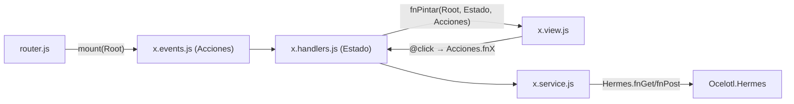

# Molde Service-View-Handlers-Events

> Cada pantalla de Iris se parte en seis archivos con una responsabilidad cada uno: estructura, estilos, datos, vista, lógica y cableado.

> [!tip] Reutilizable
> El molde no depende de Ocelotl: sirve para cualquier front en JavaScript puro + [[lit-html]] (o similar) que quiera migrar después a React. Basta copiar `features/configuracion`, el contrato `Acciones` y las reglas de nombres.

## Qué es y qué problema resuelve
En el iris anterior la lógica, el DOM y las llamadas al backend se mezclaban. El molde separa una pantalla en piezas con fronteras estrictas ("hace / no hace"), de modo que cada archivo se entiende solo, se cambia sin romper los demás y se traduce casi 1:1 a un componente de React.

## Cómo funciona por dentro
| Archivo | Hace | No hace |
|---|---|---|
| `x.html` | Estructura estática y contenedores con `id` (PascalCase) | Lógica, `onclick`, scripts o estilos inline |
| `x.css` | Estilos, todos colgando de `.pagina-x` | |
| `x.service.js` | Sus propios endpoints (`EndPoint` congelado), recibe **un objeto** (`{ Ip, Puerto, Signal }`), mapea nombres del API y normaliza (`?? []`) | DOM, toasts, importar el service de otra pantalla |
| `x.view.js` | Funciones puras `(Estado, Acciones) ⇒ html\`...\`` y `fnPintar(Root, Estado, Acciones)` | Llamar a Hermes, cambiar el estado, importar el handler |
| `x.handlers.js` | `Estado`, `fnActualizar()` y las acciones: validar, llamar al service, avisar (`Toast`), actualizar | Registrar eventos, armar HTML |
| `x.events.js` | Arma `Acciones`, `mount(Root)` / `unmount()` y suscripciones a `RobotEvents` | Lógica de cualquier tipo |

**Ciclo**: el router carga `x.html`, `x.css` y `x.events.js` → `mount(Root)` crea un [[AbortController]] y llama a `Handler.fnIniciar(Root, { Signal, Acciones })` → el handler pinta con la vista → un `@click` llama a `Acciones.fnX` → el handler cambia `Estado` con `fnActualizar` y vuelve a pintar (lit-html solo toca lo que cambió) → `unmount()` hace `abort()`.



### Acciones: el contrato vista → handler
`events.js` declara lo único que la vista puede disparar y se lo pasa por parámetro (`Ocelotl.Iris/src/features/configuracion/configuracion.events.js`):

```js
const Acciones = Object.freeze({
    fnRecargar: ConfiguracionHandler.fnCargarRobots,
    fnEscribirIp: ConfiguracionHandler.fnEscribirIp,
    fnConectar: ConfiguracionHandler.fnConectar,
    fnDesconectar: ConfiguracionHandler.fnDesconectar,
    // ...
})
```

Por qué no `data-accion` + delegación (README de Iris): no hay textos que despachar ni `switch`, los valores viajan con su tipo, "ir a la definición" lleva al handler, y en React es exactamente `onClick={() => desconectar(robot.robotId)}`.

## Cuándo usarla y cuándo no
Úsalo para pantallas con estado, formularios y llamadas al backend. Para una pantalla puramente estática basta `x.html` + `x.events.js` (como `en-construccion`); `inicio` no tiene service porque usa lo del core.

### Ventajas
- Fronteras claras: se sabe dónde va cada línea.
- Vista pura: fácil de leer y de pasar a JSX.
- Cancelación uniforme al salir de la pantalla.
- Pantallas autocontenidas: borrar una carpeta no rompe otra.

### Desventajas
- Seis archivos para pantallas pequeñas.
- Estado a nivel de módulo (`let Estado`): una sola instancia por pantalla.
- Duplicación deliberada de endpoints entre pantallas.

## Alternativas
| Alternativa | En qué se diferencia |
|---|---|
| React (componente + hook) | El destino previsto; estado y efectos gestionados por el framework. |
| Web Components / Lit `LitElement` | Estado encapsulado en un custom element; el molde usa solo plantillas de lit-html. |
| MVC/MVVM clásico | Similar separación, pero con *bindings* o controladores con estado. |
| Delegación con `data-accion` | Un listener por contenedor y un `switch` por texto; descartado. |

## Cómo se usó en Ocelotl
Todas las pantallas de [[Ocelotl.Iris]] en `src/features/` (`login`, `inicio`, `ingresos`, `dispensar`, `configuracion`, `reportes`, `soporte`); la referencia es `configuracion`. Lo usan [[Conexión de robots]], [[Ingresos]], [[Dispensar]], [[Stock e inventario]], [[Historial de salidas]], [[Soporte y estado del sistema]], [[Sesión y roles]] (login). Ver también [[Ocelotl.Iris - Arquitectura]].

Ejemplo de acción en el handler (`Ocelotl.Iris/src/features/configuracion/configuracion.handlers.js`):

```js
export async function fnConectar() {
    if (Estado.Conexion.isEnviando) return
    // ... validación con retorno temprano
    const SignalAccion = Signal
    fnActualizarConexion({ isEnviando: true })
    try {
        const Resultado = await ConfiguracionService.fnConectarRobot({ Ip, Puerto, Signal: SignalAccion })
        if (SignalAccion?.aborted) return
```

**Reglas** (README de Iris):
- `unmount()` hace `Controlador.abort()`: quita suscripciones a `RobotEvents` y cancela peticiones; si llega `fnEsCancelado(error)`, la acción sale sin avisar.
- Una pantalla nunca importa el service de otra; lo del core vive en `core/app.service.js`.
- Solo los `*.service.js` llaman a `Hermes.fnGet/fnPost/...`.
- Sin literales sueltos dentro de funciones: `Mensajes` (dinámicos como flechas), `Reglas`, `Selectores`, `Limites`, `EndPoint`, todos con `Object.freeze`.
- Retorno temprano; `isEnviando` evita el doble envío (ver [[Idempotencia]]).
- Nada de `window.App`, `alert`, `confirm`, `innerHTML` con datos del API ni datos inventados.

**Origen: guía de estilo GMM.** El README dice "Basado en la guía GMM, adaptado a módulos ES y lit-html": funciones `fn` + PascalCase, variables/constantes/parámetros en PascalCase (también en callbacks), booleanos con `is`, plantillas con prefijo `html`, bloques de constantes congelados con `Object.freeze`, 4 espacios, **sin punto y coma**, comillas simples, `==`, `if` de una línea sin llaves, separadores `// ───── Sección ─────`. `mount`/`unmount` equivalen al `init()` de GMM. El documento original de la guía GMM no está en el repositorio: qué reglas exactas vienen de ella y cuáles se añadieron es pendiente de confirmar.

**Camino a React** (README de Iris):
| Hoy | En React |
|---|---|
| `x.service.js` | Se queda igual |
| `x.handlers.js` | Hook `useX()` con `useState` / `useReducer` |
| `x.view.js` | El JSX del componente |
| `Acciones` + `@click=${...}` | Props `onClick` / `onChange` |
| `mount` / `unmount` con `AbortController` | `useEffect` con su limpieza |
| `core/router.js` + `rutas.js` | React Router con `Layout` y `<Outlet />` |

**Agregar una pantalla**: copiar `features/configuracion` a `features/<nueva>`, renombrar con el prefijo y agregarla a `core/rutas.js` (`Path`, `Feature`, `Titulo`, `Icono`, `Roles`).


**Comparación con [[Itzamna.Clio]]** (no usa este molde, es [[React]]): `x.service.js` ≈ `api/hooks.ts` ([[TanStack Query]]), `x.handlers.js` ≈ `lib/useDraftForm.ts`, `x.view.js` ≈ el JSX de `pages/X.tsx`, `core/router.js` ≈ [[React Router]] con `Shell` + `<Outlet />`.

## Errores comunes y buenas prácticas
- **La vista importa el handler** o llama a Hermes: rompe el contrato; todo pasa por `Acciones`.
- **No guardar el Signal de la acción**: una respuesta vieja pisa el estado de una pantalla nueva.
- **Olvidar `Signal` en `RobotEvents.fnSuscribir`**: la suscripción sobrevive a la pantalla. Solo es deliberado en `dispensar.events.js` (`DispensadoTerminado` fuera de `mount`).
- **Literales sueltos** (mensajes, rutas) dentro de funciones: muévelos a constantes congeladas.
- Mantener `fnActualizar` como único camino para cambiar `Estado` (inmutable, con spread).

## Qué estudiar después
- [[Componentes controlados]]
- [[lit-html]] y [[SPA y router por hash]]
- [[AbortController]]
- [[Eventos de dominio y reacciones]] (lado Iris: `robot.events.js`)
- [[Vertical Slice Architecture]] (la carpeta por pantalla)
- Hooks de React (`useState`, `useReducer`, `useEffect`)

## Documentación oficial
- https://lit.dev/docs/libraries/standalone-templates/
- https://react.dev/learn/reusing-logic-with-custom-hooks

## Autoevaluación

Contesta primero en voz alta o en papel; luego despliega la respuesta.

> [!question]- ¿Qué responsabilidad tiene cada capa del molde?
> **Service**: habla con la API (fetch, errores HTTP), sin DOM. **View**: recibe estado y devuelve/pinta HTML, sin lógica de negocio ni fetch. **Handlers**: reciben acciones de la vista, llaman servicios y actualizan el estado. **Events**: conectan los eventos del DOM (por delegación) con los handlers.

> [!question]- Caso: necesitas mostrar un spinner mientras se guarda. ¿En qué capa va cada parte?
> El handler pone `cargando = true` en el estado y llama al service; la view pinta el spinner según `cargando`; al terminar (en `finally`) el handler lo regresa a `false` y vuelve a pintar.

> [!question]- ¿Qué señal te indica que estás rompiendo el molde?
> Un `fetch` dentro de la vista, `document.querySelector` dentro del service, o un handler que arma HTML a mano. Cada capa debería poder probarse sin las otras.

