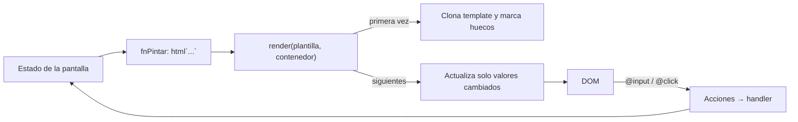

# lit-html

> Librería pequeña de plantillas HTML declarativas con *tagged template literals* que actualiza solo las partes del DOM que cambiaron.

## Qué es y qué problema resuelve
lit-html es el motor de plantillas de Lit, usable por separado y sin componentes web. Escribes la vista como una función del estado (`html\`...\``) y llamas a `render(plantilla, contenedor)` cada vez que el estado cambia; lit-html no reconstruye el DOM, solo actualiza los valores dinámicos.

Resuelve el problema de "pintar a mano" con `innerHTML` (inseguro y destruye el foco y el estado de los inputs) o con `createElement` (verboso), sin traer un framework completo ni un paso de compilación (no hay JSX).

Versión usada en Iris: lit-html `^3.2.1`.

## Cómo funciona por dentro
- `html` es una *tag function*: recibe las partes estáticas del template literal y los valores `${...}` por separado.
- La primera vez crea un `<template>` con marcadores en los huecos y lo clona; recuerda dónde está cada hueco (*parts*).
- En los `render` siguientes con la misma plantilla, solo compara y escribe los valores que cambiaron.
- Tipos de enlace: contenido `${x}`, atributo `class=${x}`, booleano `?disabled=${x}`, propiedad `.value=${x}` y evento `@click=${fn}`.
- Los valores de texto se escapan: no se interpreta HTML (protección contra XSS).
- `nothing` representa "no pintar nada" (y quita el atributo si se usa en uno).
- **Directivas** que usa Iris:
  - `repeat(items, key, plantilla)`: listas con clave estable; mueve nodos en vez de recrearlos.
  - `live(valor)`: compara contra el valor real del DOM (útil en `.value` de inputs que el usuario edita).
  - `classMap({ clase: bool })`: aplica clases según un objeto.
  - `ref(callback)`: da acceso al elemento real del DOM.



## Cuándo usarla y cuándo no
### Ventajas
- Muy ligera, sin compilador: funciona como ES module nativo con import map (ver [[ES Modules e import maps]]).
- Escapa el contenido por defecto.
- Actualizaciones eficientes y conserva foco/selección de inputs.
- Encaja con vistas "función pura del estado" (ver [[Componentes controlados]]).
### Desventajas
- No trae estado, ciclo de vida, router ni store: hay que organizarlos a mano (Iris lo hace con su [[Molde Service-View-Handlers-Events]]).
- Sin tipado de plantillas ni verificación en compilación: errores de atributos se ven en ejecución.
- Hay que entender cuándo usar `.prop`, `?attr` y `live`, o aparecen bugs sutiles.

## Alternativas
| Alternativa | En qué se diferencia |
|---|---|
| Lit (LitElement) | Agrega Web Components con estado reactivo y ciclo de vida sobre lit-html. |
| React / Preact | Virtual DOM y JSX (requiere compilación); ecosistema mucho más grande. |
| Vue / Svelte | Frameworks completos con compilador y reactividad propia. |
| `innerHTML` / DOM manual | Sin dependencias, pero inseguro o verboso y pierde estado de inputs. |
| uhtml / hyperHTML | Ideas muy parecidas (template literals), comunidades más pequeñas. |

## Cómo se usó en Ocelotl
En [[Ocelotl.Iris]] lit-html se importa como `'lit-html'` desde `node_modules` y [[Vite]] lo empaqueta (desde el 2026-11-08; antes se copiaba a `src/vendor/` y se resolvía con un import map).

- **`features/*/*.view.js`**: cada pantalla tiene una función `fnPintar` que llama `render(...)` sobre varios contenedores del HTML de la pantalla (p. ej. Configuración pinta formulario de conexión, lista de robots y formato de códigos). Pantallas: [[Panel de Inicio]], [[Ingresos]], [[Dispensar]], [[Conexión de robots]], [[Stock e inventario]] / reportes, [[Soporte y estado del sistema]].
- **`shared/components/`**: componentes como funciones que devuelven plantillas (`fnUiInput`, `fnUiSelect`, `fnUiButton`, `fnUiTabs`, `fnUiPaginacion`, `fnUiModal`, `fnUiPendiente`). Son controlados: reciben el valor y emiten eventos (ver [[Componentes controlados]]).
- **`core/layout.js`**: header, sidebar y footer se montan una vez y se re-renderizan cuando cambia la sesión, la conexión de SignalR o el estado de un robot.
- **`shared/toast.js`**: lista de toasts con `repeat`.

Lista con clave estable (`Ocelotl.Iris/src/features/configuracion/configuracion.view.js`):
```js
${repeat(Robots, (Robot) => Robot.robotId, (Robot) => fnFilaRobot(Robot, Desconectando, Acciones))}
```

Input controlado con `live`, `classMap`, `nothing` y eventos (`Ocelotl.Iris/src/shared/components/ui-input.js`):
```js
<input
    class='ui-input__control'
    id=${Id}
    type=${Tipo}
    .value=${live(String(Valor ?? ''))}
    maxlength=${MaxLength ?? nothing}
    ?disabled=${isDeshabilitado}
    aria-invalid=${MensajeError ? 'true' : 'false'}
    @input=${(e) => fnAlEscribir?.(e.target.value, e)}
/>
```

`ref` se usa en `shared/components/ui-modal.js` para llamar `showModal()` / `close()` sobre el `<dialog>` real (ver [[Elemento dialog]]).

Layout re-renderizable (`Ocelotl.Iris/src/core/layout.js`):
```js
render(fnHeader(SesionActual, RobotEvents.fnObtenerEstados()), Header)
render(SesionActual ? fnSidebar(fnMenu()) : nothing, Sidebar)
render(fnFooter(), Footer)
```

> [!tip] Reutilizable
> Los componentes de `shared/components/` (funciones puras que devuelven plantillas) y el patrón "estado → fnPintar → render en varios contenedores" se pueden copiar a cualquier app sin bundler.

## Errores comunes y buenas prácticas
- Usar `.value=${...}` (propiedad) y no `value=${...}` (atributo) en inputs; con estado controlado, envolver en `live()`.
- Dar a `repeat` una clave única y estable (un id, no el índice).
- Usar `nothing` en vez de `''` o `undefined` para omitir atributos opcionales.
- No mezclar `innerHTML` manual sobre un contenedor que lit-html ya controla.
- Las funciones de evento inline se recrean en cada render; es correcto, pero no las uses como identidad para comparar.
- Mantener las vistas sin lógica de negocio: reciben estado y `Acciones`, nada más.

## Qué estudiar después
- [[Componentes controlados]]
- [[Molde Service-View-Handlers-Events]]
- [[Elemento dialog]]
- [[ES Modules e import maps]]
- Web Components y Lit (LitElement) si se quisieran componentes con estado propio.
- Tagged template literals de JavaScript.

## Documentación oficial
- https://lit.dev/docs/libraries/standalone-templates/
- https://lit.dev/docs/templates/overview/
- https://lit.dev/docs/templates/expressions/
- https://lit.dev/docs/templates/directives/

## Autoevaluación

Contesta primero en voz alta o en papel; luego despliega la respuesta.

> [!question]- ¿Qué hace `render(template, contenedor)` en lit-html al llamarlo varias veces?
> La primera vez crea el DOM; las siguientes solo actualiza las partes dinámicas (`${...}`) que cambiaron, sin recrear todo. Por eso puedes repintar la vista completa en cada cambio de estado.

> [!question]- ¿Qué significan los prefijos `@`, `.` y `?` en una plantilla?
> `@click=${fn}`: listener de evento. `.value=${v}`: asigna la **propiedad** (no el atributo). `?disabled=${bool}`: atributo booleano que se pone o quita.

> [!question]- ¿Es seguro interpolar texto del usuario?
> Sí: lit-html inserta los valores como texto, no como HTML. Solo `unsafeHTML` lo interpreta; úsalo únicamente con contenido sanitizado.

