# Debounce y throttle

Parte de: [[04-JavaScript-Web/06 Avanzado/_Índice Avanzado|Avanzado]]

> [!info] Cómo avanzar
> `progreso`: **pendiente** → **viendo** (estudiando) → **visto** (contestaste la autoevaluación sin abrir las respuestas) → **dominado** (hiciste el laboratorio o lo aplicaste de verdad).

## Contenido

### Qué es
Son dos técnicas para **limitar cuántas veces se ejecuta una función** que se dispara muy seguido (al escribir, hacer scroll, redimensionar, mover el mouse):
- **Debounce** ("rebote"): espera a que los eventos **dejen de llegar** durante `ms` milisegundos y entonces ejecuta **una vez**. Cada evento nuevo reinicia la cuenta. Ideal para "cuando el usuario termine de escribir, busca".
- **Throttle** ("estrangular"): ejecuta **como máximo una vez cada `ms`**, aunque lleguen muchos eventos. Ideal para "mientras hace scroll, actualiza la posición, pero no 200 veces por segundo".

Ambas se construyen con [[Timers]] y [[Closures]]: la función envuelta recuerda su timer o su última ejecución entre llamadas.

### Cómo funciona
#### Debounce (al final, *trailing*)
1. Llega un evento: si hay un timer pendiente, se cancela.
2. Se programa un timer nuevo de `ms`.
3. Si en ese lapso llega otro evento, vuelve al paso 1.
4. Si el lapso termina sin eventos, se ejecuta la función con los **últimos** argumentos.

#### Throttle (al inicio, *leading*)
1. Llega un evento: si pasaron `ms` desde la última ejecución, se ejecuta ya.
2. Si no, se ignora (o, en variantes con *trailing*, se agenda una última ejecución al final del intervalo para no perder el valor final).

#### Ejemplo de línea de tiempo
Con `debounce(fn, 300)` y eventos en t = 0, 100, 200 y 700 ms:
- El evento de 0 programa para 300; el de 100 lo reinicia a 400; el de 200 a **500**. Entre 200 y 500 no llega nada: `fn` corre en **t = 500**.
- El evento de 700 programa para **1000**; no llega más: `fn` corre en t = 1000.
- Total: **2 ejecuciones**.

Con `throttle(fn, 300)` (leading) y los mismos eventos: corre en 0, ignora 100 y 200, y corre en 700 (pasaron más de 300 ms).

```mermaid
gantt
    dateFormat x
    axisFormat %L ms
    section Eventos
    e0   :milestone, 0, 0
    e100 :milestone, 100, 100
    e200 :milestone, 200, 200
    e700 :milestone, 700, 700
    section Debounce 300
    espera :200, 500
    ejecuta :milestone, 500, 500
    espera2 :700, 1000
    ejecuta2 :milestone, 1000, 1000
```



### Ejemplo
Implementaciones mínimas:

```js
export function debounce(fn, ms) {
  let id;
  const envuelta = function (...args) {
    clearTimeout(id);
    id = setTimeout(() => fn.apply(this, args), ms);
  };
  envuelta.cancelar = () => clearTimeout(id);
  return envuelta;
}

export function throttle(fn, ms) {
  let ultima = -Infinity;
  return function (...args) {
    const ahora = performance.now();
    if (ahora - ultima >= ms) {
      ultima = ahora;
      fn.apply(this, args);
    }
  };
}
```

Buscador de clientes en Itzamna.Clio. Además del debounce, hay que **cancelar la petición anterior**: si la respuesta de "an" llega después que la de "ana", pintarías resultados viejos.

```js
import { debounce } from './utilidades.js';

const input = document.querySelector('#buscar');
let control;

async function buscar(texto) {
  control?.abort();                         // cancela la búsqueda anterior
  if (texto.length < 2) return pintar([]);
  control = new AbortController();
  try {
    const r = await fetch(`/api/clientes?q=${encodeURIComponent(texto)}`, { signal: control.signal });
    pintar(await r.json());
  } catch (err) {
    if (err.name !== 'AbortError') mostrarError(err);
  }
}

const buscarConPausa = debounce(buscar, 300);  // se crea UNA vez
input.addEventListener('input', (e) => buscarConPausa(e.target.value.trim()));
```

Throttle para una barra de progreso de lectura:

```js
window.addEventListener('scroll', throttle(() => {
  const avance = scrollY / (document.documentElement.scrollHeight - innerHeight);
  barra.style.transform = `scaleX(${avance})`;
}, 100), { passive: true });
```

En el caso de una búsqueda, también ayuda un **mínimo de caracteres**, una **caché** de resultados por texto y que la API tenga índices adecuados en SQL Server.

### Cuándo usar cada uno
| Situación | Técnica |
|---|---|
| Buscar o validar al terminar de escribir | Debounce |
| Guardar borrador automático | Debounce (con un máximo de espera) |
| Recalcular layout al terminar `resize` | Debounce |
| Posición de scroll, arrastre, `pointermove` | Throttle o `requestAnimationFrame` |
| Evitar doble clic en "Pagar" | Ni uno ni otro: deshabilita el botón mientras se procesa |

Para trabajo visual por cuadro, `requestAnimationFrame` es un "throttle" natural sincronizado con el pintado. Librerías como Lodash traen versiones completas con `leading`, `trailing` y `maxWait`.

### Errores comunes
- **Crear el debounce dentro del handler**: `input.addEventListener('input', () => debounce(buscar, 300)())` crea una función nueva con su propio timer en cada evento; ninguna cancela a la anterior y se ejecutan **todas**, solo que retrasadas. Créalo una vez, afuera.
- **No cancelar peticiones en vuelo**: el debounce reduce llamadas, pero no evita respuestas desordenadas.
- **Perder `this` o los argumentos**: usa `function` y `apply` como arriba si el método depende de `this`.
- **No limpiar al desmontar**: un debounce pendiente puede ejecutarse sobre una vista que ya no existe; expón `cancelar()` y llámalo.
- **Debounce demasiado largo** en búsquedas: más de 300–400 ms se siente lento.

### Para profundizar
- [MDN: Glosario: Debounce](https://developer.mozilla.org/en-US/docs/Glossary/Debounce)
- [MDN: Glosario: Throttle](https://developer.mozilla.org/en-US/docs/Glossary/Throttle)
- [Lodash: debounce](https://lodash.com/docs/#debounce)

## Ejercicios

Resuélvelos en papel o en la herramienta; la solución está plegada.

> [!question]- Implementa `debounce(fn, ms)`.
> ```js
> function debounce(fn, ms) {
>   let t;
>   return (...args) => {
>     clearTimeout(t);
>     t = setTimeout(() => fn(...args), ms);
>   };
> }
> ```

> [!question]- Implementa `throttle(fn, ms)` (ejecuta al inicio y luego como máximo cada `ms`).
> ```js
> function throttle(fn, ms) {
>   let ultimo = 0;
>   return (...args) => {
>     const ahora = Date.now();
>     if (ahora - ultimo >= ms) {
>       ultimo = ahora;
>       fn(...args);
>     }
>   };
> }
> ```

> [!question]- Con `debounce(fn, 300)`, eventos en t = 0, 100, 200 y 700 ms. ¿Cuántas veces y cuándo corre `fn`?
> 2 veces: a los 500 ms (300 después del evento de 200) y a los 1000 ms.

## Autoevaluación

Contesta primero en voz alta o en papel; luego despliega la respuesta.

> [!question]- ¿Qué diferencia hay entre debounce y throttle?
> **Debounce**: ejecuta solo cuando pasó un tiempo **sin nuevos eventos** (buscar al dejar de teclear). **Throttle**: ejecuta como máximo una vez por intervalo mientras siguen llegando (scroll, resize, arrastrar).

> [!question]- Caso: buscador que llama a la API en cada tecla. ¿Qué aplicas además de debounce?
> Cancelar la petición anterior con `AbortController` para que una respuesta vieja no pise a la nueva.

> [!question]- ¿Qué pasa si creas el debounce dentro del handler en cada evento?
> Cada evento crea un debounce nuevo con su propio temporizador: no se agrupa nada. Créalo una vez y reutilízalo.

## Práctica

- [[Lab 4 - fetch con AbortController y manejo de errores]]

