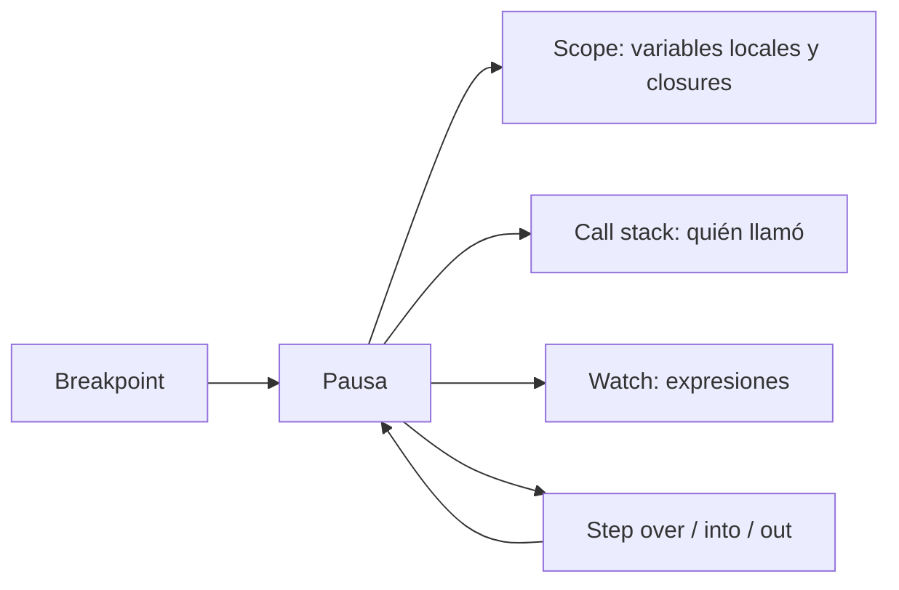

# Depuración con DevTools

Parte de: [[04-JavaScript-Web/06 Avanzado/_Índice Avanzado|Avanzado]]

> [!info] Cómo avanzar
> `progreso`: **pendiente** → **viendo** (estudiando) → **visto** (contestaste la autoevaluación sin abrir las respuestas) → **dominado** (hiciste el laboratorio o lo aplicaste de verdad).

## Contenido

### Qué es
Las **DevTools** son las herramientas de desarrollo integradas en el navegador (Chrome y Edge comparten la base de Chromium; Firefox y Safari tienen las suyas). Permiten inspeccionar el DOM y el CSS, ejecutar código en la consola, pausar el JavaScript paso a paso, ver cada petición de red, medir rendimiento y memoria, y revisar almacenamiento y service workers. Dominarlas ahorra horas frente a llenar el código de `console.log`.

### Cómo funciona
Paneles principales:
- **Elements**: árbol del DOM en vivo, estilos aplicados y su origen, box model, eventos registrados en cada nodo.
- **Console**: registros, errores y una consola para evaluar expresiones en el contexto actual (incluso mientras estás pausado).
- **Sources**: archivos cargados, breakpoints, ejecución paso a paso, *source maps* (para ver tu TypeScript original en lugar del JS generado).
- **Network**: cada petición con estado, encabezados, cuerpo enviado, respuesta, tiempos y su iniciador.
- **Performance**: graba una sesión y muestra qué hizo el hilo principal (scripts, estilo, layout, paint) cuadro por cuadro.
- **Memory**: snapshots del heap para encontrar [[Fugas de memoria]].
- **Application**: `localStorage`, cookies, IndexedDB, caché y [[Service Workers y PWA]].
- **Lighthouse**: auditorías de rendimiento, accesibilidad y SEO.

#### Tipos de breakpoints
Además del de línea (clic en el número de línea):
- **Condicional**: se detiene solo si una expresión es verdadera (`pedido.total > 10000`).
- **Logpoint**: imprime un mensaje en la consola sin detenerse y sin tocar el código.
- **De DOM**: al modificarse el subárbol, un atributo o al eliminarse un nodo (clic derecho en Elements → *Break on*). Útil para "¿quién está cambiando esto?".
- **De XHR/fetch**: cuando la URL de una petición contiene un texto.
- **De event listener**: al ejecutarse cualquier handler de un tipo (`click`, `keydown`, timers).
- **De excepciones**: pausa en excepciones no capturadas o en todas.
- **De función**: `debug(nombreFuncion)` en la consola pausa cuando se llame.

La instrucción `debugger;` en el código actúa como un breakpoint de línea **si las DevTools están abiertas**; si están cerradas, no hace nada. No la dejes en producción (un linter puede prohibirla).



### Ejemplo
Depurar "el guardado de un pedido falla a veces" en Itzamna.Clio contra la API:

1. **Network**: filtra por `Fetch/XHR`, reproduce el error y abre la petición. Revisa el **método y la URL**, la pestaña **Payload** (¿el cuerpo es JSON con los campos esperados?), los **encabezados** (`Content-Type`, `Authorization`) y la **respuesta**: un 400 con ProblemDetails te dice el `codigo` y los errores de FluentValidation; un 401 apunta a un token vencido; un error de CORS aparece en la consola.
2. En la columna **Initiator** haz clic para ir a la línea que hizo la petición.
3. Pon un **breakpoint condicional** en la función que arma el cuerpo: `!pedido.clienteId`.
4. Al pausar, revisa **Scope** y **Call stack** para ver de dónde vino el valor vacío.
5. Usa **Step over** (F10) y **Step into** (F11) para avanzar.
6. Desde la petición, clic derecho → **Copy as fetch** o **Copy as cURL** para reproducirla aislada.

Utilidades de la consola (solo funcionan escritas en la consola, no en tu código):

```js
$0                         // el elemento seleccionado en Elements
$('button.primario')       // atajo de querySelector
$$('tr[data-id]').length   // querySelectorAll como arreglo
getEventListeners($0)      // listeners registrados en el nodo
monitorEvents(window, 'resize')
copy(JSON.stringify(datos)) // copia al portapapeles
queryObjects(Promise)      // instancias vivas de un constructor
```

Y métodos de `console` que sí van en el código durante desarrollo:

```js
console.table(clientes, ['id', 'nombre']);
console.time('render'); pintar(datos); console.timeEnd('render');
console.group('Carga del tablero'); console.log(paso1); console.groupEnd();
console.assert(total >= 0, 'Total negativo', { total });
```

### Cuándo usarlo y cuándo no
- **Breakpoints** en lugar de `console.log` cuando no sabes dónde está el problema: ves todo el estado sin recompilar.
- **Logpoints** cuando pausar rompe el flujo (animaciones, eventos de foco).
- **Network** primero para cualquier bug "de API": la mayoría se aclara viendo petición y respuesta.
- Activa **Disable cache** con DevTools abiertas mientras desarrollas, y **throttling** de red y CPU para probar en condiciones de un teléfono modesto.
- Para el código de servidor en .NET usa el depurador de Visual Studio o VS Code; para Node, `node --inspect` y las DevTools de Chrome (`chrome://inspect`).

### Errores comunes
- **Depurar el código transpilado** porque no hay source maps: configúralos en [[Vite]] o TypeScript para desarrollo.
- **Dejar `debugger;` o `console.log` con datos sensibles** en producción.
- **No preservar el log** (*Preserve log*) y perder las peticiones al navegar o recargar.
- **Medir rendimiento con extensiones activas**: usa una ventana de incógnito o un perfil limpio.
- **Confiar en la vista del objeto en consola**: Chrome evalúa los objetos al expandirlos, no al momento del log; si mutó después, verás el valor nuevo. Usa `structuredClone` o `JSON.stringify` para una foto.

### Para profundizar
- [Chrome DevTools](https://developer.chrome.com/docs/devtools)
- [Chrome DevTools: Pause your code with breakpoints](https://developer.chrome.com/docs/devtools/javascript/breakpoints)
- [Chrome DevTools: Console Utilities API reference](https://developer.chrome.com/docs/devtools/console/utilities)
- [Chrome DevTools: Inspect network activity](https://developer.chrome.com/docs/devtools/network)

## Autoevaluación

Contesta primero en voz alta o en papel; luego despliega la respuesta.

> [!question]- ¿Qué tipos de breakpoints existen además del de línea?
> Condicionales, *logpoints* (imprimen sin pausar), de eventos del DOM (por tipo de evento), de cambios en el DOM (subtree/atributos), de XHR/fetch por URL y en excepciones.

> [!question]- ¿Para qué sirve la pestaña Network al depurar una API?
> Ver cada petición con status, cabeceras, cuerpo enviado y respuesta, tiempos, si vino de caché, y repetirla (*Copy as fetch/cURL*). Puedes simular red lenta o sin conexión.

> [!question]- ¿Qué hace `debugger;` en el código?
> Pausa la ejecución en esa línea si DevTools está abierto, como un breakpoint.

> [!question]- Menciona utilidades de la consola.
> `$0` (elemento seleccionado en Elements), `console.table(arr)`, `copy(obj)`, `monitorEvents(el)`, `console.time/timeEnd`.

## Práctica

- [[Lab 8 - Medir Core Web Vitals con DevTools y Lighthouse]]

