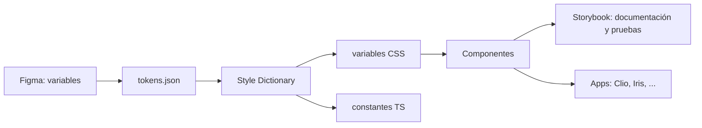

# Design systems

Parte de: [[04-JavaScript-Web/06 Avanzado/_Índice Avanzado|Avanzado]]

> [!info] Cómo avanzar
> `progreso`: **pendiente** → **viendo** (estudiando) → **visto** (contestaste la autoevaluación sin abrir las respuestas) → **dominado** (hiciste el laboratorio o lo aplicaste de verdad).

## Contenido

### Qué es
Un **design system** es el conjunto compartido de **decisiones de diseño, componentes, reglas y documentación** que usan todos los productos de una organización para verse y comportarse de forma consistente. No es solo una librería de componentes: incluye
- **Fundamentos**: color, tipografía, espaciado, retículas, elevación, iconografía, movimiento.
- **Design tokens**: esas decisiones convertidas en valores con nombre que consume el código y la herramienta de diseño.
- **Componentes** con sus estados y variantes (botón, campo, tabla, modal), en código y en la herramienta de diseño (Figma u otra).
- **Patrones**: cómo se combinan los componentes para tareas comunes (formularios, filtros, mensajes de error, estados vacíos).
- **Guías** de contenido, accesibilidad y uso ("cuándo usar un modal y cuándo no").
- **Gobierno**: quién decide, cómo se proponen cambios, cómo se versiona y se comunica.

Ejemplos públicos de referencia: Material Design (Google), Fluent (Microsoft), Carbon (IBM).

### Cómo funciona
#### Design tokens
Un **token** es una decisión de diseño con nombre: `color.fondo.peligro = #b00020`, `espacio.3 = 12px`, `radio.control = 6px`. Se organizan en capas:
1. **Primitivos** (paleta cruda): `azul.600 = #1d4ed8`.
2. **Semánticos** (intención): `color.accion.primaria = {azul.600}`. Los componentes usan estos, no los primitivos.
3. **De componente** (opcional): `boton.primario.fondo = {color.accion.primaria}`.

Así, un cambio de marca o un modo oscuro se hace cambiando el mapeo, no buscando colores sueltos en cientos de archivos. Los tokens se guardan en JSON (el Design Tokens Community Group del W3C trabaja en un formato estándar) y una herramienta como Style Dictionary los transforma en variables CSS, constantes de TypeScript o recursos para otras plataformas.



#### Componentes aislados y documentados
La herramienta más usada para desarrollar, documentar y probar componentes **aislados** es **Storybook**: cada componente tiene "historias" (estados de ejemplo), controles para cambiar props en vivo, documentación generada y complementos para accesibilidad y pruebas visuales. Funciona con React, Web Components y HTML plano.

### Ejemplo
Tokens semánticos como variables CSS, con modo oscuro:

```css
:root {
  --color-texto: #1f2933;
  --color-fondo: #ffffff;
  --color-accion: #1d4ed8;
  --color-peligro: #b00020;
  --espacio-2: 8px;
  --espacio-3: 12px;
  --radio-control: 6px;
}
@media (prefers-color-scheme: dark) {
  :root { --color-texto: #e5e7eb; --color-fondo: #111827; --color-accion: #60a5fa; }
}

.ds-boton {
  padding: var(--espacio-2) var(--espacio-3);
  border-radius: var(--radio-control);
  background: var(--color-accion);
  color: var(--color-fondo);
}
```

Una historia de Storybook para un botón de React en Itzamna.Clio (formato CSF):

```tsx
import type { Meta, StoryObj } from '@storybook/react-vite';
import { Boton } from './Boton';

const meta = { component: Boton, args: { children: 'Guardar' } } satisfies Meta<typeof Boton>;
export default meta;
type Historia = StoryObj<typeof meta>;

export const Primario: Historia = { args: { variante: 'primario' } };
export const Peligro: Historia = { args: { variante: 'peligro', children: 'Eliminar' } };
export const Cargando: Historia = { args: { cargando: true } };
```

(El paquete de framework de Storybook depende de la versión y del bundler; revisa la guía de instalación vigente.)

### Cuándo usarlo y cuándo no
- **Sí**: varias apps o equipos que deben verse igual (Itzamna.Clio, Ocelotl.Iris y paneles internos), productos que crecen, requisitos de accesibilidad y marca.
- **Empieza pequeño**: tokens + 5 a 10 componentes muy usados + documentación. Un design system crece con el uso, no con un plan de un año.
- **No** para un solo proyecto pequeño y temporal: el costo de mantenerlo supera el beneficio; basta con variables CSS y una carpeta de componentes.
- **Adoptar uno existente** (Fluent UI, Material) es razonable si su estética y su licencia encajan; personalízalo vía tokens.
- La parte técnica de construir los componentes está en [[Librería de componentes propia en JS plano]] y [[Web Components]].

### Errores comunes
- **Confundirlo con una librería de componentes**: sin tokens, guías y gobierno, cada equipo vuelve a divergir.
- **Usar primitivos en los componentes** (`azul.600` directo): el modo oscuro y los cambios de marca se vuelven imposibles.
- **Diseño y código desincronizados**: los tokens deben tener una sola fuente de verdad.
- **Ignorar accesibilidad** (contraste, foco visible, teclado) en los componentes base: el error se replica en todas las apps.
- **Cambios incompatibles sin versión ni guía de migración**: los consumidores dejan de actualizar.

### Para profundizar
- [Storybook: documentación](https://storybook.js.org/docs)
- [Design Tokens Community Group (W3C)](https://www.designtokens.org/)
- [Style Dictionary (GitHub)](https://github.com/style-dictionary/style-dictionary)
- [Microsoft Fluent 2 Design System](https://fluent2.microsoft.design/)

## Autoevaluación

Contesta primero en voz alta o en papel; luego despliega la respuesta.

> [!question]- ¿Qué es un design system y qué incluye además de componentes?
> El conjunto compartido de decisiones de diseño y su implementación: *tokens* (color, espacio, tipografía), componentes, patrones de uso, guías de accesibilidad y de contenido, y documentación.

> [!question]- ¿Qué son los design tokens?
> Valores de diseño con nombre (`--color-primario`, `--espacio-2`) que son la única fuente de verdad; se exportan a CSS, JS o apps móviles. Cambiar un token actualiza todo.

> [!question]- ¿Qué herramienta se usa comúnmente para documentar y probar componentes aislados?
> Storybook: cada estado del componente es una *story*; sirve de catálogo, para pruebas visuales y de accesibilidad.

