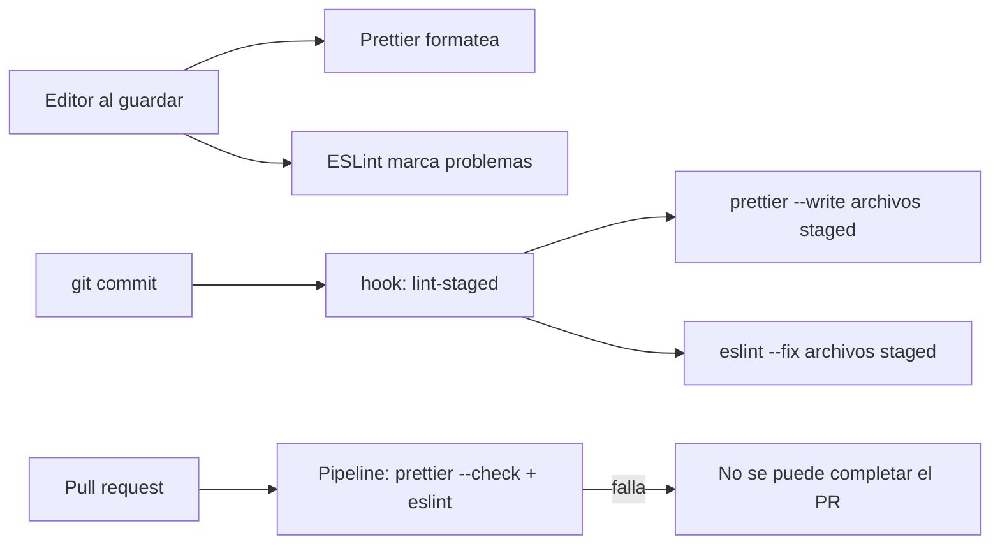

# ESLint y Prettier

Parte de: [[04-JavaScript-Web/06 Avanzado/_Índice Avanzado|Avanzado]]

> [!info] Cómo avanzar
> `progreso`: **pendiente** → **viendo** (estudiando) → **visto** (contestaste la autoevaluación sin abrir las respuestas) → **dominado** (hiciste el laboratorio o lo aplicaste de verdad).

## Contenido

### Qué es
Son dos herramientas complementarias para la calidad del código JavaScript y TypeScript:
- **ESLint** es un **linter**: analiza el código y reporta problemas de **corrección y buenas prácticas**: variables sin usar, `==` en lugar de `===`, promesas sin manejar, dependencias faltantes en hooks de React, imports inexistentes. Muchas reglas se pueden corregir solas (`--fix`).
- **Prettier** es un **formateador**: reescribe el código con un estilo uniforme (comillas, punto y coma, saltos de línea, sangría). No opina sobre la lógica.

Regla práctica: **Prettier decide cómo se ve, ESLint decide si está bien**. Es el equivalente de combinar los analizadores de Roslyn con `dotnet format` y `.editorconfig` en .NET.

### Cómo funciona
#### ESLint con *flat config*
En las versiones recientes (la línea 10 es la vigente; la 9 llegó a fin de soporte en agosto de 2026) la configuración vive en un archivo **`eslint.config.js`** (o `.mjs`, `.ts`) en la raíz, que exporta un **arreglo de objetos de configuración**. Cada objeto puede indicar a qué archivos aplica (`files`), qué ignorar (`ignores`), opciones del lenguaje (`languageOptions`), plugins y reglas. Los objetos se aplican en orden y los posteriores sobrescriben a los anteriores. El formato antiguo `.eslintrc.*` ya no se soporta en ESLint 10.

Las reglas tienen nivel `"off"`, `"warn"` o `"error"`, y casi todo se arma combinando configuraciones recomendadas: `js.configs.recommended`, `typescript-eslint` y los plugins de React.

#### Prettier
Lee `.prettierrc` (o la clave en `package.json`) con pocas opciones a propósito y un `.prettierignore`. `prettier --write .` formatea y `prettier --check .` falla si algo no está formateado (ideal para CI).

#### Cómo conviven
Algunas reglas de estilo de ESLint chocan con Prettier. La solución estándar es agregar **`eslint-config-prettier`** al final de la configuración: apaga las reglas de ESLint que se pelean con el formateador. Así cada herramienta hace lo suyo y no hay correcciones contradictorias.



### Ejemplo
`eslint.config.js` para el front de Itzamna.Clio (React + Vite + TypeScript):

```js
import { defineConfig } from 'eslint/config';
import js from '@eslint/js';
import tseslint from 'typescript-eslint';
import reactHooks from 'eslint-plugin-react-hooks';
import prettier from 'eslint-config-prettier';
import globals from 'globals';

export default defineConfig(
  { ignores: ['dist', 'coverage'] },
  js.configs.recommended,
  tseslint.configs.recommended,
  {
    files: ['**/*.{ts,tsx}'],
    languageOptions: { globals: globals.browser },
    plugins: { 'react-hooks': reactHooks },
    rules: {
      ...reactHooks.configs.recommended.rules,
      eqeqeq: 'error',
      'no-console': ['warn', { allow: ['warn', 'error'] }],
    },
  },
  prettier, // al final: apaga reglas de estilo que chocan con Prettier
);
```

(Los nombres exactos de las exportaciones de cada plugin cambian entre versiones; revisa su README al instalar.)

`.prettierrc`:

```json
{ "singleQuote": true, "semi": true, "printWidth": 100, "trailingComma": "all" }
```

Scripts en `package.json` ([[npm y package.json]]):

```json
{
  "scripts": {
    "lint": "eslint .",
    "format": "prettier --write .",
    "format:check": "prettier --check ."
  }
}
```

#### Que no llegue código sin formatear
Tres capas, de la más cómoda a la obligatoria:
1. **Editor**: formatear al guardar con la extensión de Prettier y ver errores de ESLint en vivo.
2. **Hook de pre-commit**: Husky + lint-staged ejecutan Prettier y ESLint solo sobre los archivos en *staging*.
3. **CI** (la que de verdad garantiza): un paso en el pipeline de Azure DevOps con `npm ci`, `npm run format:check` y `npm run lint`, y una política de rama que exija que pase para completar el PR. Los hooks locales se pueden saltar; el pipeline no.

```yaml
- script: npm ci
- script: npm run format:check
  displayName: Prettier
- script: npm run lint
  displayName: ESLint
```

### Cuándo usarlo y cuándo no
- **Siempre** en proyectos de equipo; en proyectos personales también, porque detecta bugs reales.
- Prefiere configuraciones recomendadas y pocas reglas personalizadas; discutir estilo es tiempo perdido, que lo decida Prettier.
- Alternativas: **Biome** reúne linter y formateador en una sola herramienta muy rápida; es razonable en proyectos nuevos si cubre las reglas que necesitas.
- Para TypeScript, el compilador (`tsc --noEmit`) sigue siendo necesario: ESLint no reemplaza la verificación de tipos.

### Errores comunes
- **Usar reglas de formato de ESLint y Prettier a la vez**: correcciones que se contradicen. Agrega `eslint-config-prettier`.
- **Mezclar formato y cambios de lógica** en el mismo PR: formatea todo el repo en un commit aparte.
- **Confiar solo en hooks locales**: cualquiera puede usar `--no-verify`.
- **Seguir con `.eslintrc`** después de actualizar: en ESLint 10 se ignora; migra a `eslint.config.js`.
- **Desactivar reglas con comentarios** por todos lados en lugar de corregir o ajustar la configuración.

### Para profundizar
- [ESLint: Configuration Files (flat config)](https://eslint.org/docs/latest/use/configure/configuration-files)
- [ESLint v10.0.0 released](https://eslint.org/blog/2026/02/eslint-v10.0.0-released/)
- [Prettier: Integrating with Linters](https://prettier.io/docs/integrating-with-linters)
- [typescript-eslint: Getting Started](https://typescript-eslint.io/getting-started/)

## Autoevaluación

Contesta primero en voz alta o en papel; luego despliega la respuesta.

> [!question]- ¿Qué diferencia hay entre ESLint y Prettier?
> ESLint analiza el código para encontrar errores y malas prácticas (variables sin usar, hooks mal usados). Prettier solo formatea (espacios, comillas, saltos). Se combinan desactivando en ESLint las reglas de formato.

> [!question]- ¿Cómo se configura ESLint en versiones recientes?
> Con *flat config*: un archivo `eslint.config.js` que exporta un arreglo de objetos de configuración (reemplaza a `.eslintrc`).

> [!question]- ¿Cómo evitas que llegue código sin formatear al repositorio?
> Formato al guardar en VS Code, un hook de pre-commit (husky + lint-staged) y un paso `eslint .` / `prettier --check .` en CI.

