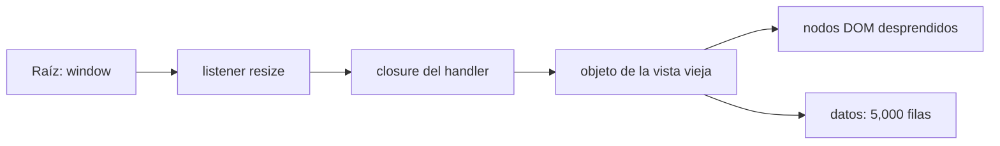

# Fugas de memoria

Parte de: [[04-JavaScript-Web/06 Avanzado/_Índice Avanzado|Avanzado]]

> [!info] Cómo avanzar
> `progreso`: **pendiente** → **viendo** (estudiando) → **visto** (contestaste la autoevaluación sin abrir las respuestas) → **dominado** (hiciste el laboratorio o lo aplicaste de verdad).

## Contenido

### Qué es
Una **fuga de memoria** en el front ocurre cuando tu aplicación **sigue reteniendo objetos que ya no necesita**, de modo que el recolector de basura (*garbage collector*, GC) no puede liberarlos. JavaScript administra la memoria automáticamente: libera todo lo que ya no es **alcanzable** desde una raíz (variables globales, la pila, el DOM actual, callbacks registrados). Si algo que ya no usas sigue siendo alcanzable por una referencia olvidada, nunca se libera.

En una SPA que el usuario deja abierta todo el día (como un panel de operación en Ocelotl.Iris), cada navegación que "olvida" algo acumula memoria: la página se vuelve lenta, el GC trabaja más (pausas visibles) y al final la pestaña puede cerrarse.

### Cómo funciona
El GC marca todo lo que se alcanza desde las raíces y libera el resto. Una fuga es siempre una **cadena de referencias** desde una raíz hasta el objeto que debería morir. Causas típicas:
- **Listeners que no se quitan**: un `window.addEventListener('resize', handler)` registrado al montar una vista y nunca quitado. El handler es un closure que retiene la vista completa y sus datos.
- **Timers e intervalos vivos**: `setInterval` sin `clearInterval` al salir de la pantalla ([[Timers]]).
- **Observers sin `disconnect()`**: `IntersectionObserver`, `MutationObserver`, `ResizeObserver` ([[IntersectionObserver y MutationObserver]]).
- **Nodos DOM desprendidos** (*detached*): quitaste un elemento del documento, pero una variable, un `Map` o un arreglo todavía lo referencia, junto con todo su subárbol.
- **Cachés sin límite**: un `Map` global que guarda respuestas o elementos y solo crece. Para asociar datos a objetos sin retenerlos, usa [[WeakMap y WeakSet]].
- **Closures** que capturan objetos grandes y viven más de lo necesario ([[Closures]]).
- **Suscripciones** a stores, websockets o eventos propios sin desuscribir; en React, efectos sin función de limpieza.



### Ejemplo
Vista con fuga y su corrección usando una sola `signal` de [[AbortController]]:

```js
// CON FUGA
export function montarTablero(contenedor) {
  const filas = [];                                     // datos grandes
  const tabla = document.createElement('table');
  contenedor.append(tabla);
  window.addEventListener('resize', () => ajustar(tabla, filas));
  setInterval(() => refrescar(filas), 5000);
  // al navegar a otra vista se hace contenedor.replaceChildren(): la tabla sale del DOM,
  // pero el listener y el intervalo la siguen reteniendo, y siguen trabajando
}

// SIN FUGA
export function montarTablero2(contenedor) {
  const control = new AbortController();
  const { signal } = control;
  const filas = [];
  const tabla = document.createElement('table');
  contenedor.append(tabla);

  window.addEventListener('resize', () => ajustar(tabla, filas), { signal });
  const id = setInterval(() => refrescar(filas, signal), 5000);
  const io = new IntersectionObserver(cargarMas);
  io.observe(tabla);

  signal.addEventListener('abort', () => { clearInterval(id); io.disconnect(); });
  return function desmontar() { control.abort(); };   // el router la llama al salir
}
```

Este "montar devuelve desmontar" es el mismo contrato del [[Molde Service-View-Handlers-Events]] y de la función de limpieza de `useEffect` en React.

### Cómo encontrarla con DevTools
1. **Confirma que crece**: abre *Performance monitor* (menú de comandos → "Show Performance monitor") y observa *JS heap size* y *DOM Nodes* mientras repites la acción sospechosa (entrar y salir de una vista 10 veces). Si sube y no baja después de forzar el GC (ícono de basurero en el panel Memory), hay fuga.
2. **Snapshots comparados**: en **Memory**, toma un *Heap snapshot*, repite la acción varias veces, toma otro y usa la vista **Comparison**. Busca constructores cuyo número crece (`HTMLTableRowElement`, tus clases, `Array`).
3. **Nodos desprendidos**: en el snapshot, filtra por "Detached" para ver elementos fuera del documento que siguen vivos.
4. **Retainers**: selecciona un objeto y revisa el panel *Retainers*: muestra la cadena de referencias que lo mantiene vivo (por ejemplo, `handler` en un listener de `window`). Ese es el lugar a corregir.
5. *Allocation instrumentation on timeline* muestra qué se reservó en cada momento y qué sobrevivió.

### Cuándo preocuparse y cuándo no
- **Sí**: SPAs de larga duración, pantallas que se montan y desmontan muchas veces, tablas o gráficas grandes, apps en equipos modestos.
- **No** confundas uso alto con fuga: una app puede usar mucha memoria de forma estable. La señal de fuga es **crecimiento sostenido** al repetir la misma acción.
- En páginas tradicionales que recargan en cada navegación, las fugas se "curan" solas al recargar; aun así, los intervalos olvidados gastan CPU y red.

### Errores comunes
- **No tener un punto de desmontaje** en las vistas: sin contrato de limpieza, todo se olvida.
- **Quitar listeners con otra referencia de función** (no se quita nada; ver [[DOM - eventos]]).
- **Guardar nodos DOM en estructuras globales** "para reusarlos".
- **Cachés sin tope ni expiración**.
- **Medir con extensiones del navegador activas**, que agregan sus propios objetos al heap; usa una ventana de incógnito.

### Para profundizar
- [MDN: Memory management](https://developer.mozilla.org/en-US/docs/Web/JavaScript/Guide/Memory_management)
- [Chrome DevTools: Fix memory problems](https://developer.chrome.com/docs/devtools/memory-problems)
- [Chrome DevTools: Record heap snapshots](https://developer.chrome.com/docs/devtools/memory-problems/heap-snapshots)

## Autoevaluación

Contesta primero en voz alta o en papel; luego despliega la respuesta.

> [!question]- ¿Qué es una fuga de memoria en el front?
> Memoria que ya no necesitas pero sigue alcanzable desde alguna referencia viva, por lo que el recolector no la libera; la pestaña consume cada vez más.

> [!question]- ¿Cuáles son las causas típicas?
> Listeners en `window`/`document` que no se quitan, `setInterval` sin `clear`, observers sin `disconnect`, nodos del DOM eliminados pero guardados en variables o cachés (*detached nodes*) y closures que capturan objetos grandes.

> [!question]- ¿Cómo encuentras una fuga con DevTools?
> Pestaña **Memory**: toma un heap snapshot, repite la acción sospechosa varias veces, toma otro y compáralos (vista *Comparison*); busca "Detached" para nodos sueltos y revisa *Retainers* para ver quién los retiene.

