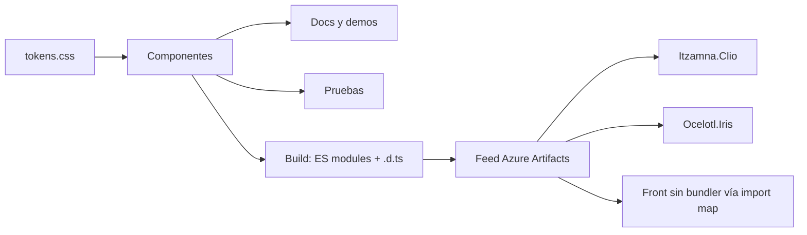

# Librería de componentes propia en JS plano

Parte de: [[04-JavaScript-Web/06 Avanzado/_Índice Avanzado|Avanzado]]

> [!info] Cómo avanzar
> `progreso`: **pendiente** → **viendo** (estudiando) → **visto** (contestaste la autoevaluación sin abrir las respuestas) → **dominado** (hiciste el laboratorio o lo aplicaste de verdad).

## Contenido

### Qué es
Una **librería de componentes propia en JS plano** es un paquete interno con las piezas de interfaz reutilizables de tus aplicaciones (botón, campo con validación, tabla con paginación, modal, selector de cliente, avisos) escritas con JavaScript estándar, sin depender de un framework. Es la implementación técnica de un [[Design systems|design system]]: los tokens y las guías se convierten en código que todos los proyectos importan, en lugar de copiar y pegar componentes entre repositorios.

Tiene sentido cuando tienes varios fronts, algunos sin bundler y otros con React (Itzamna.Clio, Ocelotl.Iris, paneles internos), y quieres que todos compartan comportamiento, accesibilidad y estilo.

### Cómo funciona
#### Qué debe tener cada componente
- **API pública clara y pequeña**: qué atributos, propiedades y eventos acepta y emite. Todo lo demás es privado (campos `#privados`, ver [[Campos privados en clases JS]]).
- **Estilos basados en tokens**: variables CSS para color, espacio y radios, con puntos de personalización documentados (`--boton-fondo`, `::part()`).
- **Accesibilidad incluida**: roles y atributos ARIA correctos, manejo de teclado, foco visible, etiquetas. Es la razón principal para centralizar: se resuelve una vez.
- **Ciclo de vida y limpieza**: montar y desmontar sin dejar listeners, timers u observers vivos ([[Fugas de memoria]]).
- **Seguridad**: los datos se insertan como texto, nunca como HTML sin escapar ([[Seguridad del DOM (innerHTML y escape de datos)]]).
- **Documentación con ejemplos** (Storybook o una página de demostración) y **pruebas** de comportamiento ([[Pruebas con Vitest y Jest]]).
- **Tipos**: un archivo `.d.ts` o JSDoc con tipos para que los proyectos en TypeScript tengan autocompletado.

#### Web Components o funciones con plantillas lit-html
| | [[Web Components]] (custom elements) | Funciones que devuelven plantillas [[lit-html]] |
|---|---|---|
| Uso | `<ds-boton variante="primario">` en cualquier HTML | `boton({ variante, texto, onClick })` dentro de una plantilla |
| Interoperabilidad | Funciona en HTML plano, React, Angular | Solo donde se renderiza con lit-html |
| Encapsulación | Shadow DOM real (estilos aislados) | Ninguna: usa el CSS global (más simple para temas) |
| Estado y ciclo de vida | Propio del elemento (`connectedCallback`) | Lo maneja la vista que llama |
| Costo | Más código por componente, cuidado con formularios y SSR | Muy ligero, fácil de probar como función pura |

Criterio práctico: si la librería debe usarse **en varios frameworks** o embebida en páginas que no controlas, Web Components. Si todos tus fronts usan el mismo molde con lit-html, funciones de plantilla son más simples. Un punto medio común: Web Components construidos internamente con lit-html (o con la librería Lit).

#### Versionado
Publica la librería como paquete versionado con **SemVer** ([[npm y package.json]]): `MAYOR.MENOR.PARCHE`.
- Cambio incompatible (renombrar un atributo, cambiar un evento, quitar un componente) → versión **mayor**.
- Antes de quitar algo, márcalo **obsoleto** en una versión menor (aviso en consola en desarrollo, nota en el changelog) y quítalo en la siguiente mayor.
- Mantén un **CHANGELOG** con guía de migración; herramientas como Changesets lo automatizan en monorepos ([[pnpm workspaces]]).
- Publica en un feed privado, por ejemplo **Azure Artifacts** en Azure DevOps, y deja que cada app actualice a su ritmo.



### Ejemplo
Estructura y un componente de aviso como custom element:

```text
ds-componentes/
  package.json        "type": "module", "exports": { ".": "./src/index.js", "./tokens.css": "./src/tokens.css" }
  src/index.js        exporta y registra todo
  src/tokens.css
  src/aviso/ds-aviso.js
  src/aviso/ds-aviso.test.js
```

```js
// src/aviso/ds-aviso.js
const plantilla = document.createElement('template');
plantilla.innerHTML = `
  <style>
    :host { display: block; }
    .caja { padding: var(--ds-espacio-3, 12px); border-radius: var(--ds-radio, 6px);
            background: var(--ds-aviso-fondo, #eef2ff); }
    :host([tipo="error"]) .caja { background: var(--ds-aviso-error, #fde8e8); }
    button { float: right; }
  </style>
  <div class="caja" part="caja" role="status">
    <button type="button" aria-label="Cerrar">×</button>
    <slot></slot>
  </div>`;

export class DsAviso extends HTMLElement {
  static observedAttributes = ['tipo'];
  #control;

  constructor() {
    super();
    this.attachShadow({ mode: 'open' }).append(plantilla.content.cloneNode(true));
  }

  connectedCallback() {
    this.#control = new AbortController();
    const caja = this.shadowRoot.querySelector('.caja');
    caja.setAttribute('role', this.getAttribute('tipo') === 'error' ? 'alert' : 'status');
    this.shadowRoot.querySelector('button').addEventListener('click', () => this.cerrar(), { signal: this.#control.signal });
  }

  disconnectedCallback() { this.#control.abort(); }

  attributeChangedCallback() {
    this.shadowRoot.querySelector('.caja')?.setAttribute('role', this.getAttribute('tipo') === 'error' ? 'alert' : 'status');
  }

  cerrar() {
    const ev = new CustomEvent('ds-cerrar', { bubbles: true, composed: true, cancelable: true });
    if (this.dispatchEvent(ev)) this.remove();      // quien escucha puede cancelar
  }
}

if (!customElements.get('ds-aviso')) customElements.define('ds-aviso', DsAviso);
```

En un front sin bundler se consume con un import map apuntando al paquete publicado ([[ES Modules e import maps]]); en Vite, con `import 'ds-componentes'`.

### Cuándo usarlo y cuándo no
- **Sí**: dos o más aplicaciones que comparten interfaz, o un front sin bundler que necesita piezas consistentes.
- **No** si solo hay una app: una carpeta `componentes/` dentro del proyecto basta; extraer después es fácil si la API es limpia.
- Evalúa antes adoptar una librería existente basada en Web Components (por ejemplo, Shoelace/Web Awesome o Fluent UI Web Components) y personalizarla con tokens.

### Errores comunes
- **APIs grandes y ambiguas** desde el inicio: cada propiedad pública es un compromiso de compatibilidad.
- **Romper compatibilidad en una versión menor**: las apps se rompen al actualizar y dejan de confiar.
- **Componentes que hacen peticiones a la API** por su cuenta: acoplan la librería a un backend; que reciban datos y emitan eventos.
- **Olvidar accesibilidad y teclado** "para después".
- **No probar en las apps reales** antes de publicar (usa una versión preliminar `-beta`).

### Para profundizar
- [MDN: Web Components](https://developer.mozilla.org/en-US/docs/Web/API/Web_components)
- [Lit: documentación](https://lit.dev/docs/)
- [Semantic Versioning 2.0.0](https://semver.org/)
- [Microsoft Learn: Azure Artifacts, feeds de npm](https://learn.microsoft.com/azure/devops/artifacts/get-started-npm)

## Autoevaluación

Contesta primero en voz alta o en papel; luego despliega la respuesta.

> [!question]- ¿Qué debe tener cada componente de una librería propia?
> API clara (parámetros/atributos y eventos que emite), estilos encapsulados o con prefijo, accesibilidad desde el inicio (teclado, roles), una forma de destruirse (quitar listeners) y un ejemplo/documentación.

> [!question]- ¿Web Components o funciones que devuelven plantillas lit-html?
> Web Components si se usarán en varios proyectos o frameworks (son estándar y se encapsulan). Funciones con lit-html si viven en una sola app sin bundler: más simples, sin ciclo de vida propio.

> [!question]- ¿Cómo versionas cambios incompatibles?
> Con SemVer: cambio de API incompatible → versión mayor, documentado en un CHANGELOG. Mantén un periodo de deprecación con aviso en consola antes de quitar algo.

