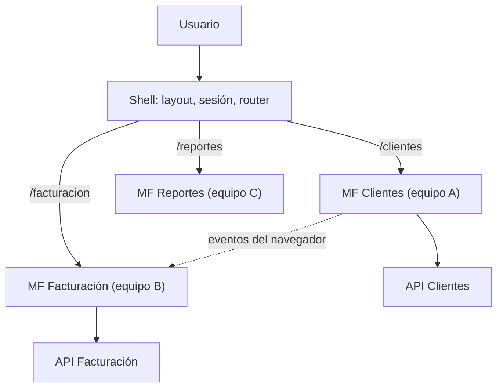

# Micro-frontends (conceptos)

Parte de: [[04-JavaScript-Web/06 Avanzado/_Índice Avanzado|Avanzado]]

> [!info] Cómo avanzar
> `progreso`: **pendiente** → **viendo** (estudiando) → **visto** (contestaste la autoevaluación sin abrir las respuestas) → **dominado** (hiciste el laboratorio o lo aplicaste de verdad).

## Contenido

### Qué es
Los **micro-frontends** aplican al front la idea de los microservicios: en lugar de una sola aplicación web monolítica, la interfaz se divide en **partes independientes, cada una propiedad de un equipo**, que se desarrollan, prueban y **despliegan por separado**, y que se componen en una sola experiencia para el usuario. Por ejemplo, en un portal de operación: "Clientes" lo mantiene un equipo, "Facturación" otro y "Reportes" un tercero, cada uno con su repositorio y su pipeline.

El objetivo principal no es técnico sino **organizacional**: que varios equipos avancen sin coordinar cada despliegue.

### Cómo funciona
Hay una **aplicación contenedora** (*shell* o *host*) que define el layout común (encabezado, menú, sesión) y decide qué micro-frontend montar según la ruta. Cada micro-frontend expone una forma de montarse y desmontarse. Las formas de integrar más comunes:

| Integración | Cómo | Ventajas | Costos |
|---|---|---|---|
| **En build** (paquetes npm) | Cada parte se publica como paquete y el shell las importa | Simple, optimizable | No hay despliegue independiente: hay que recompilar el shell |
| **En runtime con JS** | El shell carga en el navegador el bundle remoto: Module Federation, ES modules con [[ES Modules e import maps]], single-spa | Despliegue independiente real | Versionado de dependencias compartidas, contratos en runtime |
| **[[Web Components]]** | Cada parte se registra como custom element (`<mf-facturacion>`) | Agnóstico de framework, API por atributos y eventos | Hay que resolver estilos, SSR y formularios |
| **iframes** | Cada parte es una página aparte embebida | Aislamiento total (CSS, JS, fallos) | Comunicación por [[postMessage e iframes]], accesibilidad, rendimiento, URLs |
| **En servidor o en el edge** | El servidor ensambla fragmentos HTML (SSI, ESI, composición en un gateway) | Buen primer render y SEO | Infraestructura más compleja |



#### Lo que hay que acordar sí o sí
- **Contrato de montaje**: por ejemplo `montar(contenedor, contexto)` que devuelve `desmontar()`.
- **Comunicación**: eventos del navegador (`CustomEvent`) o la URL; evitar estado global compartido entre equipos.
- **Autenticación**: la sesión la maneja el shell (en este contexto, un BFF de Xolotl.Hecate con cookie) y los micro-frontends la reutilizan.
- **Diseño compartido**: un [[Design systems|design system]] con tokens y componentes comunes, para que no parezcan cinco apps distintas.
- **Dependencias compartidas**: qué versión de React (o de lo que sea) se comparte para no descargarla cinco veces.

### Ejemplo
Contrato mínimo con ES modules en runtime, sin bundler en el shell:

```html
<script type="importmap">
{ "imports": {
    "mf/clientes": "https://cdn.ejemplo.mx/mf-clientes/2.3.1/index.js",
    "mf/facturacion": "https://cdn.ejemplo.mx/mf-facturacion/1.8.0/index.js"
} }
</script>
```

```js
// shell/router.js
const rutas = { '/clientes': 'mf/clientes', '/facturacion': 'mf/facturacion' };
const contenedor = document.querySelector('#contenido');
let desmontarActual = null;

export async function irA(ruta) {
  desmontarActual?.();
  const modulo = await import(rutas[ruta]);              // carga bajo demanda
  desmontarActual = modulo.montar(contenedor, {
    usuario: window.sesion.usuario,
    navegar: (r) => irA(r),
  });
}

// Comunicación entre partes sin acoplarlas
window.addEventListener('cliente:seleccionado', (e) => console.log('Shell sabe:', e.detail.id));
```

```js
// mf-clientes/index.js (lo despliega su equipo por separado)
export function montar(contenedor, { navegar }) {
  const control = new AbortController();
  contenedor.replaceChildren(crearVistaClientes(navegar, control.signal));
  return () => { control.abort(); contenedor.replaceChildren(); };
}
```

Cambiar la versión de un micro-frontend es actualizar una línea del import map (que puede servirse dinámicamente), sin recompilar el shell.

### Cuándo usarlo y cuándo NO
**Conviene** cuando:
- Hay **varios equipos** (normalmente más de dos o tres) trabajando en la misma interfaz y los despliegues coordinados se volvieron un cuello de botella.
- Hay que **migrar gradualmente** un front viejo: el shell monta lo nuevo en algunas rutas mientras lo viejo sigue funcionando (patrón *strangler fig*).
- Partes del producto tienen ciclos de vida o tecnologías muy distintas.

**No conviene** cuando:
- Es **un solo equipo** o un producto pequeño: pagas complejidad (infraestructura, versionado, depuración distribuida, pruebas de integración) sin el beneficio organizacional. Un monolito modular bien organizado, con [[pnpm workspaces]] y vertical slices, suele bastar.
- El rendimiento es crítico y no puedes controlar el peso total: cada parte agrega su JavaScript.
- No existe un design system ni acuerdos de gobierno: el resultado se ve y se comporta inconsistente.

### Errores comunes
- **Adoptarlos por moda** sin el problema de equipos que resuelven.
- **Acoplar por estado global compartido** (un store común que todos modifican): vuelves a tener un monolito, pero distribuido.
- **Cada parte con su versión de React**: páginas pesadas y conflictos.
- **Estilos que se pisan** entre partes: usa prefijos, CSS Modules o Shadow DOM.
- **Sin pruebas de integración** del shell con las versiones reales desplegadas.

### Para profundizar
- [Martin Fowler: Micro Frontends (Cam Jackson)](https://martinfowler.com/articles/micro-frontends.html)
- [single-spa: documentación](https://single-spa.js.org/docs/getting-started-overview)
- [Module Federation: documentación](https://module-federation.io/)
- [Microsoft Learn: Strangler Fig pattern](https://learn.microsoft.com/azure/architecture/patterns/strangler-fig)

## Autoevaluación

Contesta primero en voz alta o en papel; luego despliega la respuesta.

> [!question]- ¿Qué son los micro-frontends?
> Dividir un front grande en partes que equipos distintos desarrollan y despliegan de forma independiente, y que se componen en una sola experiencia.

> [!question]- ¿Cómo se integran?
> En build (paquetes npm), en el servidor (composición de HTML), o en el navegador en runtime (Module Federation, import maps, Web Components, iframes).

> [!question]- ¿Cuándo NO conviene?
> Con un equipo pequeño o una app mediana: agregan complejidad (versiones duplicadas de librerías, estado compartido, consistencia visual, más infraestructura). Resuelven un problema organizacional, no técnico.

