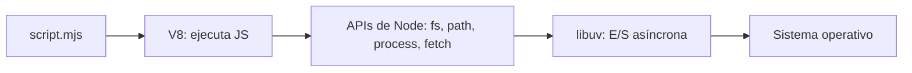

# Node.js básico

Parte de: [[04-JavaScript-Web/06 Avanzado/_Índice Avanzado|Avanzado]]

> [!info] Cómo avanzar
> `progreso`: **pendiente** → **viendo** (estudiando) → **visto** (contestaste la autoevaluación sin abrir las respuestas) → **dominado** (hiciste el laboratorio o lo aplicaste de verdad).

## Contenido

### Qué es
**Node.js** es un entorno para ejecutar JavaScript **fuera del navegador**, construido sobre el motor V8 de Chrome y una capa de E/S asíncrona (libuv). En lugar del DOM tiene APIs para archivos, procesos, red, variables de entorno y sistema operativo. Comparte con el navegador el lenguaje, el [[Event loop]] y muchas APIs web modernas (`fetch`, `URL`, `AbortController`, `structuredClone`, `crypto.randomUUID`).

Como desarrollador front (y .NET), lo usas sobre todo como **plataforma de herramientas**: no necesariamente escribes servidores con él.

### Cómo funciona
#### Para qué lo usa un desarrollador front
- **Ejecutar las herramientas de construcción y calidad**: [[Vite]], TypeScript (`tsc`), [[ESLint y Prettier]], Vitest ([[Pruebas con Vitest y Jest]]), Storybook. Todas son programas de Node.
- **Gestionar paquetes**: npm, pnpm ([[npm y package.json]], [[pnpm workspaces]]).
- **Scripts propios**: generar código desde un contrato OpenAPI de la API ASP.NET, convertir tokens de diseño, copiar archivos estáticos, validar traducciones, preparar datos de prueba.
- **Servidores de desarrollo y mocks** de API.
- En CI (Azure DevOps), los pasos de front corren en Node.

Usa la versión **LTS** vigente (consulta el calendario en nodejs.org) y fíjala por proyecto (`engines` en `package.json`, archivo `.nvmrc` o la tarea `NodeTool` del pipeline) para que todos usen la misma.

#### CommonJS vs ES Modules
Node tiene dos sistemas de módulos:

| | CommonJS (CJS) | ES Modules (ESM) |
|---|---|---|
| Sintaxis | `const x = require('x')`, `module.exports = ...` | `import x from 'x'`, `export ...` |
| Carga | Síncrona, en tiempo de ejecución | Estática, analizable; permite `await` de nivel superior |
| Cuándo aplica | `.cjs`, o `.js` sin `"type": "module"` | `.mjs`, o `.js` con `"type": "module"` en package.json |
| Variables | `__dirname`, `__filename` | `import.meta.dirname`, `import.meta.filename`, `import.meta.url` |
| Interoperabilidad | Las versiones recientes de Node permiten `require()` de módulos ES sin `await` de nivel superior | ESM puede importar CJS (`import pkg from 'cjs-pkg'`) |

En proyectos nuevos usa **ESM**: es el estándar del lenguaje y el mismo que usas en el navegador ([[ES Modules e import maps]]).

#### Entorno y argumentos
- `process.env.NOMBRE`: variables de entorno (strings o `undefined`).
- `node --env-file=.env script.js` carga un archivo `.env` sin librerías (disponible desde Node 20.6); también `process.loadEnvFile()`.
- `process.argv`: arreglo con la ruta de node, la del script y luego los argumentos.
- `util.parseArgs` interpreta opciones (`--salida reporte.json --verbose`) sin dependencias.
- `process.exitCode = 1` marca el fallo para que el pipeline lo detecte.



### Ejemplo
Script que descarga el `swagger.json` de Itzamna.Dionisio y genera un archivo con las rutas de la API, configurable por entorno y argumentos:

```js
// scripts/generar-rutas.mjs
// Uso: node --env-file=.env scripts/generar-rutas.mjs --salida src/api/rutas.ts
import { writeFile, mkdir } from 'node:fs/promises';
import { dirname } from 'node:path';
import { parseArgs } from 'node:util';

const { values } = parseArgs({
  options: {
    salida: { type: 'string', short: 'o', default: 'src/api/rutas.ts' },
    verbose: { type: 'boolean', default: false },
  },
});

const base = process.env.API_URL;
if (!base) {
  console.error('Falta API_URL (agrégala a .env, que no se sube al repo)');
  process.exit(1);
}

const r = await fetch(new URL('/swagger/v1/swagger.json', base), { signal: AbortSignal.timeout(10000) });
if (!r.ok) throw new Error(`No se pudo leer el contrato: HTTP ${r.status}`);
const contrato = await r.json();

const rutas = Object.keys(contrato.paths).sort();
const codigo = `// Generado: no editar a mano\nexport const rutas = ${JSON.stringify(rutas, null, 2)} as const;\n`;

await mkdir(dirname(values.salida), { recursive: true });
await writeFile(values.salida, codigo, 'utf8');
if (values.verbose) console.log(`Se escribieron ${rutas.length} rutas en ${values.salida}`);
```

Y en `package.json`: `"scripts": { "gen:rutas": "node --env-file=.env scripts/generar-rutas.mjs" }`. El `.env` va en `.gitignore`; en el pipeline, la variable se define como variable secreta de Azure DevOps.

### Cuándo usarlo y cuándo no
- **Sí**: herramientas de front, scripts de automatización, mocks, funciones serverless sencillas, BFFs ligeros si el equipo es fuerte en JS.
- **No necesariamente** para tu backend principal: con ASP.NET Core ya tienes un stack robusto; Node no aporta mucho ahí salvo casos específicos.
- Para scripts de sistema en Windows o en pipelines, PowerShell o un script de .NET también son válidos; usa Node cuando el script vive junto al front.
- Para trabajo pesado de CPU, Node tiene un solo hilo principal: usa `worker_threads` o pasa la tarea a otro servicio.

### Errores comunes
- **Mezclar `require` e `import`** en el mismo archivo sin saber qué sistema aplica: revisa `"type"` y la extensión.
- **Usar `__dirname` en ESM**: no existe; usa `import.meta.dirname`.
- **Versiones distintas de Node** entre máquinas y CI: errores raros de dependencias nativas. Fija la versión.
- **Subir `.env` con secretos** al repositorio.
- **Bloquear el loop** con APIs síncronas (`readFileSync`) en un servidor; en scripts de una sola ejecución no importa tanto.

### Para profundizar
- [Node.js: documentación de la API](https://nodejs.org/api/)
- [Node.js: Modules: ECMAScript modules](https://nodejs.org/api/esm.html)
- [Node.js: util.parseArgs](https://nodejs.org/api/util.html#utilparseargsconfig)
- [Node.js: Releases (calendario LTS)](https://nodejs.org/en/about/previous-releases)

## Autoevaluación

Contesta primero en voz alta o en papel; luego despliega la respuesta.

> [!question]- ¿Para qué usas Node como desarrollador front?
> Para correr herramientas (Vite, ESLint, Vitest, scripts de build), servidores de desarrollo y APIs pequeñas o BFF.

> [!question]- ¿Qué diferencia hay entre CommonJS y ES Modules en Node?
> CommonJS: `require`/`module.exports`, carga síncrona. ESM: `import`/`export`, se activa con `.mjs` o `"type": "module"`. En ESM no existen `__dirname` ni `require` (usa `import.meta.dirname` en versiones recientes o `import.meta.url`).

> [!question]- ¿Cómo lees variables de entorno y argumentos?
> `process.env.NOMBRE` y `process.argv` (los dos primeros son node y el script). Versiones recientes de Node aceptan `--env-file=.env` sin librerías.

