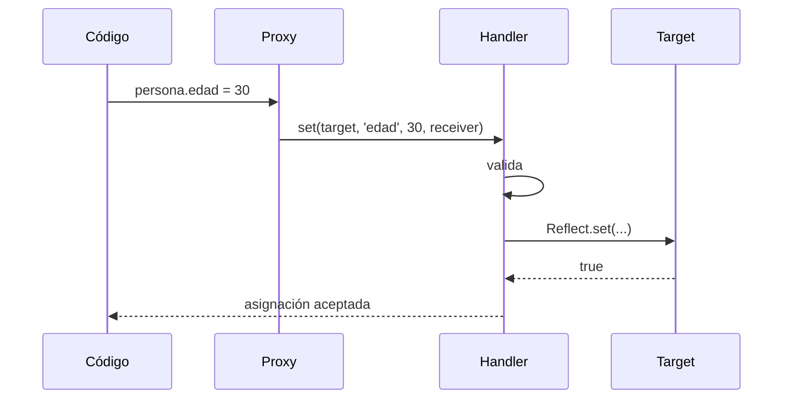

# Proxy y Reflect

Parte de: [[04-JavaScript-Web/06 Avanzado/_Índice Avanzado|Avanzado]]

> [!info] Cómo avanzar
> `progreso`: **pendiente** → **viendo** (estudiando) → **visto** (contestaste la autoevaluación sin abrir las respuestas) → **dominado** (hiciste el laboratorio o lo aplicaste de verdad).

## Contenido

### Qué es
Un **`Proxy`** es un objeto que **envuelve a otro** (el *target*) e intercepta las operaciones fundamentales que se hacen sobre él: leer una propiedad, asignarla, borrarla, preguntar si existe, enumerar llaves, llamar a una función, construir con `new`. Para cada operación puedes definir una "trampa" (*trap*) que decide qué pasa: validar, registrar, transformar, negar o reenviar al objeto original.

**`Reflect`** es un objeto con métodos estáticos que hacen **exactamente las operaciones por defecto** que intercepta un proxy: `Reflect.get`, `Reflect.set`, `Reflect.has`, `Reflect.deleteProperty`, `Reflect.ownKeys`, `Reflect.apply`, `Reflect.construct`... Cada trap tiene su método `Reflect` con la misma firma, lo que hace natural "hacer lo mío y luego el comportamiento normal".

### Cómo funciona
```js
const proxy = new Proxy(target, handler);
```
- `handler` es un objeto con trampas opcionales: `get(target, prop, receiver)`, `set(target, prop, valor, receiver)`, `has`, `deleteProperty`, `ownKeys`, `getOwnPropertyDescriptor`, `defineProperty`, `apply` (si el target es función), `construct`, entre otras.
- Si una trampa no está definida, la operación pasa directo al target.
- Toda operación sobre el proxy pasa por el handler; el target original sigue existiendo y, si alguien lo modifica directamente, **no** pasa por las trampas.
- La trampa `set` debe devolver `true` si la asignación tuvo éxito; en modo estricto (módulos ES, clases), devolver `false` lanza `TypeError`.
- Hay **invariantes** que el motor verifica: por ejemplo, no puedes decir que una propiedad no configurable no existe.

#### Para qué sirve `Reflect`
- Reenviar la operación por defecto dentro de una trampa sin reescribirla: `return Reflect.get(target, prop, receiver)`.
- Respetar **getters y herencia** gracias al `receiver` (con `target[prop]` un getter vería `this` = target, no el proxy).
- Obtener resultados booleanos en lugar de excepciones: `Reflect.set` y `Reflect.defineProperty` devuelven `true`/`false`.
- Una API uniforme de metaprogramación (`Reflect.ownKeys` devuelve strings y symbols).



### Ejemplo
Objeto que rechaza edades no numéricas:

```js
function conValidacion(objeto) {
  return new Proxy(objeto, {
    set(target, prop, valor, receiver) {
      if (prop === 'edad' && (!Number.isInteger(valor) || valor < 0)) {
        throw new TypeError(`edad debe ser un entero no negativo, llegó ${JSON.stringify(valor)}`);
      }
      return Reflect.set(target, prop, valor, receiver);
    },
  });
}

const persona = conValidacion({ nombre: 'Ana' });
persona.edad = 31;       // OK
persona.edad = '31';     // TypeError
```

Estado reactivo mínimo: avisar cuando cambia algo, la base de librerías como Vue o MobX.

```js
function reactivo(estado, alCambiar) {
  return new Proxy(estado, {
    set(target, prop, valor, receiver) {
      const anterior = target[prop];
      const ok = Reflect.set(target, prop, valor, receiver);
      if (ok && anterior !== valor) alCambiar(prop, valor, anterior);
      return ok;
    },
    deleteProperty(target, prop) {
      const ok = Reflect.deleteProperty(target, prop);
      if (ok) alCambiar(prop, undefined);
      return ok;
    },
  });
}

const filtros = reactivo({ texto: '', pagina: 1 }, (prop, v) => {
  console.log(`cambió ${String(prop)} →`, v);
  // aquí se re-pintaría la tabla
});
filtros.texto = 'café';
```

Valores por defecto para llaves de traducción faltantes:

```js
const textos = new Proxy({ guardar: 'Guardar' }, {
  get: (t, k, r) => (k in t ? Reflect.get(t, k, r) : `⟦${String(k)}⟧`), // muestra la llave que falta
});
textos.cancelar; // '⟦cancelar⟧'
```

### Dónde se usa en la práctica
- **Reactividad** de frameworks (Vue 3, MobX, Valtio) y stores.
- **Validación** y objetos de configuración de solo lectura.
- **Mocks y espías** en pruebas.
- **Clientes dinámicos**: `api.clientes.obtener(42)` construido interceptando `get` (algunos clientes RPC lo hacen).
- **Registro y depuración**: ver quién lee o escribe una propiedad.
- Inmutabilidad práctica en librerías como Immer, que usan proxies para "escribir" sobre borradores.

### Cuándo usarlo y cuándo no
- **Sí** en infraestructura (librerías, herramientas, pruebas) donde la magia está bien encapsulada.
- **No** en código de negocio común: para validar un objeto de formulario es más claro una función o una clase con setters, y en la API la validación real va con FluentValidation.
- **Rendimiento**: cada acceso pasa por una función; en bucles calientes puede notarse.
- Para "congelar" objetos simples, `Object.freeze` es más directo.

### Errores comunes
- **Olvidar devolver `true` en `set`**: en modo estricto lanza `TypeError` aunque hayas asignado.
- **Usar `target[prop]` en lugar de `Reflect.get(..., receiver)`**: rompe getters que usan `this`.
- **Modificar el target directamente** y esperar que se disparen las trampas.
- **Proxys sobre objetos nativos con slots internos** (`Map`, `Date`, elementos DOM): sus métodos fallan con `TypeError` porque `this` es el proxy, no el objeto real; hay que enlazar los métodos al target.
- **Comparar identidad**: `proxy === target` es `false`.

### Para profundizar
- [MDN: Proxy](https://developer.mozilla.org/en-US/docs/Web/JavaScript/Reference/Global_Objects/Proxy)
- [MDN: Reflect](https://developer.mozilla.org/en-US/docs/Web/JavaScript/Reference/Global_Objects/Reflect)
- [MDN: Meta programming](https://developer.mozilla.org/en-US/docs/Web/JavaScript/Guide/Meta_programming)

## Ejercicios

Resuélvelos en papel o en la herramienta; la solución está plegada.

> [!question]- Haz un objeto que lance error si asignas una edad no numérica.
> ```js
> const persona = new Proxy({}, {
>   set(t, k, v, r) {
>     if (k === 'edad' && !Number.isInteger(v)) throw new TypeError('edad inválida');
>     return Reflect.set(t, k, v, r);
>   },
> });
> persona.edad = 30;   // ok
> persona.edad = 'x';  // TypeError
> ```

## Autoevaluación

Contesta primero en voz alta o en papel; luego despliega la respuesta.

> [!question]- ¿Qué es un `Proxy`?
> Un envoltorio de un objeto que intercepta operaciones (leer, escribir, borrar, `in`, llamar) mediante *traps* en un `handler`: `new Proxy(obj, { get(t, k) {...}, set(t, k, v) {...} })`.

> [!question]- ¿Para qué sirve `Reflect`?
> Expone las operaciones por defecto como funciones (`Reflect.get`, `Reflect.set`, ...). Dentro de un trap, `return Reflect.set(t, k, v, r)` hace el comportamiento normal y devuelve si tuvo éxito.

> [!question]- ¿Dónde se usa en la práctica?
> Reactividad (Vue 3, librerías de estado detectan cambios con `set`), validación de asignaciones, objetos con valores por defecto y registro/depuración de accesos.

