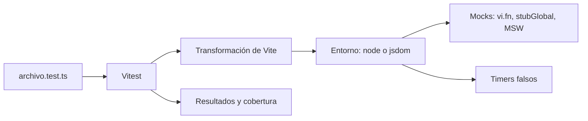

# Pruebas con Vitest y Jest

Parte de: [[04-JavaScript-Web/06 Avanzado/_Índice Avanzado|Avanzado]]

> [!info] Cómo avanzar
> `progreso`: **pendiente** → **viendo** (estudiando) → **visto** (contestaste la autoevaluación sin abrir las respuestas) → **dominado** (hiciste el laboratorio o lo aplicaste de verdad).

## Contenido

### Qué es
**Jest** y **Vitest** son *frameworks* de pruebas para JavaScript y TypeScript. Te dan todo lo necesario para escribir pruebas unitarias y de componentes: organizar casos (`describe`, `it`/`test`), afirmar resultados (`expect(...).toBe(...)`), crear dobles (*mocks*, *spies*), controlar el tiempo (timers falsos), medir cobertura y simular un DOM (con jsdom o happy-dom).

- **Jest** (originalmente de Meta) fue el estándar durante años, sobre todo en proyectos de React.
- **Vitest** es del ecosistema de [[Vite]]: tiene una API casi idéntica a la de Jest, pero reutiliza la configuración y las transformaciones de Vite.

Son el equivalente a xUnit/NUnit con Moq o NSubstitute en .NET.

### Cómo funciona
1. El runner encuentra los archivos de prueba (`*.test.ts`, `*.spec.ts`).
2. Transforma el código (TypeScript, JSX) y lo ejecuta en Node, con un entorno de DOM simulado si lo pides (`environment: 'jsdom'`).
3. Cada `it` corre; si un `expect` falla o la prueba lanza, se marca como fallida.
4. En modo *watch* vuelve a correr solo lo afectado al guardar.

#### Ventaja de Vitest en un proyecto con Vite
- **Una sola configuración**: usa el mismo `vite.config.ts` (alias, plugins de React, variables de entorno). Con Jest hay que replicar todo eso con transformadores (Babel o ts-jest) y `moduleNameMapper`.
- **ESM y TypeScript nativos**, sin configuración extra.
- **Rápido** en modo watch, porque reutiliza el pipeline de Vite.
- API compatible con Jest (`vi` en lugar de `jest`), lo que facilita migrar.

#### Código que usa `fetch` o timers
- **Timers**: `vi.useFakeTimers()` reemplaza `setTimeout`, `setInterval` y `Date`; avanzas el tiempo con `vi.advanceTimersByTime(ms)` o `await vi.advanceTimersByTimeAsync(ms)`. Restaura con `vi.useRealTimers()`.
- **`fetch`**: lo más simple es `vi.stubGlobal('fetch', vi.fn(...))` devolviendo una `Response` falsa; para muchas pruebas o de integración, **MSW** (Mock Service Worker) intercepta peticiones a nivel de red con manejadores por ruta, sin tocar tu código.
- Mejor aún: inyecta la dependencia (pasa el cliente HTTP o el reloj como parámetro) y así la prueba no necesita parchear globales.



### Ejemplo
Probar el `debounce` de [[Debounce y throttle]] y un servicio que llama a la API:

```ts
// utilidades.test.ts
import { describe, it, expect, vi, beforeEach, afterEach } from 'vitest';
import { debounce } from './utilidades';
import { obtenerCliente } from './servicioClientes';

describe('debounce', () => {
  beforeEach(() => vi.useFakeTimers());
  afterEach(() => vi.useRealTimers());

  it('ejecuta una vez después de la última llamada', () => {
    const fn = vi.fn();
    const d = debounce(fn, 300);
    d('a'); vi.advanceTimersByTime(100);
    d('b'); vi.advanceTimersByTime(299);
    expect(fn).not.toHaveBeenCalled();
    vi.advanceTimersByTime(1);
    expect(fn).toHaveBeenCalledOnce();
    expect(fn).toHaveBeenCalledWith('b');
  });
});

describe('obtenerCliente', () => {
  afterEach(() => vi.unstubAllGlobals());

  it('lanza un error con el código del ProblemDetails', async () => {
    vi.stubGlobal('fetch', vi.fn().mockResolvedValue(
      new Response(JSON.stringify({ title: 'No existe', codigo: 'CLIENTE_NO_ENCONTRADO' }), {
        status: 404, headers: { 'Content-Type': 'application/problem+json' },
      }),
    ));
    await expect(obtenerCliente(99)).rejects.toMatchObject({ codigo: 'CLIENTE_NO_ENCONTRADO' });
  });
});
```

Configuración en `vite.config.ts`:

```ts
/// <reference types="vitest/config" />
import { defineConfig } from 'vite';
import react from '@vitejs/plugin-react';

export default defineConfig({
  plugins: [react()],
  test: { environment: 'jsdom', setupFiles: ['./src/pruebas/setup.ts'], coverage: { reporter: ['text', 'cobertura'] } },
});
```

El reporte `cobertura` se publica en Azure DevOps con la tarea de cobertura del pipeline.

#### La prueba que pasa aunque falle
```ts
it('MAL: pasa siempre', () => {
  obtenerCliente(99).then((c) => expect(c.nombre).toBe('Ana')); // nadie espera esta promesa
});
```
La función de prueba termina antes de que la promesa se resuelva; el runner la da por buena y el `expect` falla después, sin efecto (o en otra prueba). Soluciones: hacer la prueba `async` y usar `await`, **devolver** la promesa, usar `await expect(p).resolves/rejects`, y en casos dudosos `expect.assertions(n)` para exigir que se ejecuten n afirmaciones.

### Cuándo usarlo y cuándo no
- **Vitest** si el proyecto usa Vite (Itzamna.Clio): menos configuración y más rapidez.
- **Jest** si ya está instalado y funciona bien, o en proyectos que no usan Vite; migrar solo por moda no siempre paga.
- Para componentes React, combínalos con Testing Library (probar lo que el usuario ve, no detalles internos).
- Para flujos completos en un navegador real, usa pruebas end-to-end con Playwright; las unitarias no sustituyen eso.
- El modo navegador de Vitest permite correr pruebas en un navegador real cuando jsdom no basta.

### Errores comunes
- **Promesas sin `await`** en las pruebas (visto arriba).
- **No restaurar mocks y timers** entre pruebas: una prueba contamina a la siguiente. Usa `afterEach` o `restoreMocks: true` en la configuración.
- **Probar detalles de implementación** (que se llamó una función interna) en lugar del comportamiento observable.
- **Mockear todo**: si mockeas el módulo bajo prueba, no estás probando nada.
- **Pruebas que dependen de la hora real o de la red**: frágiles y lentas.

### Para profundizar
- [Vitest: Getting Started](https://vitest.dev/guide/)
- [Vitest: Mocking](https://vitest.dev/guide/mocking)
- [Jest: documentación](https://jestjs.io/docs/getting-started)
- [Mock Service Worker](https://mswjs.io/docs/)

## Autoevaluación

Contesta primero en voz alta o en papel; luego despliega la respuesta.

> [!question]- ¿Qué ventaja tiene Vitest en un proyecto con Vite?
> Reutiliza la configuración y las transformaciones de Vite (TS, JSX, alias) sin configurar Babel, y su API es casi igual a la de Jest (`describe`, `it`, `expect`, `vi.fn`).

> [!question]- ¿Cómo pruebas código que usa `fetch` o timers?
> Simulas: `vi.spyOn(globalThis, 'fetch').mockResolvedValue(new Response(JSON.stringify(datos)))` o MSW para la red; `vi.useFakeTimers()` y `vi.advanceTimersByTime(300)` para timers (probar un debounce).

> [!question]- Error común: una prueba asíncrona pasa aunque el `expect` falle. ¿Por qué?
> No se esperó la promesa: falta `await` o retornarla, y la prueba termina antes. Con `await expect(p).rejects.toThrow()` y funciones `async` lo evitas.

