# INP (Interaction to Next Paint)

Parte de: [[Rendimiento web y Core Web Vitals]]

> [!info] Cómo avanzar
> `progreso`: **pendiente** → **viendo** (estudiando) → **visto** (contestaste la autoevaluación sin abrir las respuestas) → **dominado** (hiciste el laboratorio o lo aplicaste de verdad).

## Contenido

### Qué es
**INP** (*Interaction to Next Paint*) mide la **capacidad de respuesta** de una página: cuánto tiempo pasa desde que el usuario interactúa (clic, toque o tecla) hasta que el navegador **pinta el siguiente cuadro** que muestra el resultado. Considera **todas** las interacciones de la visita y reporta, en términos simples, una de las peores (para páginas con muchísimas interacciones se descartan unos pocos valores extremos). Es una de las [[Rendimiento web y Core Web Vitals|Core Web Vitals]] y sustituyó a FID en marzo de 2024.

Umbrales (percentil 75): **bueno ≤ 200 ms**, necesita mejora entre 200 y 500 ms, **malo > 500 ms**.

El scroll y el hover no cuentan como interacciones para INP.

### Cómo funciona
#### Las tres fases de una interacción
1. **Retraso de entrada** (*input delay*): desde que ocurre la interacción hasta que empiezan a correr sus handlers. Es alto si el hilo principal estaba ocupado con otra tarea (un script que se está evaluando, un timer pesado, otra interacción).
2. **Tiempo de procesamiento** (*processing duration*): lo que tardan en ejecutarse **todos** los handlers del evento (`pointerdown`, `pointerup`, `click`, `keydown`...).
3. **Retraso de presentación** (*presentation delay*): desde que terminan los handlers hasta que el navegador pinta el cuadro: recálculo de estilos, layout, paint y composite del DOM que modificaste ([[Pipeline de renderizado del navegador]]).

INP de esa interacción = suma de las tres.

```mermaid
gantt
    dateFormat x
    axisFormat %L ms
    section Interacción de 420 ms
    Retraso de entrada (otra tarea larga) :0, 150
    Procesamiento (handlers)              :150, 330
    Presentación (estilo, layout, paint)  :330, 420
```



Todo pasa en el hilo principal: cualquier **tarea larga** (más de 50 ms) que coincida con la interacción la empeora. Ver [[Event loop]].

### Ejemplo
Un filtro de tabla en Itzamna.Clio que congela la página al escribir:

```js
// ANTES: en cada tecla se filtran 20,000 filas y se re-pinta toda la tabla
input.addEventListener('input', (e) => {
  const texto = e.target.value.toLowerCase();
  const filtradas = clientes.filter((c) => c.nombre.toLowerCase().includes(texto));
  tbody.innerHTML = filtradas.map(filaHtml).join('');     // miles de nodos en un solo bloque
});
```

```js
// DESPUÉS: feedback inmediato, trabajo pesado después de ceder y con menos DOM
const cederAlHilo = () =>
  globalThis.scheduler?.yield ? scheduler.yield() : new Promise((r) => setTimeout(r, 0));

const filtrar = debounce(async (texto) => {
  await cederAlHilo();                                    // deja pintar el estado "buscando"
  const filtradas = clientes.filter((c) => c.nombreMinusculas.includes(texto));
  pintarPagina(filtradas.slice(0, 100));                  // pinta solo una página, no 20,000 filas
  contador.textContent = `${filtradas.length} resultados`;
}, 150);

input.addEventListener('input', (e) => {
  estado.textContent = 'Buscando…';                       // actualización mínima y rápida
  filtrar(e.target.value.toLowerCase());
});
```

Qué cambió por fase:
- **Procesamiento**: el handler hace solo lo urgente; el filtrado va diferido con [[Debounce y throttle]] y con el texto precalculado en minúsculas.
- **Presentación**: se pintan 100 filas en lugar de 20,000 (paginación o virtualización).
- **Retraso de entrada**: al ceder el hilo (`scheduler.yield()` donde exista, si no un `setTimeout`) otras interacciones no esperan detrás de una tarea enorme.

Para cálculos realmente pesados (parsear un Excel grande antes de enviarlo a Wee.Reporteria), muévelos a un **Web Worker**.

#### Encontrar la interacción lenta
- En campo: la librería `web-vitals` con su *attribution build* reporta qué elemento, qué tipo de evento y cuánto duró cada fase.
- En laboratorio: panel **Performance** de DevTools, graba mientras haces la interacción y busca la pista *Interactions* y las tareas largas marcadas en rojo. Usa throttling de CPU (4× o 6×) para simular un teléfono.

### Cuándo usarlo y cuándo no
- Mejorar INP importa en apps muy interactivas (formularios, tablas, filtros, editores) y en móviles modestos.
- Técnicas por fase:
  - Retraso de entrada: partir tareas largas, diferir scripts de terceros, evitar trabajo pesado en timers durante la interacción.
  - Procesamiento: handlers mínimos, diferir lo no visual (analítica, guardar en almacenamiento), evitar *layout thrashing*.
  - Presentación: menos DOM, `content-visibility: auto` para secciones fuera de pantalla, animar solo `transform` y `opacity`.
- En React: `startTransition` y `useDeferredValue` marcan actualizaciones no urgentes.
- No hace falta optimizar interacciones que ya están muy por debajo de 200 ms.

### Errores comunes
- **Creer que `async` en el handler lo hace no bloqueante**: el código síncrono antes del primer `await` sigue bloqueando.
- **Mostrar el feedback visual después del trabajo pesado**: el usuario no ve nada hasta que termina.
- **Pintar listas enormes completas** en vez de paginar o virtualizar.
- **Medir solo en una PC rápida**: el INP real lo dan los teléfonos de gama media.
- **Ignorar scripts de terceros** que ocupan el hilo principal justo cuando el usuario toca.

### Para profundizar
- [web.dev: Interaction to Next Paint (INP)](https://web.dev/articles/inp)
- [web.dev: Optimize INP](https://web.dev/articles/optimize-inp)
- [web.dev: Optimize long tasks](https://web.dev/articles/optimize-long-tasks)

## Autoevaluación

Contesta primero en voz alta o en papel; luego despliega la respuesta.

> [!question]- ¿Qué mide INP y cuál es el umbral "bueno"?
> La latencia entre una interacción (clic, tecla, toque) y el siguiente pintado, tomando una de las peores de la visita. Bueno: ≤ 200 ms; malo: > 500 ms. Reemplazó a FID como Core Web Vital en 2024.

> [!question]- ¿Qué tres fases componen una interacción?
> Retraso de entrada (el hilo está ocupado), tiempo de procesamiento (tus handlers) y retraso de presentación (render y pintado).

> [!question]- ¿Cómo mejoras un INP alto?
> Dividir tareas largas (> 50 ms), hacer solo lo urgente en el handler y diferir lo demás (`setTimeout`, `requestIdleCallback`), reducir el DOM que cambias y evitar layout thrashing.

## Práctica

- [[Lab 8 - Medir Core Web Vitals con DevTools y Lighthouse]]

