# LCP (Largest Contentful Paint)

Parte de: [[Rendimiento web y Core Web Vitals]]

> [!info] Cómo avanzar
> `progreso`: **pendiente** → **viendo** (estudiando) → **visto** (contestaste la autoevaluación sin abrir las respuestas) → **dominado** (hiciste el laboratorio o lo aplicaste de verdad).

## Contenido

### Qué es
**LCP** (*Largest Contentful Paint*) mide **cuánto tarda en pintarse el elemento de contenido más grande visible** en el viewport desde que el usuario empezó a navegar a la página. Es la métrica de **carga** de las [[Rendimiento web y Core Web Vitals|Core Web Vitals]]: aproxima el momento en que el usuario siente que "ya cargó lo importante".

Umbrales (percentil 75 de las visitas): **bueno ≤ 2.5 s**, necesita mejora entre 2.5 y 4 s, **malo > 4 s**.

### Cómo funciona
#### Qué elementos cuentan
Imágenes (``, `<image>` dentro de SVG, el póster de un `<video>`), elementos con `background-image` cargada por URL, y bloques de texto. El navegador va reportando candidatos conforme se pintan elementos más grandes; el valor final es el último candidato antes de que el usuario interactúe (clic, tecla o scroll) o salga. Se ignoran elementos invisibles (opacidad 0) y algunos que ocupan toda la pantalla y parecen fondos.

#### Las cuatro partes del LCP
Cuando el elemento LCP es una imagen, su tiempo se puede descomponer:
1. **TTFB** (*time to first byte*): desde el inicio de la navegación hasta que llega el primer byte del HTML. Depende del servidor, la red, redirecciones y caché.
2. **Retraso de carga del recurso** (*resource load delay*): desde el TTFB hasta que el navegador **empieza** a descargar la imagen. Es grande si la imagen se descubre tarde (la inserta JavaScript, está en un CSS, tiene `loading="lazy"`).
3. **Duración de carga del recurso** (*resource load duration*): lo que tarda en descargarse la imagen. Depende del peso y del formato.
4. **Retraso de renderizado del elemento** (*element render delay*): desde que terminó la descarga hasta que se pinta. Es grande si el hilo principal está ocupado, el CSS o el JS bloquean el render, o el elemento se oculta hasta que corre JavaScript.

Si el LCP es texto, las partes 2 y 3 son cero (o dependen de la fuente web).

```mermaid
gantt
    dateFormat x
    axisFormat %L ms
    section LCP 2400 ms
    TTFB                  :0, 600
    Retraso de carga      :600, 1100
    Duración de carga     :1100, 2000
    Retraso de render     :2000, 2400
```



Guía práctica: TTFB y la duración de carga suelen ser la mayor parte en una página bien hecha; si el retraso de carga o el de render son grandes, hay un problema de **descubrimiento** o de **bloqueo** que suele ser fácil de corregir.

### Ejemplo
Portada de catálogo con LCP lento y su corrección:

```html
<!-- ANTES: la imagen héroe la inserta JS después de pedir datos, con lazy y en JPEG pesado -->
<div id="heroe"></div>
<script type="module">
  const datos = await (await fetch('/api/portada')).json();
  document.querySelector('#heroe').innerHTML =
    ``;   // descubierta tardísimo
</script>
```

```html
<!-- DESPUÉS: imagen en el HTML inicial, priorizada, responsive y en formato moderno -->
<head>
  <link rel="preload" as="image" href="/img/portada-1200.avif" fetchpriority="high"
        imagesrcset="/img/portada-800.avif 800w, /img/portada-1200.avif 1200w" imagesizes="100vw">
</head>
<body>
  
</body>
```

(Si la imagen ya está en el HTML inicial, el `preload` suele sobrar; es útil cuando la imagen se descubre tarde, por ejemplo en un `background-image`.)

Del lado del servidor, para bajar el TTFB en el host ASP.NET Core: caché de salida para la página, compresión, estáticos con `Cache-Control: public, max-age=31536000, immutable` cuando llevan hash en el nombre, y una CDN.

Para ver qué elemento es el LCP: en DevTools, panel **Performance**, la marca LCP señala el nodo; o en la consola:

```js
new PerformanceObserver((lista) => {
  const ultima = lista.getEntries().at(-1);
  console.log('LCP', Math.round(ultima.startTime), 'ms', ultima.element);
}).observe({ type: 'largest-contentful-paint', buffered: true });
```

### Cuándo usarlo y cuándo no
- **Mídelo** en todas las páginas de entrada (inicio, landing, detalle de producto).
- En SPAs, LCP solo mide la **carga inicial**; las navegaciones internas sin recarga no generan LCP nuevo (los navegadores experimentan con métricas para *soft navigations*).
- Si el LCP es texto, enfócate en TTFB, CSS bloqueante y fuentes.
- En páginas renderizadas solo en cliente, el LCP depende de que el JS cargue y pida datos: considera prerender o SSR para páginas públicas ([[SEO y Open Graph]]).

### Errores comunes
- **`loading="lazy"` en la imagen principal**: el navegador la retrasa a propósito; el lazy es para lo que está **debajo** del pliegue.
- **Imagen del LCP inyectada por JavaScript** o como `background-image` en un CSS: se descubre tarde.
- **Imágenes enormes** sin `srcset` ni formato moderno.
- **CSS y JS bloqueantes** en el `<head>` que retrasan el render.
- **Ocultar el contenido hasta que "hidrata"** (spinners de pantalla completa, A/B testing que oculta la página).

### Para profundizar
- [web.dev: Largest Contentful Paint (LCP)](https://web.dev/articles/lcp)
- [web.dev: Optimize LCP](https://web.dev/articles/optimize-lcp)
- [MDN: fetchpriority](https://developer.mozilla.org/en-US/docs/Web/HTML/Reference/Attributes/fetchpriority)

## Autoevaluación

Contesta primero en voz alta o en papel; luego despliega la respuesta.

> [!question]- ¿Qué mide LCP y cuál es el umbral "bueno"?
> El tiempo hasta que se pinta el elemento de contenido más grande visible (imagen, video poster o bloque de texto). Bueno: ≤ 2.5 s; malo: > 4 s.

> [!question]- ¿En qué partes se descompone el LCP?
> TTFB (respuesta del servidor), retraso de carga del recurso, duración de la descarga y retraso de render. DevTools muestra este desglose en Performance.

> [!question]- Error común que empeora el LCP.
> Poner `loading="lazy"` en la imagen principal, o cargarla desde CSS/JS, de modo que el navegador la descubre tarde.

## Práctica

- [[Lab 8 - Medir Core Web Vitals con DevTools y Lighthouse]]

