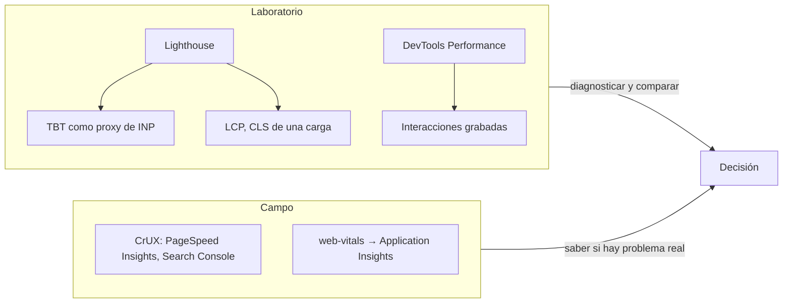

# Rendimiento web y Core Web Vitals

Parte de: [[04-JavaScript-Web/06 Avanzado/_Índice Avanzado|Avanzado]]

> [!info] Cómo avanzar
> `progreso`: **pendiente** → **viendo** (estudiando) → **visto** (contestaste la autoevaluación sin abrir las respuestas) → **dominado** (hiciste el laboratorio o lo aplicaste de verdad).

## Contenido

### Qué es
El **rendimiento web** es qué tan rápido carga una página, qué tan pronto responde cuando el usuario interactúa y qué tan estable se ve mientras lo hace. Las **Core Web Vitals** son tres métricas que Google definió para medir esa experiencia desde el punto de vista del usuario real, y que también usa como señal (entre muchas) en la búsqueda:

| Métrica | Qué mide | Bueno | Malo |
|---|---|---|---|
| [[LCP (Largest Contentful Paint)]] | **Carga**: cuándo aparece el contenido principal | ≤ 2.5 s | > 4 s |
| [[INP (Interaction to Next Paint)]] | **Respuesta**: cuánto tarda la página en reaccionar visualmente a las interacciones | ≤ 200 ms | > 500 ms |
| [[CLS (Cumulative Layout Shift)]] | **Estabilidad visual**: cuánto "brinca" el contenido | ≤ 0.1 | > 0.25 |

Se evalúan en el **percentil 75** de las visitas, separando móvil y escritorio: una página "pasa" si al menos el 75 % de las visitas tienen valores buenos. INP sustituyó a FID (First Input Delay) como métrica de respuesta en marzo de 2024.

Métricas de apoyo útiles para diagnosticar: **TTFB** (tiempo hasta el primer byte del servidor), **FCP** (primer contenido pintado) y **TBT** (tiempo total en que el hilo principal estuvo bloqueado durante la carga).

### Cómo funciona
#### Datos de laboratorio vs datos de campo
- **Laboratorio** (*lab*): una herramienta carga la página en condiciones controladas (un dispositivo y red simulados) y mide. Ejemplos: **Lighthouse**, el panel Performance de DevTools, WebPageTest. Ventajas: reproducible, sirve para depurar y para comparar antes y después de un cambio. Limitación: es **una** carga en **un** entorno, no tus usuarios.
- **Campo** (*field*, RUM: *real user monitoring*): mediciones de **usuarios reales** con sus teléfonos, redes y comportamientos. Ejemplos: el informe **CrUX** (Chrome User Experience Report) que muestran PageSpeed Insights y Search Console, o tu propia recolección con la librería `web-vitals` enviando datos a Application Insights. Es lo que de verdad vive el usuario y lo que Google evalúa.

Lo normal es que no coincidan: Lighthouse puede dar verde y el campo estar en rojo (usuarios con equipos más lentos) o al revés.

#### Por qué Lighthouse no puede medir INP
INP necesita **interacciones reales**: clics, toques y teclas a lo largo de la visita. Una auditoría de carga de Lighthouse solo abre la página y no interactúa, así que no hay nada que medir. Como aproximación de laboratorio reporta **TBT**: si el hilo principal tiene tareas largas durante la carga, probablemente las interacciones también se atoren. Para estudiar interacciones concretas en laboratorio se graban en el panel Performance de DevTools o con el modo *timespan* de Lighthouse mientras interactúas.



### Ejemplo
Recolectar las tres métricas de usuarios reales de Itzamna.Clio:

```js
import { onLCP, onINP, onCLS } from 'web-vitals';

function enviar({ name, value, rating, id }) {
  const cuerpo = JSON.stringify({ name, value, rating, id, ruta: location.pathname });
  // sendBeacon sobrevive al cierre de la pestaña
  navigator.sendBeacon?.('/api/telemetria/vitals', cuerpo) ||
    fetch('/api/telemetria/vitals', { method: 'POST', body: cuerpo, keepalive: true });
}

onLCP(enviar);
onINP(enviar);
onCLS(enviar);
```

#### Mejoras de alto impacto para una página lenta
1. **Imagen principal optimizada y priorizada**: formato moderno (AVIF/WebP), tamaño adecuado con `srcset`, `fetchpriority="high"` y **sin** `loading="lazy"` en la imagen del LCP.
2. **Menos JavaScript en la ruta crítica**: dividir el bundle por rutas (`import()` dinámico), quitar dependencias pesadas, diferir lo no esencial. Mejora LCP e INP.
3. **Dimensiones reservadas** para imágenes, anuncios y contenido que llega después (`width`/`height` o `aspect-ratio`): elimina CLS.
4. **Servidor y caché**: TTFB bajo con caché HTTP para estáticos con hash, compresión (Brotli), CDN (por ejemplo Azure Front Door) y consultas SQL eficientes en la API.
5. **Partir tareas largas** en el hilo principal y evitar *layout thrashing* ([[Pipeline de renderizado del navegador]]).
6. **Fuentes**: `font-display: swap` y precarga de las fuentes críticas.

### Cuándo usarlo y cuándo no
- **Mide primero en campo** para saber si hay problema y en qué páginas; **diagnostica en laboratorio** para encontrar la causa.
- Prioriza páginas con más tráfico o más valor (inicio, catálogo, checkout).
- En apps internas detrás de login no hay CrUX público; ahí el RUM propio es la única fuente de campo.
- No persigas un 100 en Lighthouse como objetivo: la meta es que el percentil 75 de usuarios reales esté en verde.

### Errores comunes
- **Optimizar solo con Lighthouse en una laptop rápida** y declarar victoria.
- **Medir con caché caliente y sin throttling**: usa throttling de CPU y red en DevTools.
- **Confundir FID con INP**: FID solo medía el retraso de la **primera** interacción; INP considera todas.
- **Ignorar el móvil**: los umbrales se evalúan por separado y el móvil suele ser el que falla.
- **Agregar scripts de terceros** (chat, analítica, A/B) sin medir su impacto.

### Para profundizar
- [web.dev: Web Vitals](https://web.dev/articles/vitals)
- [web.dev: Lab and field data](https://web.dev/articles/lab-and-field-data-differences)
- [Chrome for Developers: Lighthouse overview](https://developer.chrome.com/docs/lighthouse/overview)
- [GitHub: GoogleChrome/web-vitals](https://github.com/GoogleChrome/web-vitals)

## Subtemas

- [[LCP (Largest Contentful Paint)]]
- [[INP (Interaction to Next Paint)]]
- [[CLS (Cumulative Layout Shift)]]

## Autoevaluación

Contesta primero en voz alta o en papel; luego despliega la respuesta.

> [!question]- ¿Cuáles son las Core Web Vitals y qué miden?
> **LCP** (carga: cuándo se pinta el elemento más grande), **INP** (respuesta: latencia de las interacciones) y **CLS** (estabilidad visual: cuánto se mueve el diseño).

> [!question]- ¿Qué diferencia hay entre datos de laboratorio y de campo?
> Laboratorio (Lighthouse, DevTools): una carga simulada en condiciones controladas, útil para depurar. Campo (CrUX, librería `web-vitals`): usuarios reales, en el percentil 75. Google evalúa con datos de campo.

> [!question]- ¿Por qué Lighthouse no puede medir INP?
> INP necesita interacciones reales del usuario durante la visita. En laboratorio se usa como aproximación el *Total Blocking Time* (TBT), o mides INP interactuando tú con el panel Performance.

> [!question]- Menciona tres mejoras de alto impacto para una página lenta.
> Optimizar y priorizar la imagen principal (tamaño correcto, formato moderno, `fetchpriority="high"`), reducir y diferir JS (`defer`, división de código) y reservar espacio para imágenes/anuncios (`width`/`height`, `aspect-ratio`).

## Práctica

- [[Lab 8 - Medir Core Web Vitals con DevTools y Lighthouse]]

## Progreso de los subtemas

```base
filters:
  and:
    - file.inFolder("04-JavaScript-Web/06 Avanzado/Rendimiento web y Core Web Vitals")
    - file.name != "Rendimiento web y Core Web Vitals"
views:
  - type: table
    name: Progreso
    order:
      - file.name
      - progreso
      - nivel
```
