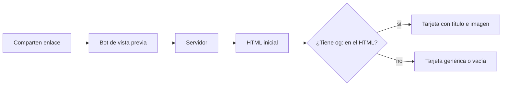

# SEO y Open Graph

Parte de: [[04-JavaScript-Web/06 Avanzado/_Índice Avanzado|Avanzado]]

> [!info] Cómo avanzar
> `progreso`: **pendiente** → **viendo** (estudiando) → **visto** (contestaste la autoevaluación sin abrir las respuestas) → **dominado** (hiciste el laboratorio o lo aplicaste de verdad).

## Contenido

### Qué es
**SEO** (*Search Engine Optimization*) es el conjunto de prácticas para que los buscadores entiendan, indexen y muestren bien tus páginas. **Open Graph** es un protocolo de etiquetas `<meta>` (creado por Facebook y adoptado por casi todas las redes y mensajerías) que define cómo se ve tu página **cuando alguien comparte el enlace**: título, descripción e imagen de la tarjeta de vista previa en WhatsApp, LinkedIn, Slack, Teams, Facebook o X.

Para apps internas detrás de login (como Itzamna.Clio) el SEO importa poco; para sitios públicos, landing pages, documentación o un portafolio, es esencial.

### Cómo funciona
#### Lo básico en el `<head>`
- `<title>` único y descriptivo por página (es el texto azul del resultado de búsqueda).
- `<meta name="description">`: resumen que el buscador puede usar como fragmento.
- `<link rel="canonical" href="...">`: la URL "oficial" cuando el mismo contenido se alcanza por varias (con parámetros, con y sin `www`).
- `<meta name="viewport">` para móviles, y `lang` en `<html>`.
- `<meta name="robots" content="noindex">` en páginas que no deben indexarse (resultados de búsqueda internos, entornos de prueba).
- Fuera del `<head>`: HTML semántico (un `<h1>` por página, encabezados en orden, enlaces con texto descriptivo, `alt` en imágenes), un `sitemap.xml`, `robots.txt` y buen rendimiento ([[Rendimiento web y Core Web Vitals]]).
- **Datos estructurados** (JSON-LD con vocabulario de schema.org) para resultados enriquecidos: productos, artículos, preguntas frecuentes.

#### Open Graph y tarjetas
Etiquetas `<meta property="og:...">`: `og:title`, `og:description`, `og:image` (URL absoluta; lo común es 1200 × 630 px), `og:url`, `og:type` (`website`, `article`) y `og:locale` (`es_MX`). X usa además `twitter:card` (`summary_large_image`) y cae a las de Open Graph si faltan las suyas.

#### Cómo las leen
1. Un **rastreador** pide la URL y recibe el HTML.
2. El rastreador de Google puede **ejecutar JavaScript** (renderiza con un Chromium), aunque ese renderizado puede llegar después del primer rastreo.
3. Los rastreadores de **vistas previas sociales** (WhatsApp, LinkedIn, Slack, Facebook) **no ejecutan JavaScript**: leen solo el HTML inicial.



### Ejemplo
`<head>` de una página de producto:

```html
<html lang="es-MX">
<head>
  <meta charset="utf-8">
  <meta name="viewport" content="width=device-width, initial-scale=1">
  <title>Café de Chiapas 500 g | Tienda Pochteca</title>
  <meta name="description" content="Café de altura de Chiapas, tostado medio, molido o en grano. Envío a todo México.">
  <link rel="canonical" href="https://tienda.ejemplo.mx/productos/cafe-chiapas-500g">

  <meta property="og:type" content="website">
  <meta property="og:title" content="Café de Chiapas 500 g">
  <meta property="og:description" content="Café de altura, tostado medio. Envío a todo México.">
  <meta property="og:image" content="https://tienda.ejemplo.mx/img/og/cafe-chiapas.jpg">
  <meta property="og:url" content="https://tienda.ejemplo.mx/productos/cafe-chiapas-500g">
  <meta property="og:locale" content="es_MX">
  <meta name="twitter:card" content="summary_large_image">

  <script type="application/ld+json">
  { "@context": "https://schema.org", "@type": "Product", "name": "Café de Chiapas 500 g",
    "offers": { "@type": "Offer", "price": "189.00", "priceCurrency": "MXN", "availability": "https://schema.org/InStock" } }
  </script>
</head>
```

#### El problema de la SPA que arma el `<head>` con JS
Si tu SPA (React + Vite, o un router por hash) sirve el mismo `index.html` para todas las rutas y luego cambia `document.title` y las `og:` con JavaScript:
- Los bots sociales ven **las etiquetas genéricas del `index.html`** (o ninguna) para cualquier enlace: todas las tarjetas se ven iguales.
- Google puede indexar el contenido renderizado, pero con retraso y menos fiabilidad.
- Con router por hash (`#/producto/5`), el fragmento ni siquiera llega al servidor: todas las URLs son la misma para los buscadores.

Soluciones, de menor a mayor esfuerzo:
- **Prerender en build** (generar HTML estático por ruta) para páginas públicas que cambian poco.
- **Inyectar las etiquetas en el servidor**: el host ASP.NET Core que sirve la SPA puede reemplazar marcadores en `index.html` según la ruta antes de enviarlo.
- **SSR** con un framework que renderice en servidor.
- Separar la parte pública (sitio estático o renderizado en servidor) de la app privada.

```csharp
// Program.cs: index.html con og: por producto (simplificado; usa HtmlEncoder para los datos)
app.MapGet("/productos/{slug}", async (string slug, IProductosConsulta consulta, IWebHostEnvironment env, HtmlEncoder enc) =>
{
    var p = await consulta.ObtenerPorSlugAsync(slug);
    if (p is null) return Results.NotFound();
    var html = await File.ReadAllTextAsync(Path.Combine(env.WebRootPath, "index.html"));
    html = html.Replace("%OG_TITLE%", enc.Encode(p.Nombre)).Replace("%OG_IMAGE%", enc.Encode(p.ImagenUrl));
    return Results.Content(html, "text/html; charset=utf-8");
});
```

### Cuándo usarlo y cuándo no
- **Siempre** lo básico (`title`, `description`, `lang`, semántica) aunque la app sea interna: mejora accesibilidad y pestañas.
- **Open Graph** en todo lo que se comparta por enlace.
- **SSR o prerender** solo para páginas públicas que deben posicionar o compartirse; la app detrás de login no lo necesita y debe llevar `noindex`.

### Errores comunes
- **El mismo `<title>` en todas las páginas**.
- **`og:image` con ruta relativa** o imagen muy pesada: no aparece la vista previa.
- **Confiar en JS para las `og:`** (visto arriba).
- **Olvidar `canonical`** con parámetros de rastreo (`?utm_source=`): contenido duplicado.
- **Indexar entornos de pruebas**: protégelos con autenticación o `noindex`.

### Para profundizar
- [Google Search Central: SEO Starter Guide](https://developers.google.com/search/docs/fundamentals/seo-starter-guide)
- [Google Search Central: JavaScript SEO basics](https://developers.google.com/search/docs/crawling-indexing/javascript/javascript-seo-basics)
- [The Open Graph protocol](https://ogp.me/)
- [schema.org](https://schema.org/)

## Autoevaluación

Contesta primero en voz alta o en papel; luego despliega la respuesta.

> [!question]- ¿Qué elementos básicos de SEO pones en el `<head>`?
> `<title>` único y descriptivo, `<meta name="description">`, `<link rel="canonical">`, `lang` en `<html>` y `viewport`. Además HTML semántico, encabezados ordenados y `alt` en imágenes.

> [!question]- ¿Qué son las etiquetas Open Graph?
> Metadatos `<meta property="og:title|og:description|og:image|og:url">` que leen redes y mensajería para armar la vista previa al compartir un enlace.

> [!question]- Caso: tu SPA arma el `<title>` y los `og:` con JS. ¿Qué problema hay?
> Muchos *crawlers* de vistas previas no ejecutan JS: verán el HTML vacío. Para portfolios conviene generar el HTML estático o con SSR para que las etiquetas vengan en la respuesta.

