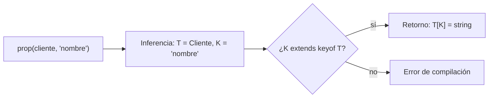

# TypeScript - genéricos

Parte de: [[04-JavaScript-Web/06 Avanzado/_Índice Avanzado|Avanzado]]

> [!info] Cómo avanzar
> `progreso`: **pendiente** → **viendo** (estudiando) → **visto** (contestaste la autoevaluación sin abrir las respuestas) → **dominado** (hiciste el laboratorio o lo aplicaste de verdad).

## Contenido

### Qué es
Un **genérico** es un tipo **parametrizado**: una función, clase, interfaz o alias que recibe un tipo como "argumento" (`<T>`) para funcionar con muchos tipos **sin perder la información** de cuál es. En lugar de escribir `primeroDeNumeros`, `primeroDeClientes`, etc., o de usar `any` y perder la verificación, escribes `primero<T>(xs: T[]): T | undefined` y el compilador conecta el tipo de entrada con el de salida.

Es la misma idea que `List<T>` o `Task<T>` en C#. La diferencia es que en TypeScript los genéricos **se borran** al compilar: no existen en ejecución.

### Cómo funciona
#### Parámetros de tipo e inferencia
```ts
function primero<T>(xs: T[]): T | undefined { return xs[0]; }
primero([1, 2]);            // T se infiere como number → number | undefined
primero(['a', 'b']);        // string | undefined
primero<Cliente>([]);       // T explícito
```
El compilador **infiere** `T` a partir de los argumentos; casi nunca necesitas escribirlo.

#### Restricciones con `extends`
Sin restricciones, dentro de la función `T` puede ser cualquier cosa, así que no puedes usar sus propiedades. Con `extends` limitas qué tipos se aceptan y ganas acceso:
```ts
function mayor<T extends { total: number }>(xs: T[]): T | undefined {
  return xs.reduce<T | undefined>((m, x) => (m && m.total >= x.total ? m : x), undefined);
}
```
`T` puede ser `Pedido`, `Factura` o lo que tenga `total: number`, y el resultado conserva el tipo exacto (no se reduce a `{ total: number }`).

#### `keyof` y tipos indexados
`keyof T` es la unión de las llaves de `T`; `T[K]` es el tipo de la propiedad `K`. Juntos permiten funciones como "dame la propiedad `k` de `o`" con el tipo exacto del valor.

#### Valores por defecto
`type Respuesta<T = unknown> = { datos: T; total: number }`.



### Ejemplo
`prop` con el tipo correcto:

```ts
function prop<T, K extends keyof T>(o: T, k: K): T[K] {
  return o[k];
}

const cliente = { id: 7, nombre: 'Ana', activo: true };
const n = prop(cliente, 'nombre');   // string
const a = prop(cliente, 'activo');   // boolean
prop(cliente, 'correo');             // Error: '"correo"' no es asignable a '"id" | "nombre" | "activo"'
```

`fetchJson` tipado, el caso más común en el front de Itzamna.Clio:

```ts
export interface Pagina<T> {
  datos: T[];
  total: number;
  pagina: number;
}

export async function fetchJson<T>(url: string, init?: RequestInit): Promise<T> {
  const r = await fetch(url, { ...init, headers: { Accept: 'application/json', ...init?.headers } });
  if (!r.ok) throw new Error(`HTTP ${r.status} en ${url}`);
  return (await r.json()) as T;   // el genérico declara lo que esperas; no lo valida
}

interface Cliente { id: number; nombre: string }

const pagina = await fetchJson<Pagina<Cliente>>('/api/clientes?pagina=1');
pagina.datos[0]?.nombre;          // string | undefined, con autocompletado
```

Ojo: el `as T` es una **promesa al compilador**, no una verificación. Si la API cambia, el tipo miente. Para datos críticos, pasa una función validadora y deja que el tipo se infiera de ella:

```ts
export async function fetchValidado<T>(url: string, validar: (x: unknown) => T): Promise<T> {
  const r = await fetch(url);
  if (!r.ok) throw new Error(`HTTP ${r.status}`);
  return validar(await r.json());
}
```

Un genérico en una clase, por ejemplo una caché simple con expiración:

```ts
export class Cache<K, V> {
  #datos = new Map<K, { valor: V; vence: number }>();
  constructor(private readonly ttlMs: number) {}

  obtener(k: K): V | undefined {
    const e = this.#datos.get(k);
    if (!e || e.vence < Date.now()) { this.#datos.delete(k); return undefined; }
    return e.valor;
  }
  guardar(k: K, valor: V): void { this.#datos.set(k, { valor, vence: Date.now() + this.ttlMs }); }
}

const clientes = new Cache<number, Cliente>(60_000);
```

### Cuándo usarlo y cuándo no
- **Sí** cuando el tipo de salida **depende** del de entrada: utilidades de colecciones, clientes HTTP, cachés, stores, componentes de React como una `Tabla<T>`.
- **No** si el parámetro de tipo aparece una sola vez: `function log<T>(x: T): void` no gana nada frente a `x: unknown`.
- Prefiere **pocas** restricciones claras a tipos condicionales complejos; si nadie del equipo entiende la firma, simplifícala.
- Los genéricos no sustituyen la validación en ejecución de datos externos.

### Errores comunes
- **Olvidar `extends`** y luego no poder acceder a propiedades de `T`.
- **Anotar `T` cuando la inferencia ya lo resuelve**: ruido.
- **Usar `as T` como si validara**: es solo una aserción.
- **Genéricos que se reducen a `unknown`** porque no hay argumento del cual inferir (`fetchJson('/api')` sin `<T>` da `unknown`, lo que en realidad es seguro, pero sorprende).
- **Confundir `extends` de genéricos con herencia de clases**: aquí significa "debe ser asignable a".

### Para profundizar
- [TypeScript Handbook: Generics](https://www.typescriptlang.org/docs/handbook/2/generics.html)
- [TypeScript Handbook: Keyof Type Operator](https://www.typescriptlang.org/docs/handbook/2/keyof-types.html)
- [TypeScript Handbook: Indexed Access Types](https://www.typescriptlang.org/docs/handbook/2/indexed-access-types.html)

## Ejercicios

Resuélvelos en papel o en la herramienta; la solución está plegada.

> [!question]- Escribe `prop(o, k)` que devuelva el valor con el tipo correcto.
> ```ts
> function prop<T, K extends keyof T>(o: T, k: K): T[K] {
>   return o[k];
> }
> const v = prop({ a: 1, b: 'x' }, 'b'); // string
> ```

> [!question]- ¿Qué tipo infiere `primero([1, 2])` con `primero<T>(xs: T[]): T | undefined`?
> `number | undefined`.

## Autoevaluación

Contesta primero en voz alta o en papel; luego despliega la respuesta.

> [!question]- ¿Qué es un genérico?
> Un parámetro de tipo: la función o tipo trabaja con cualquier tipo, conservando la relación entre entrada y salida. `function primero<T>(xs: T[]): T | undefined`.

> [!question]- ¿Para qué sirve `extends` en un genérico?
> Para restringir: `<T extends { length: number }>` acepta solo tipos con `length`. `<K extends keyof T>` acepta solo claves de `T`.

> [!question]- Caso común: tipar `fetchJson`. ¿Cómo?
> `async function fetchJson<T>(url: string): Promise<T> { const r = await fetch(url); if (!r.ok) throw new Error(String(r.status)); return r.json() as Promise<T>; }` — recuerda que es una afirmación, no validación.

## Práctica

- [[Lab 7 - TypeScript básico con un módulo de carrito]]

