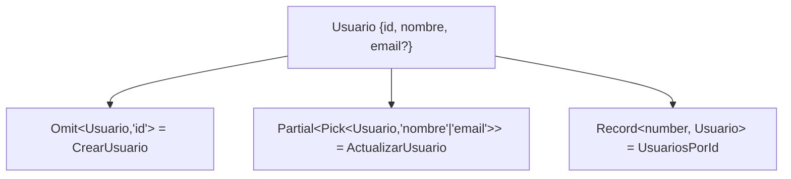

# TypeScript - interfaces y types

Parte de: [[04-JavaScript-Web/06 Avanzado/_Índice Avanzado|Avanzado]]

> [!info] Cómo avanzar
> `progreso`: **pendiente** → **viendo** (estudiando) → **visto** (contestaste la autoevaluación sin abrir las respuestas) → **dominado** (hiciste el laboratorio o lo aplicaste de verdad).

## Contenido

### Qué es
En TypeScript hay dos formas de **ponerle nombre a la forma de un objeto**: `interface` y `type` (alias de tipo). Ambas describen contratos como "un usuario tiene `id`, `nombre` y opcionalmente `email`", y para objetos sencillos son casi intercambiables. Encima de ellas, TypeScript trae **tipos utilitarios** (`Partial`, `Pick`, `Omit`, `Record`, entre otros) que **derivan** tipos nuevos de los existentes, para no repetir definiciones: el tipo del cuerpo de creación, el de actualización parcial o el de un diccionario.

### Cómo funciona
#### `interface`
```ts
interface Usuario { id: number; nombre: string; email?: string; }
interface Admin extends Usuario { permisos: string[]; }
```
- Solo describe **objetos** (y clases que la implementan con `implements`).
- Se **extiende** con `extends`.
- Admite **fusión de declaraciones**: dos `interface Usuario` en el mismo ámbito se combinan. Útil para ampliar tipos de librerías (`Window`), sorprendente si ocurre sin querer.

#### `type`
```ts
type Usuario = { id: number; nombre: string; email?: string };
type Admin = Usuario & { permisos: string[] };      // intersección
type Estado = 'activo' | 'suspendido';             // unión: solo con type
type Par = [string, number];                       // tupla
type Manejador = (e: Event) => void;               // función
```
- Puede nombrar **cualquier tipo**: uniones, tuplas, funciones, primitivos, tipos mapeados y condicionales.
- No se fusiona: declarar dos veces el mismo nombre es error.

Regla práctica: `interface` para formas de objetos públicas y extensibles (o lo que pida tu guía de estilo), `type` para uniones, tuplas, funciones y composiciones. Lo importante es ser consistente en el proyecto.

#### Modificadores
- `?` propiedad opcional (puede faltar).
- `readonly` no se puede reasignar (solo en verificación; en ejecución sí se podría).

#### Tipos utilitarios clave
| Utilitario | Qué hace | Ejemplo |
|---|---|---|
| `Partial<T>` | Todas las propiedades opcionales | Cuerpo de un PATCH |
| `Required<T>` | Todas obligatorias | Configuración ya completada |
| `Readonly<T>` | Todas de solo lectura | Estado inmutable |
| `Pick<T, K>` | Solo las llaves `K` | Vista resumida |
| `Omit<T, K>` | Todas excepto `K` | Cuerpo de creación sin `id` |
| `Record<K, V>` | Objeto con llaves `K` y valores `V` | Diccionario por id o por estado |

#### Verificación de propiedades extra
Cuando asignas un **objeto literal nuevo** directamente a una variable o parámetro tipado, TypeScript marca error si trae propiedades que el tipo no declara (*excess property check*): suele ser un error de dedo (`emial`). Si el objeto viene de **otra variable**, no se marca, porque el tipado es **estructural**: basta con que tenga al menos las propiedades requeridas.



### Ejemplo
Contratos del front para la API de usuarios de Itzamna.Dionisio:

```ts
export interface Usuario {
  readonly id: number;
  nombre: string;
  email?: string;
}

// POST /api/usuarios: todo menos el id, que lo genera la base de datos
export type CrearUsuario = Omit<Usuario, 'id'>;

// PATCH /api/usuarios/{id}: solo nombre o email, ambos opcionales
export type ActualizarUsuario = Partial<Pick<Usuario, 'nombre' | 'email'>>;

export type UsuariosPorId = Record<number, Usuario>;

const nuevo: CrearUsuario = { nombre: 'Ana López', email: 'ana@ejemplo.mx' };
const cambios: ActualizarUsuario = { email: 'ana.lopez@ejemplo.mx' };
const cache: UsuariosPorId = { 7: { id: 7, nombre: 'Luis' } };
```

Verificación de propiedades extra en acción:

```ts
const u1: Usuario = { id: 1, nombre: 'Ana', emial: 'x@y.mx' };
// Error: el literal solo puede especificar propiedades conocidas; 'emial' no existe en 'Usuario'

const crudo = { id: 2, nombre: 'Luis', rol: 'admin' };
const u2: Usuario = crudo;   // OK: estructuralmente cumple (tiene id y nombre)
```

`Record` con una unión de llaves obliga a cubrir todos los casos:

```ts
type EstadoPedido = 'pendiente' | 'pagado' | 'cancelado';
const etiquetas: Record<EstadoPedido, string> = {
  pendiente: 'Por pagar',
  pagado: 'Pagado',
  cancelado: 'Cancelado',     // si falta uno, error
};
```

En .NET, el contrato equivalente serían los records de request y response del controller; mantener los nombres alineados (o generarlos desde el OpenAPI de la API con un script de Node) evita que el front y la API se desincronicen.

### Cuándo usarlo y cuándo no
- **Deriva en lugar de duplicar**: si `CrearUsuario` se define a mano y luego agregas un campo a `Usuario`, se te olvida actualizarlo. Con `Omit` se mantiene solo.
- **No abuses** de utilitarios anidados ilegibles: si un tipo derivado tiene significado propio, dale nombre.
- Los tipos describen; **no validan** en ejecución. El cuerpo que llega del servidor puede no cumplir el contrato si la API cambió: valida en la frontera.
- Para variantes de un objeto con campos distintos, usa uniones discriminadas ([[TypeScript - uniones y narrowing]]), no un solo tipo con todo opcional.

### Errores comunes
- **Todo opcional "por si acaso"**: el compilador ya no te ayuda y aparecen `undefined` por todos lados.
- **Fusión accidental** de dos `interface` con el mismo nombre en archivos globales.
- **Confundir `Partial` con "puede tener más propiedades"**: solo vuelve opcionales las existentes.
- **Esperar el error de propiedades extra** en objetos que vienen de otra variable.
- **`Record<string, T>` y acceso sin verificar**: con `noUncheckedIndexedAccess` desactivado, `cache['x']` parece `T` aunque no exista.

### Para profundizar
- [TypeScript Handbook: Object Types](https://www.typescriptlang.org/docs/handbook/2/objects.html)
- [TypeScript Handbook: Utility Types](https://www.typescriptlang.org/docs/handbook/utility-types.html)
- [TypeScript Handbook: Differences Between Type Aliases and Interfaces](https://www.typescriptlang.org/docs/handbook/2/everyday-types.html#differences-between-type-aliases-and-interfaces)

## Ejercicios

Resuélvelos en papel o en la herramienta; la solución está plegada.

> [!question]- Define `Usuario { id, nombre, email? }` y un tipo para el cuerpo de creación sin `id`.
> ```ts
> interface Usuario { id: number; nombre: string; email?: string }
> type NuevoUsuario = Omit<Usuario, 'id'>;
> ```

> [!question]- Tipo para un PATCH que permita cambiar solo `nombre` o `email`, ambos opcionales.
> `type PatchUsuario = Partial<Pick<Usuario, 'nombre' | 'email'>>;`

## Autoevaluación

Contesta primero en voz alta o en papel; luego despliega la respuesta.

> [!question]- ¿Qué diferencia hay entre `interface` y `type`?
> Ambos describen la forma de objetos. `interface` se puede extender con `extends` y **fusionar** (dos declaraciones con el mismo nombre se juntan). `type` además puede ser uniones, tuplas, primitivos o tipos mapeados. Para objetos públicos cualquiera sirve; sé consistente.

> [!question]- ¿Qué hacen `Partial`, `Pick`, `Omit` y `Record`?
> `Partial<T>`: todo opcional. `Pick<T, 'a'|'b'>`: solo esas claves. `Omit<T, 'id'>`: todas menos esas. `Record<K, V>`: objeto con claves K y valores V.

> [!question]- Caso: pasas un objeto literal con una propiedad extra a una variable tipada. ¿Qué pasa?
> Error de *excess property check* ("Object literal may only specify known properties"). Solo aplica a literales directos; un objeto en variable con más propiedades sí se acepta.

## Práctica

- [[Lab 7 - TypeScript básico con un módulo de carrito]]

