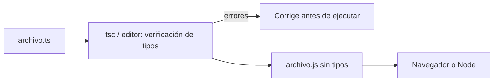

# TypeScript - tipos básicos

Parte de: [[04-JavaScript-Web/06 Avanzado/_Índice Avanzado|Avanzado]]

> [!info] Cómo avanzar
> `progreso`: **pendiente** → **viendo** (estudiando) → **visto** (contestaste la autoevaluación sin abrir las respuestas) → **dominado** (hiciste el laboratorio o lo aplicaste de verdad).

## Contenido

### Qué es
**TypeScript** agrega a JavaScript un sistema de **tipos estáticos** que se verifica antes de ejecutar: el compilador (`tsc`, o el editor en vivo) revisa que uses los valores de forma coherente y luego **borra los tipos**, generando JavaScript normal. Los tipos no existen en tiempo de ejecución. Esta nota cubre los tipos básicos y cómo razona el compilador; el panorama general está en [[TypeScript]].

### Cómo funciona
#### Tipos primitivos y compuestos
- Primitivos: `string`, `number` (no hay `int` separado), `boolean`, `bigint`, `symbol`, `null`, `undefined`.
- Arreglos: `number[]` o `Array<number>`. Tuplas: `[string, number]` (longitud y tipos por posición).
- Objetos: `{ id: number; nombre: string; email?: string }` (el `?` marca opcional; ver [[TypeScript - interfaces y types]]).
- Funciones: `(a: number, b: number) => number`.
- Literales: `'pendiente' | 'pagado'` (solo esos valores; ver [[TypeScript - uniones y narrowing]]).
- `void`: la función no devuelve nada útil.

#### Inferencia
No tienes que anotar todo: TypeScript **infiere** el tipo a partir del valor. `let total = 0` es `number`; `const estado = 'pagado'` es el literal `'pagado'` (porque `const` no cambia); `[1, 2].map((x) => x * 2)` es `number[]`. La regla práctica: anota **parámetros de funciones** y **contratos públicos** (lo que exporta un módulo, respuestas de la API); deja que infiera las variables locales y, normalmente, los retornos.

#### `any`, `unknown` y `never`
- **`any`** desactiva la verificación: puedes hacer cualquier cosa con él y el error aparecerá en ejecución. Además "contagia": lo que sale de un `any` también es `any`.
- **`unknown`** es el tipo seguro para "no sé qué es": acepta cualquier valor, pero **no te deja usarlo** hasta que lo verifiques (`typeof`, `instanceof`, una función de validación). Úsalo para datos externos: `JSON.parse`, respuestas de `fetch`, `catch (err)`.
- **`never`** es el tipo **sin valores posibles**: el retorno de una función que siempre lanza o nunca termina, y lo que queda después de descartar todas las opciones de una unión. Sirve para la **verificación exhaustiva** de `switch`.

#### Modo `strict`
Con `"strict": true` en `tsconfig.json` (siempre en proyectos nuevos) se activan, entre otras:
- `strictNullChecks`: `null` y `undefined` no se pueden usar donde se espera otro tipo; te obliga a manejarlos.
- `noImplicitAny`: un parámetro sin tipo que no se puede inferir es error, no `any` silencioso.
- `strictFunctionTypes`, `strictPropertyInitialization`, `useUnknownInCatchVariables` (el `err` de `catch` es `unknown`).



### Ejemplo
Errores que marca `strict`:

```ts
function saludar(nombre: string) { return `Hola, ${nombre.toUpperCase()}`; }

saludar(42);                       // Error: number no es asignable a string
let edad: number = '30';           // Error: string no es asignable a number

const cliente = clientes.find((c) => c.id === 7);
cliente.nombre;                    // Error: 'cliente' posiblemente es 'undefined'
cliente?.nombre;                   // OK: string | undefined

function sumar(a, b) { return a + b; } // Error con noImplicitAny: 'a' tiene tipo any implícito
```

Promedio que devuelve `null` si el arreglo está vacío:

```ts
export function promedio(valores: readonly number[]): number | null {
  if (valores.length === 0) return null;
  const suma = valores.reduce((acc, v) => acc + v, 0);
  return suma / valores.length;
}

const p = promedio([8, 9, 10]);   // number | null
console.log(p?.toFixed(2) ?? 'Sin datos');
```

`unknown` para datos externos:

```ts
async function leerConfig(url: string): Promise<{ apiUrl: string }> {
  const datos: unknown = await (await fetch(url)).json();
  if (typeof datos === 'object' && datos !== null && 'apiUrl' in datos && typeof datos.apiUrl === 'string') {
    return { apiUrl: datos.apiUrl };
  }
  throw new Error('Configuración inválida');
}

try { await leerConfig('/config.json'); }
catch (err) {                       // err: unknown
  const mensaje = err instanceof Error ? err.message : String(err);
  console.error(mensaje);
}
```

`never` para que el compilador avise si falta un caso:

```ts
type Estado = 'pendiente' | 'pagado' | 'cancelado';
function etiqueta(e: Estado): string {
  switch (e) {
    case 'pendiente': return 'Por pagar';
    case 'pagado': return 'Pagado';
    case 'cancelado': return 'Cancelado';
    default: { const _exhaustivo: never = e; return _exhaustivo; } // error si agregas un estado y no lo manejas
  }
}
```

### Cuándo usarlo y cuándo no
- **Sí**: cualquier proyecto que vaya a crecer o a tener más de una persona; React + Vite con TypeScript es el estándar para Itzamna.Clio.
- En un front **sin bundler** puedes obtener casi lo mismo con **JSDoc** (`/** @param {string} nombre */`) y `// @ts-check`, sin paso de compilación.
- Recuerda que los tipos **no validan en ejecución**: para datos de la API o de formularios, valida con código (o con una librería de esquemas) y deja que TypeScript infiera el tipo del resultado.

### Errores comunes
- **Usar `any` para "que compile"**: pierdes justo lo que TypeScript te da. Usa `unknown` y verifica.
- **Desactivar `strict`** en proyectos nuevos.
- **Afirmar tipos con `as`** sobre datos externos (`datos as Cliente`): el compilador te cree aunque sea falso.
- **Anotar todo** redundantemente (`const n: number = 5`): ruido sin beneficio.
- **El operador `!`** (`cliente!.nombre`) para callar el aviso de `undefined`: si te equivocas, falla en ejecución.

### Para profundizar
- [TypeScript Handbook: Everyday Types](https://www.typescriptlang.org/docs/handbook/2/everyday-types.html)
- [TypeScript: TSConfig strict](https://www.typescriptlang.org/tsconfig/#strict)
- [TypeScript Handbook: unknown y never (More on Functions)](https://www.typescriptlang.org/docs/handbook/2/functions.html#unknown)

## Ejercicios

Resuélvelos en papel o en la herramienta; la solución está plegada.

> [!question]- ¿Qué errores marca TS (`strict`)?
> ```ts
> const a: number = '1';
> let s = 'hola'; s = 5;
> function f(x?: string) { return x.length; }
> ```
>
> > [!success]- Respuesta
> > 1) `string` no es asignable a `number`. 2) `number` no es asignable a `string` (se infirió `string`). 3) `'x' is possibly 'undefined'`: usa `x?.length ?? 0`.

> [!question]- Tipa una función que recibe un arreglo de números y devuelve su promedio o `null` si está vacío.
> ```ts
> function promedio(xs: number[]): number | null {
>   return xs.length ? xs.reduce((a, b) => a + b, 0) / xs.length : null;
> }
> ```

## Autoevaluación

Contesta primero en voz alta o en papel; luego despliega la respuesta.

> [!question]- ¿Qué diferencia hay entre `any` y `unknown`?
> `any` desactiva la revisión: puedes hacer cualquier cosa. `unknown` acepta cualquier valor pero te obliga a comprobar su tipo antes de usarlo; es la opción segura.

> [!question]- ¿Qué es la inferencia de tipos?
> TS deduce el tipo sin que lo escribas: `let s = 'hola'` es `string`. Anota sobre todo parámetros de funciones y valores de retorno públicos.

> [!question]- ¿Para qué sirve el tipo `never`?
> Representa algo que nunca ocurre: una función que siempre lanza, o un caso imposible tras descartar todas las opciones de una unión (verificación exhaustiva).

## Práctica

- [[Lab 7 - TypeScript básico con un módulo de carrito]]

