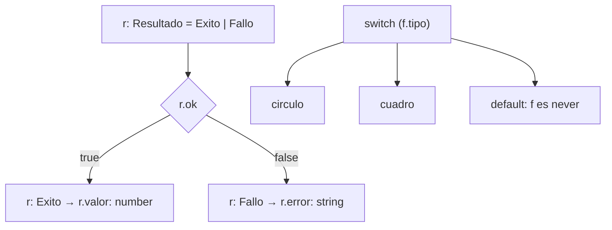

# TypeScript - uniones y narrowing

Parte de: [[04-JavaScript-Web/06 Avanzado/_Índice Avanzado|Avanzado]]

> [!info] Cómo avanzar
> `progreso`: **pendiente** → **viendo** (estudiando) → **visto** (contestaste la autoevaluación sin abrir las respuestas) → **dominado** (hiciste el laboratorio o lo aplicaste de verdad).

## Contenido

### Qué es
Una **unión** (`A | B`) describe un valor que puede ser **de uno de varios tipos**: `string | number`, `Cliente | null`, `'pendiente' | 'pagado'`. Como TypeScript no sabe cuál es en un momento dado, solo te deja usar lo que tienen **en común**. El **narrowing** (estrechamiento) es el proceso por el cual el compilador, al ver una verificación en tu código (`typeof`, `in`, `===`, `instanceof`...), **reduce** el tipo dentro de esa rama a la opción concreta. Juntos permiten modelar datos con variantes de forma segura, como un resultado que es éxito o error.

### Cómo funciona
#### Formas de estrechar
- **`typeof`**: `if (typeof x === 'string')` → `x` es `string` dentro del `if`.
- **Igualdad y truthiness**: `if (x === null)`, `if (cliente)`, `x ?? valor`.
- **`Array.isArray(x)`** para separar arreglos.
- **`in`**: `if ('error' in r)` → `r` es la variante que tiene `error`.
- **`instanceof`**: `if (err instanceof ApiError)`.
- **Funciones guarda** (*type predicates*): `function esCliente(x: unknown): x is Cliente { ... }` enseña al compilador tu propia verificación.
- **Flujo de control**: después de un `return` o `throw` en una rama, el resto de la función ya sabe que esa opción quedó descartada.

#### Uniones discriminadas
Son uniones de objetos donde **cada variante tiene una propiedad común con un valor literal distinto** (el *discriminante*, normalmente `tipo`, `kind` o `ok`). Al revisar ese campo con `switch` o `if`, TypeScript sabe exactamente qué variante tienes y qué otros campos existen. Es la forma idiomática de modelar estados (`cargando | listo | error`), mensajes, eventos o resultados.

#### Verificación exhaustiva
En un `switch` sobre el discriminante, después de cubrir todos los casos el tipo que queda es `never`. Si asignas el valor a una variable `never` en el `default`, el día que alguien agregue una variante nueva y no la maneje, **el compilador marcará error** en ese punto. Así un cambio en el modelo te lleva a todos los lugares que deben actualizarse.



### Ejemplo
Resultado de éxito o error y una función que lo muestra:

```ts
type Resultado =
  | { ok: true; valor: number }
  | { ok: false; error: string };

function mostrar(r: Resultado): string {
  if (r.ok) return `Valor: ${r.valor}`;     // aquí r es { ok: true; valor: number }
  return `Error: ${r.error}`;               // aquí r es { ok: false; error: string }
}

mostrar({ ok: true, valor: 42 });
mostrar({ ok: false, error: 'Sin conexión' });
```

Área con verificación exhaustiva:

```ts
type Figura =
  | { tipo: 'circulo'; radio: number }
  | { tipo: 'cuadro'; lado: number };

function area(f: Figura): number {
  switch (f.tipo) {
    case 'circulo': return Math.PI * f.radio ** 2;
    case 'cuadro': return f.lado ** 2;
    default: {
      const _sinCubrir: never = f;   // si agregas { tipo: 'triangulo' } esto deja de compilar
      throw new Error(`Figura no soportada: ${JSON.stringify(_sinCubrir)}`);
    }
  }
}
```

Estrechar con `typeof` y `Array.isArray`:

```ts
function largo(x: string | string[] | number): number {
  if (typeof x === 'number') return x;       // number
  return x.length;                           // string | string[]: ambos tienen length
}
```

Estado de una vista de Itzamna.Clio modelado como unión discriminada, en lugar de varias banderas sueltas (`cargando`, `error`, `datos`) que pueden contradecirse:

```ts
type EstadoVista<T> =
  | { estado: 'cargando' }
  | { estado: 'listo'; datos: T }
  | { estado: 'error'; codigo: string; mensaje: string };

function render(v: EstadoVista<Cliente[]>): string {
  switch (v.estado) {
    case 'cargando': return 'Cargando…';
    case 'listo': return `${v.datos.length} clientes`;
    case 'error': return `No se pudo cargar (${v.codigo})`;
  }
}
```

Con `strict` y retorno anotado, si falta un caso TypeScript avisa que la función puede no devolver `string`. Encaja con los ProblemDetails de la API: el `codigo` del error llega a la variante `error`.

Función guarda para datos externos:

```ts
interface Cliente { id: number; nombre: string }
function esCliente(x: unknown): x is Cliente {
  return typeof x === 'object' && x !== null
    && typeof (x as Cliente).id === 'number' && typeof (x as Cliente).nombre === 'string';
}
```

### Cuándo usarlo y cuándo no
- **Sí**: estados de UI, respuestas con éxito o error, mensajes entre partes ([[postMessage e iframes]]), acciones de un reducer, eventos.
- Prefiere uniones discriminadas a un solo objeto con todo opcional: imposibilitan estados inválidos.
- Para pocas opciones sin datos extra, una unión de literales (`'asc' | 'desc'`) basta; los `enum` de TypeScript existen, pero las uniones de literales no generan código y son más simples.
- No es necesario si el valor siempre tiene una sola forma.

### Errores comunes
- **Usar propiedades no comunes** sin estrechar (`r.valor` sin revisar `r.ok`).
- **Discriminantes no literales** (`tipo: string` en lugar de `tipo: 'circulo'`): el narrowing no funciona.
- **Olvidar el `never` exhaustivo** y que una variante nueva caiga en silencio en el `default`.
- **Funciones guarda mentirosas**: si la verificación no es completa, el compilador te cree igual.
- **Desestructurar antes de estrechar** (`const { valor } = r`): pierdes la relación con el discriminante.

### Para profundizar
- [TypeScript Handbook: Narrowing](https://www.typescriptlang.org/docs/handbook/2/narrowing.html)
- [TypeScript Handbook: Discriminated unions](https://www.typescriptlang.org/docs/handbook/2/narrowing.html#discriminated-unions)
- [TypeScript Handbook: Exhaustiveness checking](https://www.typescriptlang.org/docs/handbook/2/narrowing.html#exhaustiveness-checking)

## Ejercicios

Resuélvelos en papel o en la herramienta; la solución está plegada.

> [!question]- Tipa un resultado que sea éxito con `valor: number` o error con `error: string` y una función que lo muestre.
> ```ts
> type Resultado = { ok: true; valor: number } | { ok: false; error: string };
> function msg(r: Resultado) {
>   return r.ok ? `valor ${r.valor}` : `error ${r.error}`;
> }
> ```

> [!question]- Completa `area(f)` para `circulo` y `cuadro` con verificación exhaustiva.
> ```ts
> type Forma = { tipo: 'circulo'; r: number } | { tipo: 'cuadro'; l: number };
> function area(f: Forma): number {
>   switch (f.tipo) {
>     case 'circulo': return Math.PI * f.r ** 2;
>     case 'cuadro': return f.l ** 2;
>     default: { const _x: never = f; return _x; }
>   }
> }
> ```

> [!question]- `function largo(x: string | string[] | number)`: devuelve el número o el `length`.
> ```ts
> function largo(x: string | string[] | number): number {
>   if (typeof x === 'number') return x;
>   return x.length; // aquí x es string | string[]
> }
> ```

## Autoevaluación

Contesta primero en voz alta o en papel; luego despliega la respuesta.

> [!question]- ¿Qué es *narrowing*?
> Que TS reduzca un tipo unión dentro de un bloque gracias a una comprobación: `typeof x === 'string'`, `Array.isArray`, `'prop' in obj`, `instanceof`, comparación con un literal o `x != null`.

> [!question]- ¿Qué es una unión discriminada?
> Una unión de objetos que comparten una propiedad literal (`tipo: 'circulo' | 'cuadro'`, `ok: true | false`); al revisar esa propiedad, TS sabe cuál variante tienes.

> [!question]- ¿Cómo garantizas que un `switch` cubra todas las variantes?
> En el `default` asigna a `never`: `const _x: never = f;`. Si alguien agrega una variante nueva, TS marca error ahí.

## Práctica

- [[Lab 7 - TypeScript básico con un módulo de carrito]]

