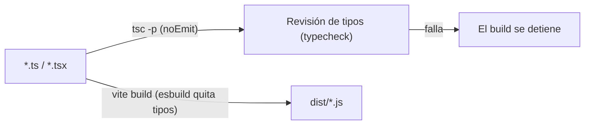

# TypeScript

> JavaScript con tipos estáticos: el compilador revisa que los datos tengan la forma esperada antes de que el código llegue al navegador.

## Qué es y qué problema resuelve
TypeScript agrega tipos (interfaces, uniones, genéricos) a JavaScript. Los tipos se borran al compilar: el navegador ejecuta JavaScript normal. Su valor está en detectar errores en el editor y en el CI: un campo mal escrito, un `null` no contemplado o un DTO que cambió en la API.

Versión usada en [[Itzamna.Clio]]: `typescript ~5.8.3`, en modo `strict`.

## Cómo funciona por dentro
- **Tipado estructural**: dos tipos son compatibles si tienen la misma forma, no el mismo nombre.
- **Uniones literales y discriminadas**: `'dev' | 'access' | 'hecate'`; `{ status: 'ready'; data } | { status: 'error' }` y el compilador estrecha el tipo según `status`.
- **Genéricos**: funciones y componentes parametrizados (`request<T>`, `Select<T extends string>`).
- **`as const`**: fija literales y los hace `readonly`.
- **Declaraciones de ambiente** (`.d.ts`): describen globals, p. ej. `import.meta.env`.
- **`tsc` vs bundler**: en Clio [[Vite]] (esbuild) solo quita los tipos; la revisión de tipos la hace `tsc` aparte (`noEmit`).



## Cuándo usarla y cuándo no
### Ventajas
- Contratos front ↔ API explícitos y verificados.
- Refactors seguros (renombrar, cambiar un DTO) con ayuda del editor.
- Autocompletado y documentación en línea.
### Desventajas
- Los tipos no validan datos en ejecución: si la API responde otra cosa, TypeScript no se entera.
- Curva de aprendizaje en genéricos y tipos avanzados.
- Mantener tipos espejo a mano puede desincronizarse.

## Alternativas
| Alternativa | En qué se diferencia |
|---|---|
| JavaScript + JSDoc (como [[Ocelotl.Iris]]) | Sin compilación; tipos opcionales en comentarios, revisión más débil. |
| Tipos generados desde OpenAPI (openapi-typescript, orval) | Los contratos salen del documento de la API en vez de escribirse a mano (ver [[OpenAPI con Swagger y Scalar]]). |
| Validación en ejecución (zod, valibot) | Comprueba los datos al recibirlos; se puede combinar con TypeScript. |
| Flow | Tipado estático de Meta, hoy poco usado. |

## Cómo se usó en Itzamna
**Configuración común** en `tsconfig.base.json` (cada app/paquete la extiende): `strict`, `noUnusedLocals`, `noUnusedParameters`, `noFallthroughCasesInSwitch`, `moduleResolution: "Bundler"`, `jsx: "react-jsx"`, `verbatimModuleSyntax` (obliga a `import type` para importar solo tipos), `isolatedModules` y `noEmit`. Las apps agregan `types: ["vite/client"]`.

**Contratos**: `packages/contracts/src/index.ts` es el espejo en TypeScript de los DTOs de [[Itzamna.Dionisio]] (`PublicPortfolio`, `StudioPortfolio`, `MediaReference`, `SectionType`…). Lo importan el Studio, el sitio público y las plantillas (ver [[pnpm workspaces]]). Convención del repo: "TypeScript estricto; sin `any`" (`.ai/02_CONVENTIONS.md`).

Variables de entorno tipadas (`Itzamna.Clio/apps/studio/src/vite-env.d.ts`):
```ts
interface ImportMetaEnv {
  readonly VITE_API_URL?: string;
  readonly VITE_PUBLIC_SITE_URL?: string;
  readonly VITE_AUTH_MODE?: 'dev' | 'access' | 'hecate';
  // ...
}
```

Cliente HTTP genérico (`Itzamna.Clio/apps/studio/src/api/client.ts`):
```ts
export const api = {
  get: <T>(path: string, signal?: AbortSignal) => request<T>('GET', path, undefined, signal),
  post: <T>(path: string, body?: unknown, signal?: AbortSignal) => request<T>('POST', path, body, signal),
  put: <T>(path: string, body?: unknown) => request<T>('PUT', path, body),
  // ...
};
```

Otros usos: `ApiError` convierte el [[ProblemDetails]] de la API en `fields: Record<string, string>` para mostrar errores por campo; las query keys de [[TanStack Query]] usan `as const`; `useDraftForm<T>` y `useEntityForm<T>` son genéricos sobre el DTO del formulario.

**Scripts**: cada paquete tiene `typecheck: tsc -p tsconfig.json`; `pnpm typecheck` los corre todos y el `build` de cada app es `tsc -p tsconfig.json && vite build`. El pipeline corre `pnpm typecheck` antes de compilar ([[Azure Pipelines]]).

> [!note] Pendiente de confirmar
> Los contratos se mantienen **a mano** (el comentario dice "espejo de CreatorPortfolio.Contracts en .NET", nombre anterior del proyecto). No hay generación desde OpenAPI ni validación en ejecución: si un DTO cambia en Dionisio, hay que actualizar `packages/contracts` sin ayuda automática.

> [!tip] Reutilizable
> `tsconfig.base.json` es una base estricta lista para cualquier monorepo React + Vite.

## Errores comunes y buenas prácticas
- Usar `as` para "callar" al compilador (`as T`, `!`): esconde errores reales. Clio lo usa en puntos acotados (respuesta JSON, `getElementById('root')!`).
- Confiar en los tipos para datos externos: valida o maneja el caso inesperado.
- Con `verbatimModuleSyntax`, importa tipos con `import type { X }`.
- Preferir uniones discriminadas a varios booleanos (`isLoading`, `isError`…).

## Qué estudiar después
- [[React]] con TypeScript (tipar props, eventos y genéricos de componentes)
- Generación de clientes desde [[OpenAPI con Swagger y Scalar]]
- Validación en ejecución (zod)
- Project references de TypeScript para monorepos

## Documentación oficial
- https://www.typescriptlang.org/docs/
- https://www.typescriptlang.org/tsconfig/
- https://www.typescriptlang.org/docs/handbook/2/narrowing.html

## Autoevaluación

Contesta primero en voz alta o en papel; luego despliega la respuesta.

> [!question]- ¿Qué agrega TypeScript a JavaScript y qué no cambia?
> Agrega tipos estáticos que se revisan al compilar (errores antes de ejecutar, autocompletado, refactors seguros). No cambia el runtime: los tipos se borran y en ejecución es JS normal, sin validación.

> [!question]- ¿Por qué igual debes validar los datos de una API aunque tengas tipos?
> Porque `fetch().json()` devuelve lo que llegue; el tipo que le pones es una promesa tuya. Valida en el borde (con zod u otra librería) si los datos pueden no cumplir.

> [!question]- ¿Qué hace `strict: true` en `tsconfig.json`?
> Activa un conjunto de comprobaciones, entre ellas `strictNullChecks` (null/undefined no son asignables a cualquier tipo) y `noImplicitAny`. Es lo recomendado para proyectos nuevos.

## Práctica

- [[Lab 7 - TypeScript básico con un módulo de carrito]]

