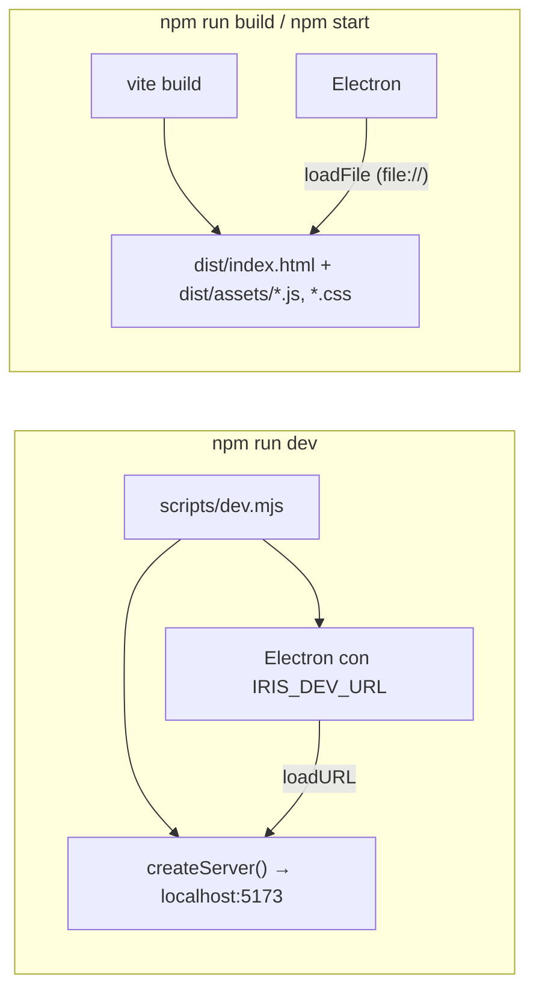

---
proyecto:
  - Ocelotl.Iris
  - Itzamna.Clio
proyectos:
  - "[[Ocelotl.Iris]]"
  - "[[Itzamna.Clio]]"
tipo: tecnologia
nivel: intermedio
estado: completo
tags:
  - conocimiento
  - frontend
  - build
  - vite
progreso: pendiente
area: JavaScript y Web
---
# Vite

> Herramienta de desarrollo y build para fronts web: un servidor de desarrollo con recarga en caliente y un empaquetador para producción. Desde el 2026-11-08 la usa [[Ocelotl.Iris]] (versión 8.x), en lugar de copiar las librerías a `src/vendor` y usar un import map ([[ES Modules e import maps]]).

## Qué es y qué problema resuelve
Sin bundler, el navegador solo entiende rutas relativas, y las librerías de `node_modules` hay que copiarlas a mano y mapearlas. Vite resuelve eso en dos modos:
- **Desarrollo (`vite`):** sirve los archivos tal cual como ES modules. Las dependencias de `node_modules` se preempaquetan a ESM, y al guardar un archivo solo se reemplaza lo que cambió (**HMR**).
- **Build (`vite build`):** empaqueta con Rolldown (Vite 8). Minifica, elimina el código que no se usa, separa en *chunks* lo que se carga con `import()` y genera *source maps*.

## Cómo funciona por dentro

- **`root`:** carpeta con el `index.html` de entrada. **`base: './'`:** rutas relativas, necesarias con `file://`.
- **`import.meta.glob('patrón')`:** Vite expande el patrón al compilar y da un objeto `{ ruta: () => import(ruta) }`. Con `{ query: '?raw', import: 'default' }`, un `.html` llega como texto.
- **CSS:** un `<link>` en `index.html` (con sus `@import`) o un `import 'x.css'` se empaqueta. El CSS de un chunk se inyecta al cargarlo.
- **Archivos referenciados solo por texto** (`'assets/icons/x.svg'` dentro de un `.html` que se inserta con `innerHTML`): Vite no los ve. Van en `publicDir` o se copian con un plugin.

## Cuándo usarla y cuándo no
### Ventajas
- Importas de `node_modules` directo: sin `vendor.mjs` ni import map.
- Sin script inline en el HTML: la CSP ya no necesita el hash del import map.
- Recarga en caliente: no hay que reiniciar Electron por cada cambio.
- Build optimizado, un chunk por pantalla, *source maps*.
- Es el camino natural a TypeScript y a React.
### Desventajas
- Hay un paso de build: el código que corre es el de `dist/`.
- Las rutas armadas en tiempo de ejecución (`import(\`../${x}.js\`)`) deben volverse `import.meta.glob`.
- Una dependencia de desarrollo más (Node ≥ 20.19 para Vite 8).

## Alternativas
| Alternativa | En qué se diferencia |
|---|---|
| Sin bundler + import map (lo que tenía Iris) | Sin build, pero con copia manual de librerías y el hash de la CSP a mano |
| electron-vite | Vite configurado para main, preload y renderer a la vez; obliga a reestructurar carpetas |
| Webpack | Más configurable, más lento y con más configuración |
| esbuild / Rolldown solos | Empaquetan, pero sin servidor de desarrollo ni HMR listos |

## Cómo se usó en Ocelotl
En [[Ocelotl.Iris]] solo la **página** (renderer) pasa por Vite. `electron/main.js` y `preload.js` corren tal cual.

| Archivo | Qué hace |
|---|---|
| `vite.config.mjs` | `root: src`, `base: './'`, salida `dist/`, servidor en `localhost:5173` (`strictPort`), `modulePreload` sin polyfill y un plugin que copia `src/assets` a `dist/assets` |
| `scripts/dev.mjs` | Levanta Vite con su API (`createServer`) y abre Electron con `IRIS_DEV_URL`; al cerrar Electron, apaga Vite |
| `electron/main.js` | `fnCargarPagina`: si no está empaquetada y hay `IRIS_DEV_URL`, usa `loadURL`; si no, `loadFile(dist/index.html)` |
| `src/core/router.js` | `import.meta.glob` para cargar el `.html` (`?raw`), el `.css` y el `.events.js` de cada pantalla |
| `src/core/hermes.signal.js` | `import { HubConnectionBuilder, LogLevel } from '@microsoft/signalr'`, en lugar de `window.signalR` |

```js
// src/core/router.js
const Pantallas = Object.freeze({
    Html: import.meta.glob('../features/*/*.html', { query: '?raw', import: 'default' }),
    Css: import.meta.glob('../features/*/*.css'),
    Eventos: import.meta.glob('../features/*/*.events.js')
})
```

**Scripts de `package.json`:**

| Script | Hace |
|---|---|
| `npm run dev` | Desarrollo con recarga en caliente |
| `npm run build` | Genera `dist/` |
| `npm start` | Build y abre Iris desde `dist/` |

- El servidor de desarrollo usa `http://localhost:5173`, que ya está en `Seguridad:OrigenesPermitidos` de Hermes (Development).
- La misma CSP sirve en desarrollo y en producción ([[Content Security Policy]]).

> [!tip] Reutilizable
> `vite.config.mjs` + `scripts/dev.mjs` + `fnCargarPagina` sirven para cualquier app [[Electron]] que quiera Vite sin reestructurar `main`/`preload`. Ver [[Reglas Front - SPA]].

> [!note] Pendiente de confirmar
> Iris no tiene configuración de empaquetado (electron-builder o similar). Cuando se agregue, debe incluir `dist/` y dejar fuera `src/`.

## Errores comunes y buenas prácticas
- Olvidar `base: './'`: en producción las rutas `/assets/...` no existen con `file://` y la página sale en blanco.
- Un `import()` con una ruta armada en tiempo de ejecución: Vite no sabe qué empaquetar. Usa `import.meta.glob`.
- Íconos referenciados solo en texto: Vite no los copia solo.
- Cambiar el puerto de desarrollo sin actualizar los orígenes permitidos de Hermes: CORS bloquea las peticiones.

## Qué estudiar después
- [[ES Modules e import maps]] (lo que Vite reemplaza), [[Content Security Policy]], [[Electron]]
- HMR por módulo (`import.meta.hot`) y la migración a React con `@vitejs/plugin-react`.

## Documentación oficial
- https://vite.dev/guide/
- https://vite.dev/guide/features#glob-import

## Cómo se usó en Itzamna
[[Itzamna.Clio]] usa **Vite `^6.3`** (no la 8.x de [[Ocelotl.Iris]]) con **`@vitejs/plugin-react ^4.6`** para compilar JSX/TSX de [[React]] y [[TypeScript]]. Hay dos apps dentro de un [[pnpm workspaces|workspace de pnpm]], cada una con su `vite.config.ts`:

| App | Puerto (dev y preview) | Particularidad |
|---|---|---|
| `apps/studio` | 5173 (`strictPort`) | `manualChunks`: separa librerías en `react`, `data` y `editor` |
| `apps/web` | 5174 (`strictPort`) | Config mínima; la plantilla se divide sola con `lazy(() => import(...))` ([[Plantillas y diseño]]) |

Diferencias con Iris: es una web normal servida por HTTP ([[Azure Static Web Apps]]), así que **no** necesita `base: './'`, `root` ni `import.meta.glob`; la entrada es el `index.html` de cada app con `<script type="module" src="/src/main.tsx">`. Los paquetes internos (`@clio/contracts`, `@clio/portfolio-core`, `@clio/templates`) se importan como código fuente TypeScript y Vite los compila junto con la app.

Separación de librerías en el Studio (`Itzamna.Clio/apps/studio/vite.config.ts`):
```ts
build: {
  rollupOptions: {
    output: {
      manualChunks: {
        react: ['react', 'react-dom', 'react-router-dom'],
        data: ['@tanstack/react-query', 'zustand'],
        editor: ['@dnd-kit/core', '@dnd-kit/sortable', '@dnd-kit/utilities', 'react-easy-crop'],
      },
    },
  },
},
```
Así las librerías que cambian poco quedan en archivos propios y el navegador los reutiliza de caché entre despliegues (`/assets/*` se sirve con `Cache-Control: public, max-age=31536000, immutable`).

**Variables `VITE_*`**: Vite solo expone a `import.meta.env` las variables con prefijo `VITE_` y las **escribe dentro del JavaScript** al compilar. Por eso el README y `azure-pipelines.yml` advierten: son públicas, nunca secretos.

| App | Variables |
|---|---|
| studio | `VITE_API_URL`, `VITE_PUBLIC_SITE_URL`, `VITE_AUTH_MODE` (`dev`/`access`/`hecate`), `VITE_MAX_IMAGE_MB`, `VITE_MAX_VIDEO_MB`, `VITE_HECATE_AUTHORIZE_URL`, `VITE_HECATE_CLIENT_ID`, `VITE_HECATE_SCOPE` |
| web | `VITE_API_URL`, `VITE_STUDIO_ORIGIN` |

- En local: copiar `apps/<app>/.env.example` a `.env.local`. En CI: se pasan como `env` del paso `pnpm --filter @clio/<app> build` ([[Azure Pipelines]]); como quedan horneadas, **cambiar una URL obliga a recompilar**.
- Están tipadas en `apps/studio/src/vite-env.d.ts` (`ImportMetaEnv`) y cada uso tiene un valor por defecto de desarrollo (`?? 'https://localhost:7180'`).
- `VITE_AUTH_MODE` decide el login ([[Autenticación y acceso]]); `VITE_STUDIO_ORIGIN` y `VITE_PUBLIC_SITE_URL` fijan los orígenes de la vista previa ([[postMessage e iframes]], [[Vista previa en vivo]]).
- `public/staticwebapp.config.json` se copia tal cual a `dist/` (carpeta `public` de Vite).
- Scripts: `build` = `tsc -p tsconfig.json && vite build` (Vite no revisa tipos); `typecheck` aparte.

> [!note] Pendiente de confirmar
> `VITE_MAX_VIDEO_MB` vale 200 en `.env.example` y 50 en el pipeline ("igual que `MediaLimits:MaxVideoBytes` de producción"); el límite real lo valida la API. El `index.html` del Studio enlaza `/favicon.svg`, pero `apps/studio/public/` solo contiene `staticwebapp.config.json`.

## Autoevaluación

Contesta primero en voz alta o en papel; luego despliega la respuesta.

> [!question]- ¿Por qué Vite arranca rápido en desarrollo?
> Sirve el código fuente como ES Modules nativos y transforma bajo demanda solo lo que el navegador pide; las dependencias se pre-empaquetan una vez con esbuild. No arma el bundle completo antes de arrancar.

> [!question]- ¿Qué variables de entorno ve el cliente?
> Solo las que empiezan con `VITE_` (vía `import.meta.env.VITE_...`). Todo lo que llega al bundle es público: nunca pongas secretos ahí.

> [!question]- ¿Para qué sirve `server.proxy` en `vite.config`?
> Redirigir en desarrollo rutas como `/api` al backend (`http://localhost:5000`), evitando problemas de CORS.

