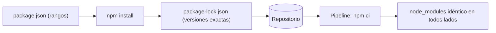

# npm y package.json

Parte de: [[04-JavaScript-Web/06 Avanzado/_Índice Avanzado|Avanzado]]

> [!info] Cómo avanzar
> `progreso`: **pendiente** → **viendo** (estudiando) → **visto** (contestaste la autoevaluación sin abrir las respuestas) → **dominado** (hiciste el laboratorio o lo aplicaste de verdad).

## Contenido

### Qué es
**npm** es el gestor de paquetes que viene con Node.js: descarga librerías del registro público (o de un feed privado como Azure Artifacts), resuelve sus dependencias y ejecuta scripts del proyecto. **`package.json`** es el archivo que describe tu proyecto: nombre, versión, tipo de módulos, dependencias y scripts. Es el equivalente del `.csproj` con sus `PackageReference` en .NET, y el **lockfile** (`package-lock.json`) cumple el papel de un `packages.lock.json`.

pnpm y Yarn son alternativas que usan el mismo `package.json` (ver [[pnpm workspaces]]).

### Cómo funciona
#### Campos principales
```json
{
  "name": "itzamna-clio",
  "version": "1.4.0",
  "private": true,
  "type": "module",
  "engines": { "node": ">=22" },
  "scripts": {
    "dev": "vite",
    "build": "tsc -b && vite build",
    "test": "vitest run",
    "lint": "eslint ."
  },
  "dependencies": { "react": "^19.1.0", "react-dom": "^19.1.0" },
  "devDependencies": { "vite": "^7.0.0", "typescript": "~5.8.3", "vitest": "^3.2.0" }
}
```
(Las versiones son ilustrativas; usa las que instale tu proyecto.)

- **`dependencies`**: lo que el código necesita **para ejecutarse** (en una librería publicada, lo que el consumidor también descargará). En una app que se compila con Vite, son las librerías que terminan dentro del bundle.
- **`devDependencies`**: lo que solo se necesita **para desarrollar, compilar o probar**: Vite, TypeScript, ESLint, Vitest, tipos `@types/*`. No se instalan cuando alguien instala tu paquete como dependencia, y en un servidor de producción puedes omitirlas (`npm ci --omit=dev`).
- **`peerDependencies`**: en librerías, lo que el consumidor debe traer (por ejemplo, una librería de componentes de React declara `react` como peer para no duplicarlo).
- **`"type": "module"`**: hace que los archivos `.js` del paquete se traten como **ES Modules** (`import`/`export`). Sin él, `.js` es CommonJS (`require`). Los `.mjs` siempre son ESM y los `.cjs` siempre CommonJS (ver [[Node.js básico]]).
- **`scripts`**: comandos con nombre; `npm run build`. `npm test` y `npm start` no necesitan `run`. Dentro de los scripts, los binarios de `node_modules/.bin` están en el PATH.
- **`exports`**: en librerías, define qué archivos pueden importar los consumidores.

#### Rangos de versión (SemVer)
Las versiones siguen **MAYOR.MENOR.PARCHE**: mayor = cambios incompatibles, menor = funciones nuevas compatibles, parche = correcciones.
- `^1.4.2` (caret): acepta cambios **menores y parches**: `>=1.4.2 <2.0.0`. Es lo que pone `npm install` por defecto.
- `~1.4.2` (tilde): acepta **solo parches**: `>=1.4.2 <1.5.0`.
- `1.4.2`: exacta.
- Caso especial: con versión mayor 0, el caret es más estricto: `^0.4.2` significa `>=0.4.2 <0.5.0`, porque en 0.x cualquier menor puede romper.

#### Lockfile y `npm ci`
Los rangos permiten que hoy se instale 1.4.2 y mañana 1.6.0. El **`package-lock.json`** registra la **versión exacta** (y la integridad) de cada paquete del árbol completo, incluidas las dependencias de tus dependencias. Se **sube al repositorio**.
- `npm install`: instala según `package.json`, puede actualizar el lockfile si algo no coincide.
- `npm ci`: instalación **limpia y reproducible** para CI: borra `node_modules`, instala **exactamente** lo del lockfile y **falla** si el lockfile no corresponde con `package.json`. Nunca modifica el lockfile.



### Ejemplo
Flujo diario en el front de Itzamna.Clio:

```bash
npm install date-fns            # dependencia de ejecución → dependencies con ^
npm install -D @types/node      # solo para desarrollo → devDependencies
npm outdated                    # qué hay más nuevo
npm update                      # actualiza dentro de los rangos permitidos
npm audit                       # vulnerabilidades conocidas
npm run build
```

Pipeline de Azure DevOps con caché y feed privado:

```yaml
steps:
- task: NodeTool@0
  inputs: { versionSpec: '22.x' }
- task: npmAuthenticate@0          # autentica contra el feed de Azure Artifacts definido en .npmrc
  inputs: { workingFile: .npmrc }
- script: npm ci
- script: npm run lint && npm test && npm run build
```

### Cuándo usarlo y cuándo no
- **npm** basta para la mayoría de los proyectos; **pnpm** ahorra disco y es más estricto con dependencias no declaradas, y brilla en monorepos.
- En un front **sin bundler** puedes no tener `package.json` en producción (cargas módulos con import maps), pero conviene tenerlo para herramientas de desarrollo (ESLint, Prettier, pruebas).
- Revisa antes de agregar dependencias: tamaño, mantenimiento, licencia. Cada paquete es superficie de ataque (ataques a la cadena de suministro).

### Errores comunes
- **No subir el lockfile** o borrarlo "para arreglar algo": instalaciones distintas en cada máquina.
- **Usar `npm install` en CI**: puede instalar versiones diferentes; usa `npm ci`.
- **Poner herramientas de build en `dependencies`** (o librerías de ejecución en `devDependencies` en un servidor Node que instala con `--omit=dev`).
- **Mezclar gestores** (npm y pnpm en el mismo proyecto) con dos lockfiles.
- **Instalar paquetes globales** para herramientas del proyecto; usa `npx` o devDependencies para que todos usen la misma versión.

### Para profundizar
- [npm Docs: package.json](https://docs.npmjs.com/cli/configuring-npm/package-json)
- [npm Docs: npm ci](https://docs.npmjs.com/cli/commands/npm-ci)
- [npm Docs: About semantic versioning](https://docs.npmjs.com/about-semantic-versioning)
- [Semantic Versioning 2.0.0](https://semver.org/)

## Autoevaluación

Contesta primero en voz alta o en papel; luego despliega la respuesta.

> [!question]- ¿Qué diferencia hay entre `dependencies` y `devDependencies`?
> `dependencies`: lo que el código necesita para ejecutarse. `devDependencies`: herramientas de desarrollo y build (Vite, ESLint, Vitest).

> [!question]- ¿Qué significan `^1.4.2` y `~1.4.2`?
> `^`: acepta versiones compatibles por debajo de la siguiente mayor (`>=1.4.2 <2.0.0`). `~`: solo parches (`>=1.4.2 <1.5.0`).

> [!question]- ¿Para qué sirve el lockfile y qué hace `npm ci`?
> `package-lock.json` fija las versiones exactas de todo el árbol. `npm ci` instala exactamente eso (borra `node_modules` y falla si no coincide con `package.json`): es lo que debe usar CI.

> [!question]- ¿Qué hace `"type": "module"` en package.json?
> Que los `.js` del paquete se traten como ES Modules (`import/export`) en Node; si no, se interpretan como CommonJS.

